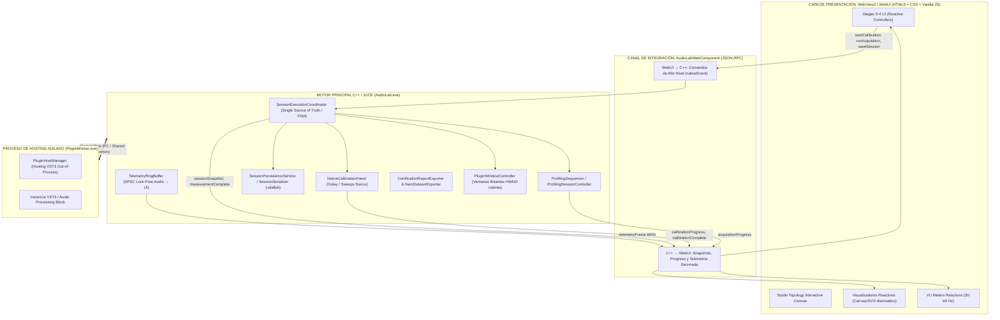
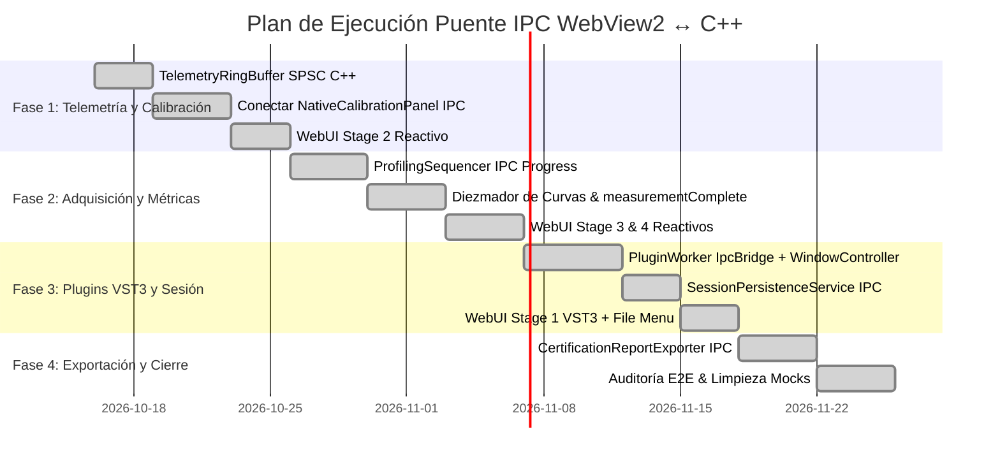

# PLAN.md — Arquitectura y Puente IPC WebView2 ↔ C++ Nativo (ABDAudioLab)

**Objetivo**: Establecer la integración definitiva entre el motor nativo C++/DSP de ABDAudioLab y la interfaz gráfica WebView2 (WebUI) bajo el principio rector de **Separación Estricta de Responsabilidades**: el motor C++ es la única fuente de verdad y cálculo (DSP, hardware, hosting VST3, hilos de audio, persistencia), mientras que la WebUI opera exclusivamente como una **capa de presentación puramente reactiva** que consume snapshots de estado y despacha comandos de alto nivel.

**Fecha**: 2026-10-15  
**Versión**: 2.0 (Refinamiento Arquitectónico — Separación Estricta Motor ↔ WebUI)  
**Autor**: Antigravity (Lead Architect)

---

## 🏛️ Principio Rector de Diseño

> **La WebUI nunca calcula DSP, nunca serializa audio crudo, nunca carga DLLs ni habla protocolos serie/MIDI/SysEx.**
> Su función es renderizar el estado del motor a partir de `sessionSnapshot` y telemetría diezmada, y enviar intenciones de alto nivel mediante comandos IPC asíncronos. Todo el estado maestro, la orquestación metrológica, el hosting en procesos aislados y la persistencia viven en C++.



---

## 🚫 1. Lo que SE ELIMINA del planteamiento anterior

| Elemento Erróneo Anterior | Causa de Eliminación | Destino Correcto |
| :--- | :--- | :--- |
| **`MeasurementEngine` con `measureFrequencyResponse()` en IPC** | El DSP (Farina swept-sine, THD armónico, IMD 2-tone, Wiener-Hammerstein) se procesa en hilos C++ en segundo plano. La WebUI colapsaría intentando procesar o deconvolucionar audio. | C++ emite `measurementComplete` con curvas diezmadas (puntos `{freq, mag, phase}` listos para pintar en Canvas/SVG). |
| **`RenderBlockRequest / Response` en IPC para WebUI** | El procesamiento VST3 ocurre en `PluginWorker.exe` vía memoria compartida/tubería local. La WebUI no toca buffers de audio. | Solo comandos `openPluginGui()` / `closePluginGui()` para gestionar la ventana nativa. |
| **`HardwareSendMidiCc`, `HardwareSendSysEx`, `HardwareSendNRPN` en IPC** | La WebUI no debe conocer mensajes MIDI crudos, temporizaciones SysEx ni modems de audio (Juno/Casio). | WebUI envía intenciones abstractas: `configureTarget(targetId)`, `loadTargetPreset(presetId)`. |
| **`CalibrationStartRequest` con parámetros técnicos (`targetLevelDbfs`, `settleTimeMs`)** | `NativeCalibrationPanel` y `LoopbackCalibrator` ya conocen los requisitos metrológicos exactos de la tarjeta. | WebUI solo envía `startCalibration()`, `abortCalibration()`, `loadCalibrationProfile(id)`. |
| **`AnalogDutCharacterizer` expuesto a WebUI** | La modelización matemática analítica pertenece al núcleo C++. | WebUI sólo visualiza el resultado final en el Stage 4. |

---

## 📡 2. Contrato IPC Completo

### A. Comandos WebUI → C++ (`nativeEvent` actions)

```typescript
// ==========================================
// CONFIGURACIÓN DE AUDIO & MIDI Y HARDWARE
// ==========================================
{ action: "openAudioSettings" }                          // Abre el modal nativo AudioDeviceSelectorComponent de JUCE
{ action: "autoDetectHardware" }                         // Lanza la detección física de interfaces y MIDI

// ==========================================
// STAGE 1: SELECCIÓN DE OBJETIVO (TARGET & ROUTING)
// ==========================================
{ action: "selectTarget", targetId: "korg_ms2000" }       // Configura el target en ProfilingSessionController
{ action: "loadTargetPreset", presetId: "init_saw" }      // Envía configuración al hardware vía HardwareController
{ action: "loadPluginFromFile" }                         // Abre diálogo nativo de archivo para cargar un .vst3 en PluginWorker
{ action: "openPluginGui" }                              // Muestra ventana nativa flotante del editor VST3 (HWND)
{ action: "closePluginGui" }                             // Oculta la ventana nativa flotante del editor VST3
{ action: "unloadPlugin" }                               // Descarga el plugin activo del worker aislado

// ==========================================
// STAGE 2: CALIBRACIÓN DE INTERFAZ & RUIDO (2A & 2B)
// ==========================================
{ action: "startNoiseBaselineCheck" }                    // Ejecuta verificación 2A: 400 ms en silencio con entrada desconectada (< -45 dBFS)
{ action: "startPhysicalLoopbackSweep" }                 // Ejecuta verificación 2B: barrido Farina (1300 ms) con cable patch conectado
{ action: "startCalibrationSweep" }                      // Ejecuta el flujo automático 2A -> 2B en el panel nativo
{ action: "skipCalibration" }                            // Bypassea la calibración (ganancia nominal y latencia 0 muestras)
{ action: "saveCalibrationProfile", name: "RME_48k" }   // Guarda el perfil medido actual en disco (.abdloop)
{ action: "loadCalibrationProfile", profileId: "uuid" }  // Carga perfil .abdloop desde CalibrationProfileStore

// ==========================================
// STAGE 3: ADQUISICIÓN / PROFILING
// ==========================================
{ action: "startAcquisition", config: { recipeId: "farina_sweep_32", model: "LUT_SIMD_2D" } }
                                                         // Arranca ProfilingSequencer + ProfilingSessionController
{ action: "pauseAcquisition" }                           // Pausa la ejecución secuencial
{ action: "resumeAcquisition" }                          // Reanuda la ejecución
{ action: "abortAcquisition" }                           // Cancela la sesión activa y restaura el bus de audio

// ==========================================
// STAGE 4: RESULTADOS Y EXPORTACIÓN
// ==========================================
{ action: "exportProductionPackage" }                    // Invoca CertificationReportExporter (escribe .abdpack firmado)
{ action: "exportNAM", format: "nam" }                   // Invoca NamDatasetExporter (dataset para redes neuronales)
{ action: "exportLUT", format: "json" }                  // Invoca JsLutExport (código C++/JS/WASM optimizado)
{ action: "openCertificationReport" }                    // Abre el reporte de certificación HTML generado en el navegador

// ==========================================
// GESTIÓN DE SESIONES Y ARCHIVOS (.abdlab / carpetas)
// ==========================================
{ action: "saveSession" }                                // Guarda en el archivo actual vía SessionSerializer
{ action: "saveSessionAs" }                              // Abre file picker nativo y guarda
{ action: "loadSession" }                                // Abre file picker nativo y carga .abdlab en SessionManager
{ action: "newSession" }                                 // Reinicia la sesión a estado limpio
{ action: "openDataFolder", folder: "exports" }          // Abre carpeta específica: working | presets | exports | reports | sessions | loopbackProfiles
{ action: "setWorkingDirectory" }                        // Abre diálogo selector nativo para cambiar directorio raíz

// ==========================================
// SISTEMA Y TELEMETRÍA
// ==========================================
{ action: "setTheme", theme: "audiolab-light" }          // Alterna tema en LabWebMainWindow ("audiolab" | "audiolab-light")
{ action: "toggleScopeWindow" }                          // Alterna ventana flotante Scope WebView2
{ action: "openPluginScan" }                             // Abre modal nativo de escaneo de plugins VST3
{ action: "checkUpdates" }                               // Consulta el módulo AutoUpdater
```

---

### B. Eventos C++ → WebUI (`emitEventIfBrowserIsVisible`)

```typescript
// 1. Telemetría Diezmada (30-60 Hz desde SPSC Lock-Free Ring Buffer)
{
  type: "telemetryFrame",
  meters: {
    inDbfs: -12.3,
    outDbfs: -14.1,
    inPeakHoldDbfs: -6.1,
    outPeakHoldDbfs: -8.0,
    clipped: false
  }
}

// 2. Snapshot de Estado Maestro (Single Source of Truth = C++)
{
  type: "sessionSnapshot",
  sessionId: "sess_20261015_0915",
  workflowStage: "Calibrating",        // "StudioSetup" | "TargetSelection" | "Calibrating" | "Profiling" | "ReviewResults"
  sessionStatus: "Running",            // "Idle" | "Running" | "Paused" | "Completed" | "Error"
  target: {
    targetId: "korg_ms2000",
    targetName: "Korg MS2000",
    category: "Synthesizer",
    isVirtualPlugin: false,
    hasMidi: true
  },
  calibration: {
    isReady: true,
    latencySamples: 128,
    snrDb: 98.4,
    noiseFloorDbfs: -96.2,
    gainTrimDb: -3.02,
    activeProfileName: "Loopback_RME_48kHz.abdloop"
  },
  evaluation: {
    hasEvaluation: true,
    status: "Accepted",
    validationEsrDb: -42.1,
    spectralCorrelationRho: 0.9998,
    thdPercent: 0.042
  },
  exportOptions: {
    canExportPackage: true,
    canExportNam: true,
    canExportLut: true
  }
}

// 3. Progreso de Calibración (push desde NativeCalibrationPanel)
{
  type: "calibrationProgress",
  stage: "NoiseBaseline",              // "NoiseBaseline" | "FrequencySweep" | "GolayCorrelation" | "LevelCalibration"
  progress: 0.45,                      // 0.0 a 1.0
  statusText: "Measuring system noise floor...",
  currentInDbfs: -85.2
}

{
  type: "calibrationComplete",
  success: true,
  profileId: "cbb60763-7182-4bf1-a489-cf775d71337e",
  metrics: {
    latencySamples: 128,
    latencyMs: 2.67,
    snrDb: 98.4,
    frequencyResponseFlatnessDb: 0.12
  }
}

// 4. Progreso de Adquisición (push desde ProfilingSequencer)
{
  type: "acquisitionProgress",
  recipeStep: 4,
  totalSteps: 16,
  currentStimulus: "Log Swept-Sine (20 Hz - 20 kHz)",
  progress: 0.25,
  elapsedTimeSec: 12.4,
  remainingTimeSec: 37.2
}

// 5. Medición Completada (push tras análisis metrológico en C++)
{
  type: "measurementComplete",
  evaluationId: "eval_98a72f0b",
  status: "Accepted",                  // "Accepted" | "RejectedTolerance" | "ClippingDetected"
  curves: [                            // Curvas DIEZMADAS listas para pintar en Canvas/SVG (sin cálculos en JS)
    {
      name: "FrequencyResponse",
      unitY: "dB",
      points: [ { freq: 20, mag: -0.15, phase: -2.1 }, { freq: 100, mag: 0.02, phase: -0.4 }, /* ... ~200 puntos */ ]
    },
    {
      name: "HarmonicDistortionTHD",
      unitY: "dB",
      points: [ { freq: 1000, harmonic: 2, level: -84.2 }, { freq: 1000, harmonic: 3, level: -92.1 } ]
    }
  ],
  metrics: {
    validationEsrDb: -42.1,
    spectralCorrelationRho: 0.9998,
    enobBits: 19.2,
    dynamicRangeDb: 108.4
  }
}

// 6. Eventos de Hosting VST3 (Worker out-of-process)
{
  type: "pluginLoaded",
  pluginUid: "vst3_dexed_synth",
  name: "Dexed",
  manufacturer: "Digital Suburban",
  isInstrument: true,
  numParameters: 128
}

{
  type: "workerTerminated",
  exitCode: -1073741819,
  reason: "Access violation in third-party VST3 processBlock",
  canRestart: true
}

// 7. Alertas del Sistema
{
  type: "systemAlert",
  severity: "warning",                 // "info" | "warning" | "error"
  title: "Audio Device Disconnected",
  message: "ASIO driver reported unexpected hardware unplug.",
  recommendedAction: "Reconnect interface and verify settings in Stage 0."
}
```

---

## ⚙️ 3. Modificaciones en el Motor C++

### 3.1 Telemetría Thread-Safe de Audio (Ring Buffer SPSC Lock-Free)
Para garantizar cumplimiento estricto de [dsp_thread_safety.md](file:///.agents/rules/dsp_thread_safety.md):
- **Cero memoria dinámica** (`zero heap allocation`) y **cero locks** en el hilo de audio en tiempo real.
- Comunicación hacia el hilo de UI de JUCE mediante un buffer circular `Single Producer, Single Consumer` (SPSC).

```cpp
// En src/audio/TelemetryRingBuffer.h
struct TelemetryFrame {
    float inDbfs { -100.0f };
    float outDbfs { -100.0f };
    float inPeakHoldDbfs { -100.0f };
    float outPeakHoldDbfs { -100.0f };
    bool clipped { false };
    uint64_t timestampUs { 0 };
};

class TelemetryRingBuffer {
public:
    static constexpr size_t Capacity = 1024;

    bool push(const TelemetryFrame& frame) noexcept {
        const auto currentWrite = writeIdx_.load(std::memory_order_relaxed);
        const auto nextWrite = (currentWrite + 1) % Capacity;
        if (nextWrite == readIdx_.load(std::memory_order_acquire))
            return false; // Buffer lleno; descartar sin bloquear
        buffer_[currentWrite] = frame;
        writeIdx_.store(nextWrite, std::memory_order_release);
        return true;
    }

    bool pop(TelemetryFrame& outFrame) noexcept {
        const auto currentRead = readIdx_.load(std::memory_order_relaxed);
        if (currentRead == writeIdx_.load(std::memory_order_acquire))
            return false; // Vacío
        outFrame = buffer_[currentRead];
        readIdx_.store((currentRead + 1) % Capacity, std::memory_order_release);
        return true;
    }

private:
    std::array<TelemetryFrame, Capacity> buffer_;
    std::atomic<size_t> writeIdx_ { 0 };
    std::atomic<size_t> readIdx_ { 0 };
};
```

### 3.2 Despacho en Temporizador de UI (JUCE Timer @ 30-60 Hz)
En `src/gui/web/AudioLabWebComponent.cpp` o `LabWebMainWindow.cpp`:
```cpp
void AudioLabWebComponent::timerCallback() {
    TelemetryFrame frame;
    bool hasData = false;
    // Drenar hasta el frame más reciente
    while (telemetryBuffer.pop(frame)) {
        hasData = true;
    }
    if (hasData && isVisible()) {
        nlohmann::json payload;
        payload["meters"]["inDbfs"] = frame.inDbfs;
        payload["meters"]["outDbfs"] = frame.outDbfs;
        payload["meters"]["inPeakHoldDbfs"] = frame.inPeakHoldDbfs;
        payload["meters"]["outPeakHoldDbfs"] = frame.outPeakHoldDbfs;
        payload["meters"]["clipped"] = frame.clipped;
        emitEventIfBrowserIsVisible("telemetryFrame", payload);
    }
}
```

### 3.3 Conexión de Calibración Real (`NativeCalibrationPanel`)
`NativeCalibrationPanel` emite el progreso del sweep hardware real hacia el puente:
```cpp
// En NativeCalibrationPanel setup
onCalibrationProgress = [this](CalibrationSubView stage, float progress, const juce::String& statusText, float currentDb) {
    juce::MessageManager::callAsync([this, stage, progress, statusText, currentDb] {
        if (webComponent != nullptr) {
            nlohmann::json p;
            p["stage"] = stageToString(stage);
            p["progress"] = progress;
            p["statusText"] = statusText.toStdString();
            p["currentInDbfs"] = currentDb;
            webComponent->emitEventIfBrowserIsVisible("calibrationProgress", p);
        }
    });
};
```

### 3.4 Análisis Metrológico en Segundo Plano y Diezmado
En `SessionExecutionCoordinator`:
```cpp
void SessionExecutionCoordinator::onCaptureSessionFinished(const ComplexEnvelopeCaptureSession& session) {
    // 1. Análisis DSP intensivo en thread pool de fondo (sin congelar UI ni audio)
    backgroundThreadPool.addJob([this, session] {
        auto characterization = AnalogDutCharacterizer::analyze(session);

        // 2. Diezmado inteligente de curvas para render Web (de 48,000 bins a ~200 puntos logarítmicos)
        auto decimatedCurves = Decimator::decimateFrequencyResponse(characterization.frequencyResponse, 200);

        nlohmann::json payload;
        payload["evaluationId"] = juce::Uuid().toString().toStdString();
        payload["status"] = characterization.isAccepted ? "Accepted" : "RejectedTolerance";
        payload["curves"] = decimatedCurves;
        payload["metrics"] = {
            {"validationEsrDb", characterization.metrics.esrDb},
            {"spectralCorrelationRho", characterization.metrics.rho},
            {"enobBits", characterization.metrics.enob}
        };

        // 3. Despachar a WebUI en el hilo de mensaje
        juce::MessageManager::callAsync([this, payload] {
            if (webComponent != nullptr)
                webComponent->emitEventIfBrowserIsVisible("measurementComplete", payload);
        });
    });
}
```

### 3.5 Control de Ventana Nativa VST3
El editor VST3 es un `HWND` nativo gestionado por `PluginWindowController`. La WebUI solo lo comanda:
```cpp
else if (action == "openPluginGui") {
    if (auto* fixture = getCurrentPluginFixture()) {
        pluginWindowController.showEditor(fixture->getPluginInstance());
    }
}
else if (action == "closePluginGui") {
    pluginWindowController.hideEditor();
}
```

---

## 🌐 4. Transformación Reactiva de la WebUI

| Stage | Comportamiento Anterior (Mock) | Nuevo Comportamiento Reactivo (Contrato C++) |
| :--- | :--- | :--- |
| **Stage 0 (Studio)** | Controles estáticos con simulación de buffers | Petición `openAudioMidiSettings` abre el modal nativo JUCE; escucha `audioDeviceState`. |
| **Stage 1 (Target)** | Mock selectivo; sin carga real de VST3 | Selector cascading ligado a contratos; botón "Load VST3" envía `loadPluginFromFile` y botón "Open GUI" envía `openPluginGui`. |
| **Stage 2 (Calibration)** | Simulación con `setTimeout` de 4 segundos | Botón `startCalibration` → UI muestra barra reactiva a `calibrationProgress` → al recibir `calibrationComplete` pinta latencia y SNR medidos en hardware. |
| **Stage 3 (Acquisition)** | Barra fake de progreso | Botón `startAcquisition` → barra y tiles reactivos a `acquisitionProgress` → transición automática a Stage 4 al recibir `measurementComplete`. |
| **Stage 4 (Export)** | Generación de mocks o downloads dummy | Recibe `curves` precalculadas y las pinta en Canvas/SVG; botones de exportación envían `exportProductionPackage` y esperan confirmación de archivo firmado. |
| **Navbar / Sesión** | Sin persistencia de archivo | Botones Save / Load invocan `saveSession` / `loadSession` con el diálogo nativo de C++ y actualizan toda la pantalla con el nuevo `sessionSnapshot`. |

---

## 🗺️ 5. Plan de Ejecución por Fases (Tándem Antigravity + Aider)



### **Fase 1: Telemetría SPSC + Calibración Física (Loopback)**
* **C++ Entregables:**
  - `src/audio/TelemetryRingBuffer.h`: Buffer circular SPSC lock-free.
  - `src/gui/web/AudioLabWebComponent.cpp`: Timer 60Hz drenando el buffer hacia `telemetryFrame`.
  - `src/gui/NativeCalibrationPanel.cpp`: Callbacks de progreso y resultado hacia IPC (`calibrationProgress`, `calibrationComplete`).
* **WebUI Entregables:**
  - `stage2_calibration.js`: Eliminación de `setTimeout`; enlace a eventos `calibrationProgress` y `calibrationComplete`.
  - `app.js`: VU meters alimentados exclusivamente por `telemetryFrame`.

### **Fase 2: Adquisición Secuencial + Medición Diezmada**
* **C++ Entregables:**
  - `src/core/ProfilingSequencer.cpp`: Emisión de `acquisitionProgress`.
  - `src/gui/SessionExecutionCoordinator.cpp`: Pipeline de background para `AnalogDutCharacterizer` + serialización de curvas diezmadas en `measurementComplete`.
* **WebUI Entregables:**
  - `stage3_acquisition.js`: Barra reactiva a `acquisitionProgress`.
  - `stage4_export.js`: Renderizado de curvas SVG/Canvas a partir de `curves` diezmadas recibidas en el payload.

### **Fase 3: Hosting VST3 Aislado + Persistencia de Sesiones**
* **C++ Entregables:**
  - `src/gui/PluginWindowController.cpp`: Manejo de ventanas flotantes nativas para VST3.
  - `src/gui/web/AudioLabWebComponent.cpp`: Acciones `openPluginGui`, `closePluginGui`, `saveSession`, `loadSession`.
  - Integración con `SessionPersistenceService` para abrir diálogos nativos de archivo.
* **WebUI Entregables:**
  - `stage1_target.js`: Flujo real de plugin VST3 ("Load VST3...", visualización de metadatos, botón "Open Plugin GUI").
  - Menú superior de sesión (New, Open, Save, Save As).

### **Fase 4: Exportación Certificada + Limpieza Final**
* **C++ Entregables:**
  - Conexión de `CertificationReportExporter` y `NamDatasetExporter` a la acción IPC `exportProductionPackage`.
  - Apertura del reporte HTML certificado en el navegador predeterminado.
* **WebUI Entregables:**
  - `stage4_export.js`: Botones de descarga reemplazados por comandos de exportación nativos.
  - Notificaciones de confirmación con la ruta absoluta del archivo generado en disco.

### **Fase 5: Ventanas Metrológicas Flotantes + Teclado MIDI Embebido** (✅ COMPLETADO)
* **C++ Entregables:**
  - `MeasurementViewerPanel` y `MeasurementComparisonPanel` integrados con ventanas flotantes nativas y barras de título DWM oscuras.
  - Erradicación de caracteres non-ASCII/mojibake y traducción integral a inglés.
  - Routing de notas MIDI en tiempo real (`midiNoteOn`, `midiNoteOff`, `midiAllNotesOff`) hacia `LabAudioEngine::postLiveMidiMessage()` con seguridad de hilos (thread-safe y zero heap allocation).
* **WebUI Entregables:**
  - `VirtualKeyboardDrawer.js`: Tira de teclado piano inferior interactiva (25 teclas, selector de octavas C1-C7, 4 niveles de velocidad, soporte QWERTY y pánico MIDI).
  - Integración en `SynthNavBar` con botón de acceso rápido y atajo de teclado global `Ctrl+K`.
  - Herramientas `Tools -> Toggle Virtual MIDI Keyboard`.

### **Fase 6: Paridad Completa en Stages 3 & 4 + Integración Teclado ABDShared** (✅ COMPLETADO)
* **C++ Entregables:**
  - Handlers IPC de ciclo de vida completo: `pauseAcquisition`, `resumeAcquisition`, `abortAcquisition` y `confirmOperatorStep`.
  - Despacho de `midiPitchBend` y `midiController` hacia `LabAudioEngine` con cero asignaciones de memoria y thread-safety.
* **WebUI Entregables:**
  - `stage3_acquisition.js`: Máquina de estados completa (Start, Pause, Resume, Abort, Free Capture), tarjeta interactiva para pasos manuales del operador (`OperatorStepGuidance`), osciloscopio dinámico reactivo al nivel RMS y HUD con 4 tiles metrológicos en tiempo real. Cero emojis.
  - `stage4_export.js`: Selector de Residual Boost (+0, +12, +24 dB) para audición diferencial de hardware real vs. clon DSP, gráficos de 3 curvas diezmadas y enlace nativo a exportación certificada.
  - `VirtualKeyboardDrawer.js`: Migrado al componente oficial `@abdsynths/midi-keyb` con ruedas filmstrip de modulación/pitch (`wheel.js`), adaptador canónico de tokens de `ABDShared/Assets/styles/components/keyboard.css` y atajo `Ctrl+K`.

---

## 🏁 6. Criterios de Aceptación Arquitectónica

1. **Zero Mocks en Flujo de Producción**: Ni un solo `setTimeout` simulando progreso o resultados en `WebUI`.
2. **DSP Thread Safety Estricto**: Cero llamadas a `malloc`, locks o serialización JSON en el hilo de audio en tiempo real. Telemetría vía buffer SPSC.
3. **Single Source of Truth**: El estado maestro de la sesión pertenece a `SessionExecutionCoordinator` en C++. La WebUI sólo refleja el snapshot.
4. **Desacoplamiento Visual**: La GUI nativa de plugins VST3 vive en sus ventanas nativas propias; la WebUI no intenta incrustar HWNDs dentro del DOM.
5. **Rendimiento UI**: La telemetría diezmada no excede los 60 Hz y el tamaño de las curvas espectrales no supera los 200-300 puntos para garantizar 60 fps fluidos en Chromium.