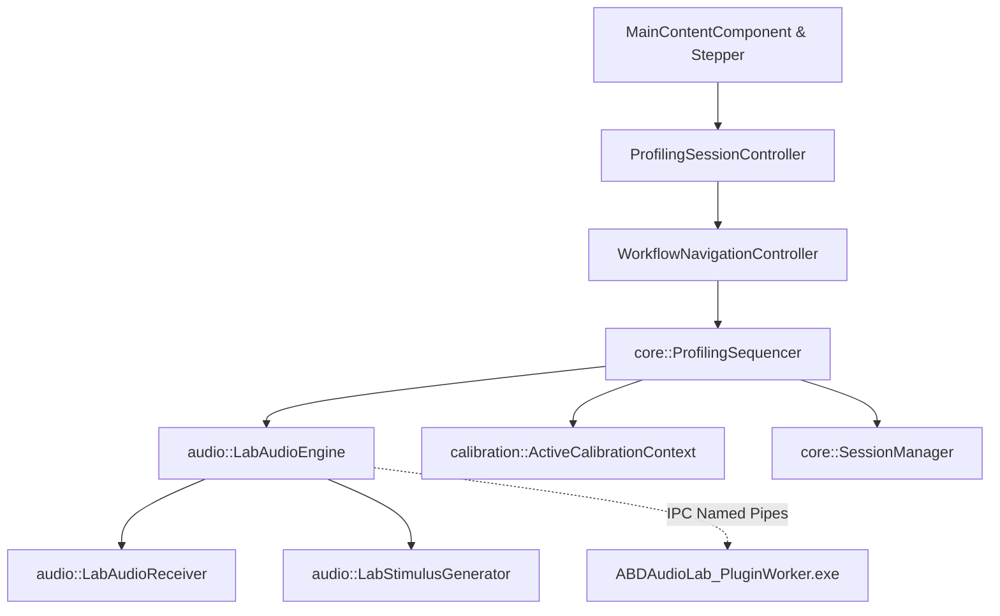
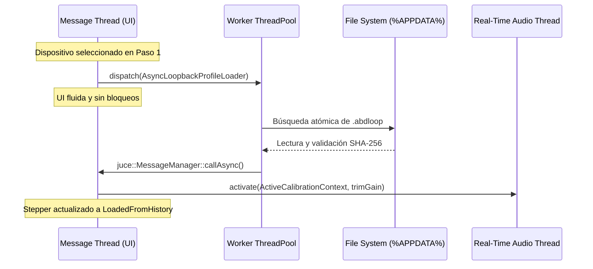

# Technical Requirements Document (TRD): ABDAudioLab v2.x

**Versión:** 2.1.0  
**Fecha:** Octubre 2026  
**Estado:** Aprobado / En Ejecución  
**Lead Architect:** Antigravity  

---

## 1. Arquitectura General del Sistema

### 1.1. Principio de Target Único y Paridad Estricta (ADR-001)
El sistema opera bajo un binario ejecutable principal (`ABDAudioLab.exe`) y un proceso satélite para aislamiento de plugins (`ABDAudioLab_PluginWorker.exe`). 
No existe bifurcación condicional (`#ifdef`) de código para el "Modo Guiado" frente al "Modo Clásico/Lab Bench":
- **Autoridad Única de Orquestación:** La clase `core::ProfilingSequencer` gobierna el ciclo de vida de captura, generación de estímulos y análisis.
- **Canonicidad del Plan:** Tanto la experiencia guiada de 5 pasos como el banco de trabajo libre consumen la misma estructura `ExperimentPlan`. Los presets de rol ("Pedal de Saturación", "Sintetizador Dinámico") son compiladores de planes de medición canónicos.

### 1.2. Aislamiento Out-Of-Process de Plugins
Para proteger la aplicación host de fallos de segmentación o violaciones de acceso de plugins de terceros:
- El worker `ABDAudioLab_PluginWorker.exe` se comunica con el host vía canales IPC sobre **Win32 Named Pipes** bidireccionales (`ipc::Win32NamedPipe`).
- En caso de crash del plugin esclavo, el host permanece intacto, marcando el estado del target como desconectado y permitiendo la recuperación sin pérdida de la sesión activa.



---

## 2. Motor DSP, Matemáticas y Seguridad de Hilos

### 2.1. Políticas de Seguridad en Tiempo Real (Real-Time Safety)
El hilo de audio de alta prioridad (`audioDeviceIOCallbackWithContext`) opera bajo restricciones industriales inflexibles:
1. **Cero Asignaciones en el Heap:** Prohibido el uso de `malloc`, `new`, `std::vector::reserve`, `std::string` o cualquier llamada que pueda invocar el asignador de memoria global del sistema operativo.
2. **Sincronización Lock-Free:** Prohibidos mutexes (`std::mutex`), locks de lectura/escritura o llamadas a kernel.
3. **Ordenamiento de Memoria Atómico:** La sincronización entre el hilo de audio y los hilos de control/UI se efectúa estrictamente mediante `std::atomic` con semánticas explícitas:
   - Lecturas de control en tiempo real: `std::memory_order_acquire`.
   - Publicación de métricas y estados: `std::memory_order_release`.
4. **Prevención TOCTOU (Time-of-Check to Time-of-Use):** Las transiciones de punteros a buffers se gestionan mediante contadores de referencia locales o estructuras fijas pre-dimensionadas en la fase de configuración (`audioDeviceAboutToStart`).

### 2.2. Algoritmos DSP Centrales
- **Deconvolución Logarítmica de Farina:** Generación de sweeps sinusoidales logarítmicos con compensación de fase inversa para el aislamiento simultáneo de la respuesta al impulso lineal $h(t)$ y las componentes de distorsión armónica no lineal ($H_2$ a $H_5$).
- **Modelado Wiener-Hammerstein:** Modelado de sistemas dinámicos no lineales consistente en un filtro LTI de entrada, un bloque estático no lineal (función de saturación polinómica o tangencial hiperbólica) y un filtro LTI de salida.
- **Rastreo de Piso de Ruido:** Estimación continua del SNR y piso de ruido térmico RMS en bandas espectrales de $1/3$ de octava.
- **Compensación Inversa $H_{inv}(f)$:** Cálculo del filtro inverso de la tarjeta de sonido acotado a un realce máximo configurable (típicamente $+6\text{ dB}$) para evitar sobre-amplificación de frecuencias espurias.

---

## 3. Especificación de Formatos de Datos y Persistencia

### 3.1. Formato `.abdloop` (Sprint 1 - Perfil de Infraestructura)
- **Propósito:** Almacenar la huella de calibración loopback (DAC $\to$ ADC) de una interfaz de audio concreta para permitir el bypass automático en sesiones posteriores.
- **Ubicación:** `%APPDATA%/ABDAudioLab/loopback_profiles/<hardware_key>.abdloop`.
- **Clave de Hardware Determinista:**
  ```cpp
  hardware_key = toLowerCase(sanitizedDeviceName) + "_" + sampleRateInt + "_" + bufferSize;
  ```
- **Esquema JSON:**
  ```json
  {
    "schemaVersion": 1,
    "profileId": "loopback-apollo_twin_usb_48000_256",
    "createdAt": "2026-10-13T16:00:00Z",
    "device": {
      "deviceName": "Universal Audio Apollo Twin USB",
      "driverType": "ASIO",
      "sampleRate": 48000.0,
      "bufferSizeSamples": 256
    },
    "routing": {
      "inputChannelIndex": 0,
      "inputChannelLabel": "Input 1",
      "outputChannelIndex": 0,
      "outputChannelLabel": "Output 1"
    },
    "metrics": {
      "isCalibrated": true,
      "peakInDbfs": -3.0,
      "recommendedTrimGain": 1.02,
      "targetHeadroomDbfs": -3.0,
      "roundTripLatencyMs": 5.333,
      "latencySamples": 256,
      "thdPlusNoisePercent": 0.0015,
      "snrDb": 96.4,
      "frequencyFlatnessDb": 0.12,
      "phaseInversionDetected": false,
      "clippingDetected": false
    },
    "frequenciesHz": [ 20.0, 100.0, 1000.0, 10000.0, 20000.0 ],
    "magnitudeDb": [ -0.05, 0.0, 0.02, -0.01, -0.15 ],
    "inverseCorrectionDb": [ 0.05, 0.0, -0.02, 0.01, 0.15 ],
    "sha256Hash": "d5a8...64hex"
  }
  ```
- **Protocolo de Guardado Atómico:** Escritura obligatoria en dos fases: el contenido se vuelca primero en un archivo temporal con sufijo `.tmp` y se renombra atómicamente (`moveFileTo`) sobre el archivo destino final para prevenir corrupción por caídas de tensión o terminación del proceso.

### 3.2. Formato `.abdprofile` (Sprint 3 - Contenedor Universal de Clonación)
- **Estructura Física:** Archivo ZIP comprimido nativo manipulado con `juce::ZipFile`.
- **Archivos Internos del Paquete:**
  1. `metadata.json`: Identificadores únicos (UUID), metadatos de hardware (fabricante, modelo, número de serie opcional, operador), fecha de captura y versión de software.
  2. `infrastructure_snap.json`: Resumen de la cadena física utilizada (dispositivo, latencia RTL medida, piso de ruido).
  3. `model_matrix.dat`: Stream binario crudo con la matriz de 32 coeficientes flotantes (`float[32]`) correspondientes a la rejilla de excitación $4\times 8$.
  4. `validation_samples.wav`: Grabación de audio Float32 con la respuesta al estímulo de comprobación para verificación de fidelidad A/B 5D.

---

## 4. Modelo de Concurrencia y Jerarquía de Hilos



### 4.1. Carga Asíncrona de Perfiles (`juce::ThreadPoolJob`)
- Todas las operaciones de búsqueda y lectura de archivos en disco se ejecutan dentro de la clase `calibration::AsyncLoopbackProfileLoader`, que hereda de `juce::ThreadPoolJob`.
- El resultado se notifica a la interfaz mediante `juce::MessageManager::callAsync`, garantizando que la creación de objetos gráficos y la mutación de estado ocurran en el hilo principal.
- Uso obligatorio de `juce::Component::SafePointer` en lambdas asíncronas para evitar referencias colgantes si el componente se destruye durante la lectura.

### 4.2. Bloqueo Quirúrgico Controlado (Sprint 2)
- Cuando el usuario solicita una acción de "Re-Medir Punto Singular" sobre un coeficiente de la matriz $4\times 8$:
  - La interfaz deshabilita temporalmente la interacción del contenedor (`matrixContainer.setEnabled(false)`), mostrando un indicador de progreso localizado.
  - El motor de audio ejecuta el barrido del punto específico sin reiniciar la sesión general.
  - Al concluir, la interfaz re-habilita la interacción y repinta la celda con el nuevo valor.

### 4.3. Algoritmo de Interpolación 2D Bilateral
- Cuando un punto singular se marca como corrupto o outlier:
  - La función `SessionManager::interpolateMatrixNode2D(int index)` mapea el vector plano de 32 elementos a una rejilla bidimensional $4\times 8$ (`row = index / 8`, `col = index % 8`).
  - Aplica interpolación basada en pesos inversos de distancia considerando los vecinos válidos (norte, sur, este, oeste), gestionando estrictamente las condiciones de contorno (`col == 0`, `col == 7`, `row == 0`, `row == 3`).

---

## 5. Arquitectura de Controladores y UI Governance

### 5.1. Jerarquía de Componentes y Responsabilidades
- **`SoundIdSidebarStepper`:** Barra lateral vertical de navegación. Implementa estados de pasos: `Pending`, `Current`, `Completed`, `LoadedFromHistory`, `Skipped`, `Warning`. Dibuja insignias vectoriales con colores semánticos (verde `#10b981`, cian `#06b6d4`, ámbar `#f59e0b`).
- **`WorkflowNavigationController`:** Controlador que gestiona la visibilidad y coordenadas de los paneles principales correspondientes a cada etapa, impidiendo saltos a pasos no inicializados.
- **`ActiveCalibrationContext`:** Representación en memoria de la calibración activa. Calcula los samples exactos de compensación de latencia inyectados en `LabAudioReceiver`.
- **`SessionExecutionCoordinator`:** Coordina la máquina de estados de ejecución de mediciones (Idle, PreFlight, Running, Paused, Finished, Failed).

### 5.2. Catálogo Centralizado de Textos (`UiStrings.h`)
- Todos los textos de botones, tooltips, advertencias y selectores de modo se definen en el espacio de nombres `abdaudiolab::gui::strings` como constantes `inline constexpr const char*`. Queda prohibida la duplicación de literales de cadena en código de presentación.

---

## 6. Integración WebView2 (ABDScope)

El módulo de osciloscopio y visualización espectral en tiempo real se aloja en un contenedor web acelerado por hardware:
- **Tecnología:** Microsoft WebView2 (`NEEDS_WEBVIEW2 TRUE` en CMake).
- **Provisión de Recursos:** La clase `WebView2ResourceProvider` sirve los recursos empaquetados en binario (`ABDScopeWebAssets`) mediante un esquema de URI local hermético (`https://scope.abdaudiolab.local/`), sin dependencias de servidor HTTP externo ni puertos de red abiertos.
- **Paso de Datos:** Transferencia de buffers de osciloscopio en tiempo real serializados en JSON ligero hacia el contexto JavaScript a través de `postMessage`.

---

## 7. Infraestructura de Compilación y Aseguramiento de Calidad (QA)

### 7.1. Directrices de Build
- **Script Oficial:** `build.bat` en la raíz del repositorio, invocando CMake y MSVC x64.
- **Control Exclusivo del Usuario:** Conforme al protocolo de trabajo en tándem, el agente no lanza compilaciones en background; el usuario compila y ejecuta las suites en su terminal local.
- **Tolerancia Cero de Enlace:** Ausencia total de símbolos sin resolver (`LNK2019` / `LNK1120`).

### 7.2. Estrategia de Testing Automatizado (Catch2 v3)
1. **Tests Unitarios de Infraestructura (`test_LoopbackProfileStore.cpp`):** Verificación de serialización `.abdloop`, firma SHA-256, guardado atómico y tolerancia a fallos.
2. **Tests de Paridad de Modos (`test_Parity01GuidedVsClassic.cpp`):** Demostración de que la transición entre modo asistido y clásico mantiene la invariante de datos del `ExperimentPlan`.
3. **Tests de Rendimiento y Thread Safety (`test_CalibrationNoiseBaseline.cpp`, `test_AudioReceiverLifecycle.cpp`):** Validación de comportamiento determinista y estabilidad en ciclos de arranque/parada del motor.
