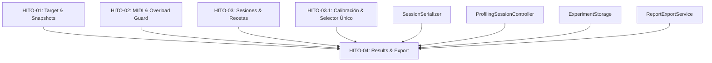
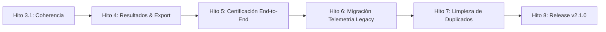

# Roadmap del Proyecto — ABDAudioLab

**Proyecto:** ABDAudioLab (Universal Black-Box Musical Hardware Profiler)  
**Versión del Documento:** 2.8.0  
**Versión del Producto (Objetivo):** v2.4.0 (Fase 24 DSP Metrológico Completada)  
**Fecha de Actualización:** 2026-10-16  

---

## Convenciones de Estado

- Las métricas históricas se conservan con el recuento vigente en el momento de cada hito. No se actualizan retroactivamente.
- **Baseline actual de release (Build #402, post-HITO-07):** 615 test cases · 607 PASS · 8 SKIPPED · 0 FAIL · 228.818 assertions.
- La **versión del documento** (2.8.0) y la **versión del producto** son independientes. La versión del documento se incrementa con cada actualización del roadmap.

---

## 1. Misión y Alcance

**ABDAudioLab** es un entorno de perfilado acústico y modelado caja-negra/gris para instrumentos musicales (hardware analógico, sintetizadores MIDI y plugins VST3/digitales).

### Alcance Estratégico
Integrar las capacidades metrológicas ricas del modo guiado en el **Stepper clásico del Lab Bench**, consolidando un flujo unificado y continuo de 5 pasos (0 a 4), sin perder capacidades existentes, sin bifurcar el motor de audio y sin duplicar máquinas de estado ni selectores.

---

## 2. Principios No Negociables

1. **Un único target activo**: No pueden convivir dos dispositivos seleccionados simultáneamente.
2. **`catalogSelector` es la única autoridad de selección**: `SoundIdTargetView` es una ficha pasiva/viva y `HardwareSelectorPill` solo navega a Paso 1.
3. **`ProfilingSequencer` es la única autoridad de ejecución**: Coordina campañas, adquisición, intermedios y pausas; no se crean secuenciadores paralelos.
4. **`ProfilingSessionController` es la autoridad de sesión y snapshots**: Publica snapshots inmutables con secuencia monotónica hacia la UI.
5. **Cero máquinas de estado paralelas**: Se prohíben bucles de ejecución o despachadores duplicados en vistas.
6. **Instrumentación de audio siempre visible**: Vúmetros y analizador FFT permanecen visibles en todos los pasos.
7. **Arquitectura limpia post-HITO-07**: `stepperBar`, `loopbackModal`, `hardwareRoutingPanel` y `SoundIdGuidedWorkflowContainer` han sido retirados. La autoridad canónica reside en `WorkflowNavigationController`, `SoundIdSidebarStepper`, `CanonicalCalibrationState`, `SoundIdHardwareCatalogSelector` y `resolveCanonicalTarget()`.
8. **Conservación estricta de tests**: Cada nuevo corte debe mantener el 100% de la suite previa en verde (615 test cases en baseline actual, Build #402).
9. **Convergencia absoluta en exportación e informe único**: Todos los modos (Automated MIDI/VST3 y Manual Operator/Analógico) convergen en un modelo común de evaluación (`EvaluationSnapshot`) y en una única cadena de exportación (`ReportExportService` -> `ProductionPackage`); las diferencias metrológicas se expresan exclusivamente mediante metadatos y secciones condicionales en el manifest e informe unificado, nunca mediante exportadores paralelos.

---

## 3. Estado de Hitos de Integración

| Hito | Alcance Principal | Estado | Evidencia y Artefactos |
|---|---|---|---|
| **HITO-01** | `SoundIdTargetView` integrada en Paso 1 (`HardwareRouting`) | **Certificado** | [ACTA_HITO_01_STEP1_TARGETVIEW.md](audits/ACTA_HITO_01_STEP1_TARGETVIEW.md) + ST-01–ST-03 |
| **HITO-02** | Núcleo MIDI automatizado, compuertas `gateMs`/`settlingMs`, `sequenceHash` SHA-256, Panic 16ch | **Certificado** | [ACTA_HITO_02_MIDI_AUTOMATED_CORE.md](audits/ACTA_HITO_02_MIDI_AUTOMATED_CORE.md) + ST-11–ST-13 |
| **HITO-03** | Excitación digital y manual unificada en Pasos 2–3, tarjetas de operador | **Certificado** | [ACTA_HITO_03_STEPPER_EXCITATION_INTEGRATION.md](audits/ACTA_HITO_03_STEPPER_EXCITATION_INTEGRATION.md) + ST-21–ST-46 |
| **HITO-03.1** | Selector único, orden Stepper (0..4), calibración condicionada e invalidación de recetas | **Certificado** | [ACTA_HITO_03_1_STEPPER_COHERENCE.md](audits/ACTA_HITO_03_1_STEPPER_COHERENCE.md) + ST-47–ST-68 |
| **HITO-04A** | Contrato `ExportReadiness`, guardas metrológicas puras y proyección en UI | **Certificado** | ST-69–ST-85 (581 tests globales) |
| **HITO-04B** | I/O de Filesystem, Rollback Atómico, Staging y Paquetes de Producción | **Certificado** | ST-86–ST-98 (13/13 tests, 157 aserciones) |
| **HITO-04C** | Integración Mode-to-Export (E2E MIDI/VST3 y Manual/Analógico con procedencia) | **Certificado** | [ACTA_HITO_04_EXPORT_INTEGRATION_PIPELINE.md](audits/ACTA_HITO_04_EXPORT_INTEGRATION_PIPELINE.md) + ST-99–ST-107 |
| **HITO-04 (Padre)** | Resultados ricos, exportación unificada y guardas metrológicas en Paso 4 | **Certificado** | [ACTA_HITO_04_EXPORT_INTEGRATION_PIPELINE.md](audits/ACTA_HITO_04_EXPORT_INTEGRATION_PIPELINE.md) + ST-69–ST-107 + Smoke UI |
| **HITO-05** | Certificación de workflow completo end-to-end (0 a 4) en los 4 tipos de target | **Certificado** | [ACTA_HITO_05_E2E_HERMETIC.md](ACTA_HITO_05_E2E_HERMETIC.md) + ST-E2E-01–04 |
| **HITO-06** | Migración de seams de telemetría legacy (`loopbackModal`, `stepperBar`) | **Certificado** | [ACTA_HITO_06_TELEMETRY_SEAMS.md](ACTA_HITO_06_TELEMETRY_SEAMS.md) + SEAM-04–05 |
| **HITO-07** | Retirada segura de duplicados y de `SoundIdGuidedWorkflowContainer` | **Certificado** | [ACTA_HITO_07_SAFE_REMOVAL.md](ACTA_HITO_07_SAFE_REMOVAL.md) — 615 casos / 228.818 assertions / Build #402 |
| **HITO-08** | Documentación operativa de release y sellado de versión v2.1.0 | **Certificado** | [ACTA_RELEASE_CANDIDATE_v2.1.0.md](../ACTA_RELEASE_CANDIDATE_v2.1.0.md) — Build #406 / tag `v2.1.0` / 23-Sep-2026 |
| **FASE-24** | Precisión metrológica avanzada: FIR de fase mínima por Cepstrum real, Kaiser $I_0(x)$, ERB + Spline $C^2$, Schroeder `noiseFloorKnee` ($T_{30}/T_{20}/T_{10}$), PID Auto-Trim, doble piloto de deriva de reloj, inversión de Kirkeby, convolución particionada de latencia cero y lista negra ASIO | **Completado** | `HITO-DSP-24.1` a `24.7` ([MATHEMATICAL_MODELS.md](MATHEMATICAL_MODELS.md)) — 44/44 suites (87.350 aserciones) |
| **PARITY-01** | Auditoría de convergencia y paridad Guiado/Exploración | **Planificación** | [ADR-001](ADR-001_CONVERGENCIA_GUIADO_EXPLORACION.md) — pendiente de ejecución |
| **HITO-09** | Unificación de flujo operativo mediante presets, macrotareas y plan canónico | **Pendiente** | Condicionado a resultados de PARITY-01 |
| **HITO-DSP-25** | Analítica de Osciladores/FX, Target Korg MS2000 (ROM v1.07), Auditoría 5D de 128 Presets y Teclado Hardware Canónico | **Planificado** | Extracción compartida `ABDShared/Code` y arquitectura de profiling de síntesis |

---

## 3b. Próxima Etapa Post-v2.1.0

> [!IMPORTANT]
> La dirección estratégica adoptada en ADR-001 supone que los modos Guiado y Exploración
> deben converger en un único banco de trabajo con un solo `ExperimentPlan` canónico.
> La diferencia entre usuarios expertos y no expertos debe residir únicamente en cómo
> se genera el plan (preset vs. edición libre), nunca en qué motor lo ejecuta.

### PARITY-01 — Auditoría de Convergencia Guiado/Exploración

**Objetivo:** Determinar si los flujos guiado y exploración comparten actualmente
la misma receta, ejecución, captura, análisis, evaluación e informe, o divergen materialmente.

**Cobertura de la auditoría:**

| Dimensión | Pregunta |
|---|---|
| Target y estado inicial | ¿Ambos modos parten del mismo `resolveCanonicalTarget()`? |
| Receta / `ExperimentPlan` | ¿El plan generado es estructuralmente idéntico? |
| Eventos MIDI y automatización | ¿Las secuencias y compuertas coinciden? |
| Calibración y auto-trim | ¿Ambos pasan por `CanonicalCalibrationState`? |
| Ruta de audio y captura | ¿Misma política de ventana y buffer? |
| Algoritmos de análisis | ¿Misma versión y parámetros de política? |
| Métricas y veredicto | ¿Mismo `EvaluationSnapshot`? |
| Manifest e informe | ¿Misma cadena `ReportExportService → ProductionPackage`? |

**Resultados posibles y acción derivada:**

| Resultado | Significado | Acción |
|---|---|---|
| Convergen completamente | Ya comparten toda la cadena canónica | Pasar directamente a HITO-09: simplificar UI hacia presets |
| Convergen parcialmente | Comparten exportación/análisis pero no receta/ejecución | Migrar partes divergentes al pipeline canónico antes de HITO-09 |
| Divergen materialmente | Motores, políticas o capturas distintas | No venderlos como equivalentes; fusionar antes de rediseñar UX |

### HITO-09 — Unificación de Flujo Operativo

**Objetivo:** Sustituir la duplicidad conceptual Guiado/Exploración por una única
experiencia de trabajo basada en:

- **Presets / macrotareas declarativas** (ficheros JSON, no ramas de código)
- **Editor avanzado** del `ExperimentPlan` para usuarios técnicos
- **Un solo banco de trabajo** con un solo motor, un solo análisis, un solo informe

**Condicionado a:** resultados de PARITY-01.

**Referencia de diseño:** [ADR-001](ADR-001_CONVERGENCIA_GUIADO_EXPLORACION.md)

## 4. Hito Siguiente Desglosado: HITO-04-RESULTS-EXPORT-INTEGRATION

### Objetivo
Integrar los resultados ricos del modo guiado en el Paso 4 (*Export & Report*) sin duplicar persistencia, evaluación acústica ni exportación a disco.

### Alcance Incluido
- Integrar `SoundIdResultsSummaryView` como panel informativo oficial del Paso 4.
- Métricas físicas reproducibles: ESR (dB), correlación espectral $\rho$, latencia/alineación temporal y evaluación contra conjunto holdout.
- Audición A/B interactiva: reproducción segura de archivos `Target`, `Modelo` y `Residuo`.
- Verificación criptográfica SHA-256 e integridad RFC 8785 con botón de copiado.
- Cadena única de exportación: `ReportExportUiController` $\to$ `ReportExportService` $\to$ `CertificationReportExporter` $\to$ `ProductionPackage`.
- Artefactos producidos: Paquete C++20 (`alignas(16) static const AbdBatchedPoint`), informe HTML (`certification_report.html`), dataset NAM y LUT SIMD.
- Matriz estricta de guardas de exportación: bloqueo ante resultados inválidos.

### Alcance Excluido (No Incluido)
- Rediseño del motor DSP o del secuenciador.
- Nuevos esquemas de persistencia paralelos a `.abdlabtest` / `ExperimentStorage`.
- Creación de nuevas máquinas de estado.
- Eliminación de código legacy (`stepperBar`, `loopbackModal`, etc.). *(Completado posteriormente en HITO-07.)*
- Modificaciones en la adquisición o excitación MIDI.

---

## 5. Matriz de Dependencias de HITO-04



---

## 6. Criterios de Entrada y Salida (HITO-04)

### Criterios de Entrada
- [x] Target estable seleccionado vía `catalogSelector`.
- [x] Sesión finalizada (`ProfilingSessionStatus::Completed` o `EvaluationLoadedForReview`).
- [x] Calibración compatible y completada según target (`isReadyForProfiling() == true`).
- [x] Snapshot de evaluación disponible con hash canónico RFC 8785 calculado.
- [x] Veredicto metrológico emitido (`Approved`, `ApprovedWithWarnings`, `Rejected`, `Inconclusive`, `InvalidMeasurement`).

### Criterios de Salida
- [ ] `SoundIdResultsSummaryView` integrado visualmente en Paso 4 (`Step::ExportReport`).
- [ ] Informe HTML generado exclusivamente mediante `ReportExportService`.
- [ ] `ProductionPackage` C++20 generado con metadatos inmutables y SHA-256 verificado.
- [ ] Audición A/B funcional y reproducible sin cuelgues.
- [ ] Exportación bloqueada con diálogo explicativo si el modelo es inválido, rechazado, inconcluso o adulterado.
- [ ] Exportación bloqueada si el target cambió tras la medición o la calibración pertenece a otro target.
- [ ] Persistencia de sesión `.abdlabtest` conserva y recarga la evaluación.
- [ ] Suite de pruebas ST-69 a ST-85 en verde (100% PASS) y suite previa de 564 tests intacta. *(564: baseline vigente en el momento de HITO-04; la baseline actual es 615, Build #402.)*

---

## 7. Seams y Decisiones de Arquitectura

Un **Seam** (costura arquitectónica) es un punto explícito donde dos subsistemas se conectan a través de un contrato formal, permitiendo variar el comportamiento o probar un componente sin modificar el código consumidor.

### Inventario de Seams

| Seam / Punto de Conexión | Productor | Consumidor | Contrato | Estado |
|---|---|---|---|---|
| **Target Selection** | `catalogSelector` | `ProfilingSessionController` | `TargetSelectionState` | **Certificado** (Hito 3.1, ST-47–ST-50) |
| **Target Display** | `ProfilingSessionController` | `SoundIdTargetView` | `ProfilingSessionSnapshot` (inmutable) | **Certificado** (Hito 1 / 3.1, ST-66) |
| **Run Projection** | `ProfilingSequencer` | `SoundIdProfilingRunView` | `ProfilingSessionSnapshot` | **Certificado** (Hito 3, ST-28–ST-38) |
| **Manual Confirmation** | `operatorStepModal` / UI | `ProfilingSequencer` | `confirmManualStep()` / `repeat()` | **Certificado** (Hito 3, ST-39–ST-46) |
| **Calibration Readiness** | `NativeCalibrationPanel` | `WorkflowNavigationController` | `CalibrationStatus::isReadyForProfiling()` | **Certificado** (Hito 3.1, ST-51–ST-55) |
| **Results $\to$ Export** | `ProfilingSessionSnapshot` | `SoundIdResultsSummaryView` $\to$ `ReportExportService` | `IProfilingSessionCommands::exportModel()` | **Certificado** (Hito 4, ST-69–ST-107) |
| **Session Persistence** | `ProfilingSessionSnapshot` | `SessionSerializer` $\leftrightarrow$ `.abdlabtest` | `serializeSession()` / `deserializeSession()` | **Certificado** (Hito 4/5, E2E-01–04) |
| **Calibration Telemetry (SEAM-04)** | `CanonicalCalibrationState` | `MainContentTelemetrySource` | Polling desacoplado | **Certificado** (Hito 6, SEAM-04) |
| **Stepper Telemetry (SEAM-05)** | `CanonicalWorkflowState` | `MainContentTelemetrySource` | Polling desacoplado | **Certificado** (Hito 6, SEAM-05) |

### Definición de Seam Cerrado
Un seam se declara formalmente **Cerrado** únicamente cuando:
1. Existe un **único productor** de estado.
2. Existe un **único consumidor** autorizado.
3. No hay callbacks duplicados ni eventos espejo.
4. Posee tests de contrato automatizados.
5. Posee pruebas de integración end-to-end.
6. La persistencia conserva íntegramente la información del contrato.
7. El documento de handoff registra la decisión y las autoridades.

---

## 8. Matriz de Capacidades y Trazabilidad

| ID | Capacidad Funcional | Dónde se Implementa | Quién la Ejecuta | Snapshot que la Representa | Dónde se Persiste | Test de Verificación |
|---|---|---|---|---|---|---|
| **F-01** | Selección de Target | `SoundIdHardwareCatalogSelector` | `ProfilingSessionController` | `snapshot.target` | `session.json` (`target`) | ST-47, ST-48, ST-68 |
| **F-02** | Inspección de Target | `SoundIdTargetView` | `ProfilingSessionController` | `snapshot.target` | `session.json` | ST-01, ST-66 |
| **F-03** | Excitación MIDI Auto | `ProfilingHardwareDispatcher` | `ProfilingSequencer` | `snapshot.excitation.midi` | `session.json` (`midiRecipe`) | ST-11, ST-23, ST-26 |
| **F-04** | Parada Segura / Panic | `ProfilingHardwareDispatcher` | `ProfilingSequencer` | `snapshot.sessionStatus` | Audit log | ST-12, ST-27, ST-62 |
| **F-05** | Hash Criptográfico | `Sha256` / `RFC 8785` | `ProfilingSessionController` | `snapshot.evaluation.canonicalHash` | `manifest.json` | ST-13, ST-65, ST-73 |
| **F-06** | Operador Manual | `ManualAnalogueController` | Operador / Sequencer | `snapshot.excitation.manual` | `session.json` (`manualRecipe`) | ST-24, ST-39–ST-46 |
| **F-07** | Calibración Ortogonal | `NativeCalibrationPanel` | `ProfilingSessionController` | `snapshot.calibration` | `session.json` (`calibration`) | ST-50–ST-55, ST-61 |
| **F-08** | Navegación Stepper 0..4 | `SoundIdSidebarStepper` | `WorkflowNavigationController` | `snapshot.workflowStage` | `session.json` (`step`) | ST-48, ST-49, ST-64 |
| **F-09** | Resultados Ricos | `SoundIdResultsSummaryView` | `ProfilingSessionController` | `snapshot.evaluation` | `manifest.json` | ST-69, ST-82 (Hito 4) |
| **F-10** | Exportación Unificada | `ReportExportService` | `ReportExportUiController` | `snapshot.exportOptions` | Carpeta `exports/` | ST-78, ST-80, ST-81 (Hito 4) |

---

## 9. Auditoría de Divergencia Arquitectónica (DR-01 a DR-10)

Antes de iniciar la codificación de HITO-04, se auditó el grafo de llamadas del repositorio para descartar desviaciones entre diseño y código real:

| ID | Área de Auditoría | Hallazgo en el Repositorio | Dictamen |
|---|---|---|---|
| **DR-01** | Estados de target duplicados | `catalogSelector.onSelectionChanged` es el único emisor hacia `ProfilingSessionController::selectTarget`. `TargetView` tiene su popup desactivado y `HardwareSelectorPill` solo navega. | **Confirmado Único** |
| **DR-02** | Clasificadores de capacidades | `ProfilingSessionController::selectTarget()` centraliza la derivación de `TargetControlMode` y requisitos de calibración según `target.kind` y flags reales. | **Confirmado Único** |
| **DR-03** | Exportación directa desde vista | `SoundIdResultsSummaryView` no escribe archivos en disco directamente; invoca `commands_.exportModel("cpp", "")`. | **Confirmado Único** |
| **DR-04** | Calibración paralela | `NativeCalibrationPanel` despacha a `ProfilingSessionController` (`updateAudioCalibration`, `verifyDigitalCalibration`) y escucha `onSessionSnapshotUpdated`. | **Confirmado Único** |
| **DR-05** | Callbacks espejo del stepper | `stepperBar` está oculto (`setVisible(false)`). Sin embargo, `loopbackModal` invoca `stepperBar.onStepSelected(RunSession)` como remanente legacy. | **Resuelto**: componentes eliminados en HITO-07 |
| **DR-06** | Persistencia de recetas | `SessionSerializer` gestiona el estado de sesión interactivo y `ExperimentStorage` los artefactos científicos inmutables. Roles complementarios sin colisión. | **Compatible** |
| **DR-07** | Alcance de rollback | `TargetViewIntegrationMode::Disabled` desactiva únicamente la vista `TargetView` en Paso 1, no el selector ni el backend. Documentado explícitamente. | **Aclarado** |
| **DR-08** | Componentes legacy activos | `loopbackModal` y `stepperBar` son leídos por `MainContentTelemetrySource`. No deben eliminarse hasta HITO-06. | **Resuelto**: telemetría migrada en HITO-06; componentes eliminados en HITO-07 |
| **DR-09** | Generación monotónica | `controllerGeneration` incrementa ante cambio de target, invalidando recetas y renovando `sessionId`. | **Confirmado Único** |
| **DR-10** | Silenciamiento de emergencia | Silenciamiento dual centralizado en `ProfilingHardwareDispatcher` (CC 123 + CC 120 en 16 canales). | **Confirmado Único** |

### Fitness Functions de Arquitectura (ARCH-01 a ARCH-10)
- **ARCH-01**: Solo `catalogSelector` emite `selectTarget`. (Verificado por ST-47, ST-67).
- **ARCH-02**: `TargetView` no posee callback de selección. (Verificado por ST-66).
- **ARCH-03**: Solo `ProfilingSequencer` ejecuta ensayos de excitación. (Verificado por ST-28, ST-35).
- **ARCH-04**: Solo `ProfilingSessionController` publica snapshots inmutables. (Verificado por ST-26, ST-56).
- **ARCH-05**: Ninguna vista de UI escribe directamente en disco; delegan en servicios. (Verificado por ST-80).
- **ARCH-06**: Toda exportación de producción pasa por `ReportExportService`. (Verificado por ST-81).
- **ARCH-07**: `TargetControlMode` se resuelve en un único punto normativo. (Verificado por ST-21, ST-59).
- **ARCH-08**: Componentes legacy no reciben foco ni emiten selecciones divergentes. (Verificado por ST-67).
- **ARCH-09**: Cambio de target incrementa `controllerGeneration` e invalida recetas. (Verificado por ST-55, ST-56).
- **ARCH-10**: Parada segura no deja notas MIDI colgadas en ningún canal. (Verificado por ST-12, ST-27).

---

## 10. Roadmap Posterior (Secuencia de Hitos 4 a 8)



- **HITO-04 (Resultados y Exportación)**: Integración de `SoundIdResultsSummaryView`, persistencia y guardas. (**Certificado** - Build 380)
- **HITO-05 (Certificación End-to-End)**: Ejecución y verificación del ciclo 0 $\to$ 4 sobre los 4 arquetipos con suite hermética `test_E2E_HermeticWorkflows.cpp`. (**Certificado** - Build 384)
- **HITO-06 (Migración de Telemetría Legacy)**: Migración limpia y purga de dependencias a widgets legacy (`loopbackModal`, `stepperBar`) en `MainContentTelemetrySource` hacia `CanonicalCalibrationState` y `CanonicalWorkflowState`. (**Certificado** - Build 391/392)
- **HITO-07 (Limpieza de Componentes Duplicados)**: **CERTIFICADO Y CERRADO** (Build #402, Smoke 13/13 PASS)
  - Retirada segura de `loopbackModal`, `stepperBar`, `hardwareRoutingPanel` y `SoundIdGuidedWorkflowContainer`. 615 casos / 228.818 assertions / 0 FAIL.
  - Observación: problemas de contraste en modo oscuro (preexistentes, no bloqueantes).
- **HITO-08 (Release y Documentación)**: **PENDIENTE DE PLANIFICACIÓN**
  - QA operativo, release notes (incluyendo known issues), sellado de versión del producto **v2.1.0** y criterios de publicación.

---

## 11. Definición de Terminado (*Definition of Done*)

Un hito o fase se considera terminado únicamente cuando:
1. **Código y Compilación**: Compila en Release x64 con MSVC sin advertencias críticas ni dependencias circulares.
2. **Suite de Tests**: 100% de tests unitarios y de integración en verde, sin regresiones sobre los 615 tests base (baseline actual, Build #402).
3. **Seams Verificados**: Contratos entre productor y consumidor demostrados mediante tests específicos.
4. **Persistencia Validada**: Comprobada la serialización y deserialización sin pérdida de datos (*round-trip*).
5. **Acta de Certificación**: Documentada en `docs/audits/ACTA_HITO_XX_*.md` con resultados empíricos reproducibles.
6. **Handoff y Roadmap Sincronizados**: Estado, decisiones y riesgos reflejados fielmente en la documentación maestra.

---

## 12. Plan de Mejoras de Calidad (Post-Review Oct 2026)

### Estado
Revisión de calidad realizada identificó mejoras menores de memory ordering en thread-safety.

### Estado de la revisión de calidad (post-revisión y post-auditoría en este hilo)
- **MEJ-01 (ALTO)**: `LabStimulusGenerator` - en este repositorio, `processBlock()` ya lee `playing`, `finished`, `currentSampleIndex` y `totalSamples` con `acquire`, y la finalización publica `playing=false` y `finished=true` con `release`. Tarea considerada como ya implementada en este punto del código. Detalle en [PLAN_MEJORAS_CALIDAD.md](PLAN_MEJORAS_CALIDAD.md).
- **MEJ-02 (MEDIO)**: `LabAudioEngine` - corregido en este hilo: ahora el callback de audio lee `diagnosticToneFreq`, `diagnosticToneLevel` y `diagnosticToneActive` con `acquire`, y `isDiagnosticTestToneActive()` también usa `acquire`. Detalle en [PLAN_MEJORAS_CALIDAD.md](PLAN_MEJORAS_CALIDAD.md).
- [ ] **MEJ-03 (OBLIGATORIO)**: Compilar, ejecutar tests de audio (`[audio]`, `[AudioEngine]`) y suite completa. Verificar 0 regresiones.

**Detalle completo**: Ver [PLAN_MEJORAS_CALIDAD.md](PLAN_MEJORAS_CALIDAD.md)

---

## 13. Plan Maestro de Usabilidad, Persistencia y Rediseño de Flujo (Inspirado en Sonarworks SoundID Reference)

### 13.1 Diagnóstico de Fricción Metrológica (Problema Actual)
ABDAudioLab posee un motor científico de perfilado y clonación de hardware maduro, pero sufre de sobrecarga cognitiva y fricción operativa ("síndrome del laboratorio de física"):
1. **Fatiga de recableado (Loopback repetitivo)**: Cada sesión exige recablear físicamente salida a entrada para calibrar la tarjeta de sonido, aunque el hardware de audio y la sala no hayan cambiado.
2. **Rigidez de bloque único**: Una medición es monolítica. Si se produce un glitch aislado de SysEx o ruido en 1 de 32 puntos, la sesión se declara fallida o exige repetir los 32 puntos desde cero.
3. **Sobrecarga visual de laboratorio**: Mostrar simultáneamente FFT cruda, curvas de fase, THD en dBFS y matrices dispersas abruma al músico/productor.
4. **Falta de persistencia integral**: No existe un formato de entrega comercial para empaquetar, transportar y reabrir perfiles de hardware medidos.

### 13.2 Principios de Diseño Sustractivo ("Habla en Músico, Piensa en Ingeniero")
- **Embudo lineal obligatorio (3 Pasos)**: 1. Setup/Conexión (con test rápido de comprobación) $\rightarrow$ 2. Captura (botón central con barra de progreso limpia) $\rightarrow$ 3. Resultado (huella y acciones directas).
- **Safe Defaults**: Ocultar el 90% de los parámetros de metrología matemática bajo un botón o pestaña secundaria de "Inspección de Ingeniería".
- **Traducción psicoacústica**: THD $\rightarrow$ "Carácter / Calidez", Fase $\rightarrow$ "Alineación de Fase (Semáforo)", FFT $\rightarrow$ Curva suavizada a 1/3 de octava por defecto.

### 13.3 Fases de Ejecución

#### Sprint 1: Perfiles de Infraestructura (`.abdloop`)
- **Objetivo**: Eliminar la fatiga de recablear la interfaz de audio en cada sesión.
- **Implementación**:
  - Almacenamiento local en `AppData/Roaming/ABDAudioLab/<hash>.abdloop` desacoplado del target.
  - Clave de hash unívoca: `(audioDeviceName, sampleRate, bufferSize)`.
  - Detección automática al seleccionar driver en Paso 0 / Paso 2.
  - Estado visual en stepper: `StepStatus::LoadedFromHistory` (indicador oliva/historial).
  - Opciones de UI: `[Omitir Calibración (Usar Guardada)]` (bypass instantáneo al Paso 3) | `[Volver a Calibrar]`.

#### Sprint 2: Banco de Pruebas Interactivo (Edición Quirúrgica en Pantalla)
- **Objetivo**: Tratar los datos de medición como un lienzo editable, reparando puntos corruptos sin repetir toda la sesión.
- **Implementación**:
  - Matriz 2D de parámetros con indexación plana (`0..31`) mapeada a filas/columnas (`4x8`).
  - Menú contextual asíncrono vía `juce::PopupMenu::showMenuAsync` con salvaguarda `Component::SafePointer`:
    - `Re-Medir Punto Singular`: Bloqueo controlado de la UI (`setMatrixInteractionEnabled(false)`), disparo de barrido puntual sin alterar el hilo de audio DSP en tiempo real (cero heap allocation).
    - `Interpolar / Vecinos`: Reparación matemática mediante promedio de vecinos válidos (gestión segura de bordes y esquinas 2D).
    - `Eliminar / Omitir de la Huella`: Exclusión del nodo como outlier para el reporte final.

#### Sprint 3: Contenedor de Huella Universal (`.abdprofile`)
- **Objetivo**: Persistencia unificada y portable de sesiones de hardware.
- **Estructura del archivo (ZIP nativo via `juce::ZipFile`)**:
  - `metadata.json`: UUID, nombre de hardware, fabricante, carácter analógico, fecha, operario, enlace de infraestructura (`infrastructureLink`).
  - `infrastructure_snap.json`: Estado metrológico, validez, tipo de suavizado (1/3 octava).
  - `model_matrix.dat`: Stream binario puro de los 32 floats de coeficientes (`writeInt` + `write` crudos).
- **Carga Cruzada Inteligente (ProfileLoader)**:
  - Comparación de `infrastructureLink` contra el hardware activo actual.
  - Coincidencia idéntica: Carga completa en caliente.
  - Discrepancia de interfaz: `AlertWindow::showOkCancelBoxAsync` con fallback controlado a "Modo Offline / Sólo Lectura" (`StepStatus::Warning`, bloqueo de bypass de loopback).

#### Sprint 4: Refinamiento de Usabilidad y Evaluación de Convergencia WebView2
- **Objetivo**: Consolidar la experiencia de usuario hacia un estándar comercial prémium.
- **Actividades**:
  - Presets de medición declarativos ("Pedal de Saturación", "Sintetizador Dinámico", "Procesador Lineal").
  - Capa de presentación simplificada (curva suavizada 1/3 octava, semáforo de fase, tarjeta de fidelidad de captura).
  - Ocultación de visores densos (Lab Bench) tras un panel colapsable ("Consola de Telemetría").
  - Evaluación arquitectónica para unificar las ventanas flotantes actuales de WebView2 (Scope y Topología) en un shell SPA integrado con el backend C++.

### 13.4 Condicionantes y Dependencias Identificadas en el Roadmap
1. **Alineación con ADR-001 / PARITY-01**: La convergencia entre modo guiado y libre debe basarse en un único `ExperimentPlan` canónico; los nuevos presets de medición son la realización directa de esta directiva.
2. **Cierre de MEJ-03 (Obligatorio previo)**: Antes de introducir nueva lógica de persistencia, se debe asegurar que las modificaciones de memory ordering en `LabAudioEngine` y `LabStimulusGenerator` compilen sin errores y mantengan la suite de tests en verde.
3. **Invariantes DSP en Tiempo Real**: Prohibición de asignaciones dinámicas o bloqueos en el hilo de audio durante operaciones de re-medición o guardado (la UI se deshabilita localmente, el motor de audio procesa asíncronamente).

---

## Detalle Histórico de Fases Precedentes (Fase 1 a 20)


### ✅ FASE 1: Laboratorio Autónomo y Motor de Perfilado MVP (COMPLETADA)
- [x] **Subfase 1.1: Entorno de Compilación y Configuración**
  - CMake 3.22+ configurado con C++20, JUCE 8.0.4 y `nlohmann_json`.
  - Script `build.bat` con detección automática de Visual Studio 18 (2026) y compilación paralela Release.
- [x] **Subfase 1.2: Capa de Abstracción de Hardware y Validación**
  - Contrato abstracto `IHardwareController` puro e independiente.
  - `MockHardwareController` (simulación DSP interna de filtro resonante y ruido térmico).
  - `AiraSysExController` (Roland AIRA por USB SysEx `RQ1`/`DT1` y CC 11..16).
  - `RoutingValidator` (Validación de conexiones ilegales `RF-25` y catálogo normativo de 31 submódulos `RF-26`).
  - `MidiCcController` (dispositivos MIDI Continuous Controller genéricos).
  - `ManualAnalogueController` (módulos analógicos/Eurorack con guía interactiva para operador humano).
- [x] **Subfase 1.3: Motor de Audio en Tiempo Real**
  - `LabStimulusGenerator` (9 tipos de estímulo: Silencio, Dirac Delta, `SyncPulses3` pre-roll de sincronización, Farina Sweep logarítmico, Ruido Blanco LCG, Ruido Rosa, Tono 1 kHz, Onda Cuadrada 1 kHz, Rampa de amplitud).
  - `LabAudioReceiver` (Búfer circular lock-free con `AbstractFifo` y disparo por umbral de amplitud a -40 dBfs).
  - `LabAudioEngine` (Cadena jerárquica de 3 pasos de inicialización de audio, `ScopedNoDenormals` e inyector atómico de tono de prueba a 1 kHz).
- [x] **Subfase 1.4: Motor Matemático y Estadístico**
  - `FarinaDeconvolver` (Filtro inverso a $-6\text{ dB/oct}$, convolución FFT, respuesta en frecuencia y THD %).
  - `LabAnalyticEngine` (Extracción de $\mu$ y $\sigma$ para los 5 bloques funcionales).
- [x] **Subfase 1.5: Secuenciador y Exportación**
  - `ProfilingSession` (Generación de suites de prueba para Filtros, ADSR, Delays, Saturadores, VCAs y carga de JSON).
  - `ProfilingSequencer` (Máquina de estados en segundo plano con calibración de línea e interludios de ruido de fondo).
  - `LutExporter` (Exportación de archivos `.h` con `alignas(16) static const AbdBatchedPoint` y reportes `.json`).
- [x] **Subfase 1.6: Consola de Control de Usuario y Publicación**
  - Interfaz gráfica standalone con diálogo de configuración de Audio y Puertos MIDI (In/Out), selector de los 4 modos de hardware, selector de suites de test, cartel de operador manual (confirmación con Barra Espaciadora) y monitor de logs.
  - Repositorio Git inicializado y publicado en [https://github.com/ajabadia/ABDAudioLab](https://github.com/ajabadia/ABDAudioLab).

---

### ✅ FASE 1.5: Ampliación del Laboratorio (Core Científico & GUI Interactiva) (COMPLETADA)

#### A. Módulos del Core Científico y DSP:
- [x] **1.5.1: Muestreo Periódico del Suelo de Ruido y Deriva Térmica** (COMPLETADO)
  - Interludio automático cada $N$ minutos/ensayos (500 ms silencio + 500 ms captura).
  - Cálculo de $Noise_{RMS}$ y FFT de 32 bandas del soplido/hum analógico implementado en [`NoiseFloorTracker.h/.cpp`](src/math/NoiseFloorTracker.h).
  - Generación del archivo exportado `<Base>_Noise_Timeline.h` y persistencia en sesión.
- [x] **1.6.4: Arquitectura Basada en Contratos JSON Dinámicos para Hardware**
  - Eliminación de modelos hardcodeados en el código C++.
  - Creación de contratos JSON en `contracts/hardware/` (`mock_va_synth.json`, `roland_aira_bitrazer.json`, `roland_aira_torcido.json`, `generic_midi_synth.json`, `manual_eurorack_vcf.json`).
  - `HardwareContractRegistry`: Descubrimiento y carga dinámica de contratos de hardware desde disco.
  - **Nota de diseño futuro (Inspiración ABDBankManager)**: Reutilizar o inspirarse en el sistema de autodetección por MIDI de ABDBankManager para identificar automáticamente el hardware conectado mediante consultas SysEx / Identity Inquiry cruzadas con los contratos.
- [x] **1.5.3: Índice de Confianza y Calidad de Medida (*Confidence Check* — ALEX)** (COMPLETADO)
  - Cálculo de SNR en tiempo real por cada punto capturado.
  - Validación con umbral mínimo estricto de 18 dB (`isMeasurementConfidenceAcceptable`) con reintento automático (`maxRetries = 1`) y flag/advertencia de baja confianza ante ruido persistente en `ProfilingSequencer`.
- [x] **1.5.4: Calibración Automática de Ganancia (*Auto-Trim* a $-3\text{ dBfs}$)** (COMPLETADO)
  - Generación de tono de pre-roll a 1 kHz durante la inicialización del secuenciador para medir el headroom de la entrada física.
  - Cálculo y aplicación digital automática de escala en `audioEngine.setInputAutoTrim` asegurando el margen exacto de $-3.0\text{ dBfs}$ para evitar saturación del ADC.
- [x] **1.5.5: Bloque Funcional `CyclicModulator` (Chorus / Flanger / Phaser / LFO)** (COMPLETADO)
  - 5º bloque funcional con medición de velocidad ($Hz$), profundidad ($Depth$) e irregularidad del LFO físico mediante seguidor pasa-bajos y autocorrelación en `LabAnalyticEngine::analyzeCyclicModulator`. Validado en tests unitarios.
- [x] **1.5.6: Barrido Multinivel de Amplitud (Saturación No Lineal — Välimäki / DAFx)**
- [x] **1.5.7: Motor de Interpolación Multidimensional (Bilineal & Bicúbica Catmull-Rom 2D)**
- [x] **1.5.8: Checkpoint de Seguridad y Recuperación de Sesión**
- [x] **1.5.9: Visualizador Gráfico de Curvas en Tiempo Real (*Live Curve Plotter*)**
- [x] **1.5.10: Analizador de Espectro FFT en Vivo (20 Hz - 20 kHz Logarítmico con Peak-Hold y Decay)**
- [x] **1.5.11: Mapa de Calor / Matriz de Contorno 2D (Escala Perceptual Viridis con Color Bar & Ejes)**
- [x] **1.5.12: Vúmetros Estéreo con Indicador de Clipping y Calibración a $-3\text{ dBfs}$**
- [x] **1.5.13: Panel de Salud de Medición y Monitor de SNR/Confianza en Vivo (Horizontal Strip)**
- [x] **1.5.14: Previsualizador de Archivos Exportados (.h / .json) y Apertura de Carpeta**
- [x] **1.5.15: Barra de Menú (vía SlideInDrawer) y Auto-incremento de Compilación en build.bat**

---

### 🎨 FASE 1.6: Rediseño Integral de la Interfaz Estilo Sonarworks SoundID (Tema Claro Nórdico) (COMPLETADA)
- [x] **1.6.1: SoundIdTheme (LookAndFeel C++/JUCE)**
  - Paleta clara nórdica (`#fbfbfc`, `#f4f5f7`), botones tipo píldora (`#111827`), badges redondeados de color (`FLT`, `ENV`, `MOD`, `SAT`) y tipografía nítida.
- [x] **1.6.2: SoundIdCurvePlotter (Visualizador de Curvas de Alta Precisión)**
  - Rejilla logarítmica milimétrica clara, curva media en verde esmeralda (`#10b981`) y banda de dispersión $\pm\sigma$ sombreada en lavanda/lila (`#8b5cf6` / `#f3e8ff`).
- [x] **1.6.3: SoundIdMeterStrip (Tira Vertical Derecha de Medición & Trim)**
  - Vúmetros verticales LED dobles (`In` y `Out`), lectura numérica de picos en dBfs, deslizador vertical de ganancia/trim y botón maestro circular de inicio/pausa.
- [x] **1.6.4: SoundIdSuiteList (Selector de Suites con Badges Estilo SoundID)**
  - Lista inferior de tarjetas de test con badges coloreados (`SpectrumFilter`, `TimeDynamic`, `CyclicModulator`, `WaveShaper`) y parámetros clave.
- [x] **1.6.5: SlideInDrawer (Pestaña Deslizable desde la Izquierda)**
  - Panel animado nativo con `juce::ComponentAnimator`, ancho responsivo (50% de la pantalla), viewport con scroll vertical, renderizado limpio de imágenes de dispositivo, selector de hardware y selector de resolución de matriz.
- [x] **1.6.6: Diálogo Modal de Información ("About ABDAudioLab")**
  - Modal flotante en tema claro nórdico con dismiss por clic en fondo o tecla Escape, accesible directamente desde el panel de información.

---

### 🚀 FASE 1.7: Re-Análisis Offline, Corrección de Errores y Ecosistemas Modulares
- [x] **1.7.3: Contratos Modulares Universales (*Modular Ecosystem Taxonomy*)**
  - Creación del contrato universal de 31 submódulos (`roland_aira_submodules.json`) para evitar duplicar pruebas idénticas entre hardware de la misma familia.
  - Los contratos individuales de cada modelo se concentran exclusivamente en su algoritmo nativo de panel frontal.
  - Soporte para automatización mediante MIDI CC, SysEx Roland DT1 con checksum oficial y 14-bit NRPN.
- [x] **1.7.5: Duración Dinámica de Ráfaga y Captura Adaptativa Inteligente (*Adaptive Auto-Tail Cutoff*)**
  - Selector en la interfaz para duraciones fijas (0.5s, 1.0s, 2.5s, 5.0s) con estimador de tiempo en vivo.
  - Arquitectura de máquina de estados para detección adaptativa de transitorios de ataque y truncado automático de silencio en colas de relajación (ADSR / Reverb).
- [x] **1.7.1: Motor de Carga y Re-Análisis Offline de Sesiones (*Session Reload & Offline Re-Analysis*)** (COMPLETADO v1.2.0)
  - Carga de contenedor `.abdlabtest` / `session_manifest.json` y audio bruto en `raw_audio/*.wav` con decodificación multiformato JUCE.
  - Implementación de `core::SessionManager::reanalyzeSessionOffline()` con despacho analítico a `LabAnalyticEngine` (filtros, envolventes ADSR, saturadores no lineales, moduladores LFO, Wiener-Hammerstein, SNR y THD).
  - Interfaz de usuario integrada: botón *"Re-Analyze Session (Offline)"* en la pestaña de sesión de `SlideInDrawer` y opción de menú *"Re-Analyze Session (Offline)..."* en `File`.
  - Notificación de progreso en tiempo real y refresco dinámico inmediato de curvas en `SoundIdCurvePlotter`.
  - Banco de pruebas unitarias automatizadas en `src/tests/test_OfflineReanalysis.cpp` (3/3 pruebas validadas; 42/42 tests CTest en verde).
- [x] **1.7.2: Parcheo y Re-Medición por Rangos (*Point Range Re-Measurement & Error Patching*)** (COMPLETADO v1.3.0)
  - Selección multidimensional en la tabla/matriz: checkboxes interactivos y clic para puntos discontinuos, selección continua por rangos mediante Shift + Clic, y atajos de selección masiva (*"Select All in Test"*, *"Select All Invalidated / Error Points"*).
  - Botón de acción reactivo en cabecera de cola: `⚡ Re-Measure (N) Points`, con actualización en vivo del recuento de puntos seleccionados y estilo de alerta ámbar.
  - Menú contextual (clic derecho) sobre celdas para selección rápida, marcado para re-ejecución (*"Mark as Re-Run"*), anulación o lanzamiento inmediato de parcheo.
  - Generador de sesiones dirigidas (`MainContentComponent::buildPatchProfilingSession`) que sintetiza únicamente los `TestCase`s correspondientes a las coordenadas elegidas, preservando los parámetros exactos y su índice global.
  - Parcheo *in-place* seguro en `SessionManager::patchMeasuredPoint`, `SoundIdCurvePlotter::patchPoint` y sobreescritura del archivo `raw_audio/*.wav` correspondiente sin destruir ni truncar los datos válidos del resto del ensayo.
  - Banco de pruebas unitarias automatizadas en `src/tests/test_PointRangePatching.cpp` (4/4 pruebas validadas; 46/46 tests CTest en verde, 100% de éxito).
- [x] **1.7.6: Cola de Ensayos por Lotes y Validación Anti-Duplicación (*Session Test Queue & Anti-Duplication*)**
  - Constructor de planes de ensayo encadenando múltiples pruebas (estándar desde contrato o personalizadas).
  - Regla de validación en tiempo real para evitar añadir exactamente la misma prueba o función duplicada en una misma sesión de laboratorio.
  - Ejecución secuencial unificada con progreso consolidado y exportación de paquete multidimensional unificado.
- [x] **1.7.7: Autoguardado Continuo, Empaquetador `.abdlabtest` y Salvaguardas (*Continuous Autosave & Container Package*)**
  - Creación del serializador y empaquetador ZIP `.abdlabtest` ([SessionSerializer](src/core/SessionSerializer.h)) con verificación SHA-256.
  - Grabación directa de audio `.wav` PCM 24-bit en disco para cada pase.
  - Flujos completos de `Save`, `Save As...` y recuperación periódica.
  - Diálogos de 3 vías de confirmación (*Purgar y Borrar* vs *Invalidar y Conservar* vs *Cancelar*) al borrar o editar pruebas ya medidas.
- [x] **1.7.9: Optimización de Tiempo de Arranque & Pantalla de Presentación (*Startup Optimization & Splash Screen*)**
  - Implementación de la pantalla de bienvenida flotante [SoundIdSplashScreen](src/gui/SoundIdSplashScreen.h) con visualización de estado en tiempo real (*"Scanning Audio Interfaces..."* -> *"Loading Hardware Modules..."* -> *"Ready."*).
  - Transición fluida de desvanecimiento (*Fade-Out*).
- [x] **1.7.9.1: Barra de Progreso y Telemetría Real en SplashScreen (*Real Startup Process Pipeline*)** (COMPLETADO v1.2.0)
  - Desacoplados los estados estáticos fijados en `LabApplication.h` (0.25f, 0.65f) mediante un callback de progreso granular (`StartupProgressCallback`) canalizado hacia `MainContentComponent`.
  - Método `SoundIdSplashWindow::reportProgress(msg, progress, minDwellMs)` con forzado de repintado sincrónico inmediato del `HWNDComponentPeer` (`performAnyPendingRepaintsNow()`) y dwell time imperceptible para fluidez visual.
  - Mapeo 100% verídico de los hitos reales de carga:
    * `15%`: Inicialización de `AudioDeviceManager` y escaneo de interfaces ASIO / DirectSound / WASAPI.
    * `32%`: Verificación de interfaz de audio activa.
    * `45%`: Escaneo y deserialización de contratos en `ABDSharedAssets/contracts` y `contracts/hardware`.
    * `62%`: Confirmación de contratos cargados con recuento exacto de modelos de sintetizador.
    * `76%`: Configuración de motores DSP (Farina, Wiener-Hammerstein, Splines & RTNeural).
    * `88%`: Pre-warming del monitor reactivo de hardware (`HardwareMidiHotplugMonitor` y detector SysEx).
    * `96%`: Pre-warming de los motores Chromium WebView2 para `ScopeWebFloatingWindow` y `HardwarePickerWindow`.
    * `100%`: Finalización y fade-out fluido a la ventana principal.
- [x] **1.7.4: Autodetección de Hardware por MIDI Multicanal (1..16) y Universal SysEx Identity Inquiry** (COMPLETADO v1.0.0 Build 142)
  - Identificación automática de dispositivos conectados mediante consultas SysEx Universal Identity Inquiry (`F0 7E <dev> 06 01 F7`) y coincidencia con las firmas declaradas en los contratos JSON.
  - Implementación de [`MidiIdentityDetector.h/.cpp`](src/hardware/MidiIdentityDetector.h) con soporte nativo de identidad y contratos JSON para:
    - **Casio CZ-101** (`ABDCZ101`, Manufacturer `0x44`)
    - **Roland Juno-106 / Juno-60** (`ABDJUNIO601`, Manufacturer `0x41`, Model `0x32`)
    - **Korg MS2000 / MS2000R** (`ABDMS2000`, Manufacturer `0x42`, Model `0x58`)
    - **Korg Prophecy** (`korg_prophecy`, Manufacturer `0x42`, Model `0x5A`)
    - **Behringer PRO-800** (`pro800`, Manufacturer `0x00 0x20 0x32`, Model `0x2C`)
    - **Behringer DeepMind 12 y DeepMind 6** (`behringer_deepmind12`, `behringer_deepmind6`)
    - **Yamaha DX7 y DX7II** (`yamaha_dx7`, `yamaha_dx7ii`)
    - Serie **Roland AIRA Modular** (Bitrazer, Demora, Torcido, Scooper).
  - Botón interactivo *"Auto-Detect Device (MIDI)"* en [`SlideInDrawer`](src/gui/SlideInDrawer.cpp) con selección y emparejamiento automático de hardware en el panel.
  - Validado mediante suite de tests unitarios Catch2 (`test_MidiIdentityDetector.cpp`).
- [x] **1.7.5: Generador y Exportador de Datasets de Calibración NAM / RTNeural** (COMPLETADO v1.1.0)
  - Implementación del estímulo de calibración estandarizado `StimulusType::NamCalibration` en [`LabStimulusGenerator`](src/audio/LabStimulusGenerator.h) (trenes de sincronía de 1 kHz, ruido blanco/rosa multinivel, barrido sinusoidal logarítmico y trenes armónicos ricos).
  - Implementación de [`NamDatasetExporter`](src/export/NamDatasetExporter.h): alineamiento temporal sample-accurate por correlación cruzada en el pre-roll, compensación de latencia del convertidor, y exportación normalizada de `input.wav`, `target.wav` y `nam_dataset_manifest.json` listos para entrenamiento externo con PyTorch / Neural Amp Modeler.
  - Suite de tests unitarios Catch2 en [`test_NamDatasetExporter.cpp`](src/tests/test_NamDatasetExporter.cpp) validada.
- [x] **1.7.8: Rango Dinámico Útil por Parámetro (*Parametric Min/Max Range Bounds: Start % - End %*)** (COMPLETADO v1.0.0 Build 138)
  - Capacidad de acotar el intervalo útil de barrido de cada potenciómetro (por defecto: `0% - 100%`, configurable a ej. `15% - 85%`).
  - Evita medir zonas muertas de silencio, frecuencias inaudibles o saturaciones planas irrelevantes. Renderizado de pista sombreada de rango útil en Knobs/Sliders vectoriales y serialización en contenedor `.abdlabtest`.
- [x] **1.7.11: Integración de AutoUpdater Desacoplado (ABDSharedCode)** (COMPLETADO v1.1.0)
  - Integración modular de la librería compartida `ABDShared::AutoUpdater` vía CMake (FetchContent de GitHub / soporte local en monorepo).
  - Configuración del repositorio `ajabadia/ABDAudioLab` en [`AutoUpdaterConfig.h`](src/config/AutoUpdaterConfig.h).
  - Botón *"Check for Updates..."* en la vista de archivo con comprobación manual/desatendida y ventana modal para descarga de instaladores.
- [x] **1.7.10: Banda de Tolerancia Sombreada ($\pm 1\sigma$ *Accuracy Corridor*) y Leyenda Conmutable** (COMPLETADO)
  - Renderizado de polígono translúcido entre $(\mu - \sigma)$ y $(\mu + \sigma)$ en `SoundIdCurvePlotter` mostrando la dispersión térmica y tolerancia analógica (`accentPurpleFill`).
  - Barra superior de leyenda conmutable interactiva con botones píldora ON/OFF en la cabecera: Medición Real (`Mean (μ)` en verde), Tolerancia (`±1σ Band` en violeta) y Nodos de Medición / Distorsión (`THD %` en ámbar).
- [/] **1.7.11: Multi-Format Plugin Host & Benchmark Engine (*VST3, AU, CLAP, LV2*)** (PARCIALMENTE COMPLETADO — Ver Fase 10)
  - *Evolución arquitectónica*: Expansión del laboratorio a entorno híbrido Hardware/Software. Permite medir, perfilar y comparar A/B plugins virtuales en cualquier formato soportado por JUCE (VST3 en Windows/macOS/Linux, AudioUnit en macOS, y wrappers CLAP/LV2) bajo los mismos estándares científicos que el hardware físico.
  - **Estado**: La capacidad base VST3 está completada y validada (Fase 10, v2.0.0). Los formatos AU/CLAP/LV2 son experimentales y **no forman parte del scope de HITO-08 ni del release v2.1.0**.
- [x] **1.7.12: Campo de Observaciones / Metadatos de Laboratorio en Manifiesto** (COMPLETADO)
  - Inclusión de metadatos de entorno y observaciones (`operatorNotes`, `ambientTemperatureC`, `warmupTimeMinutes`) en `SessionManifest`, `ProfilingMetadata` y `SessionManifestData`.
  - Persistencia completa en contenedor `.abdlabtest`, serialización JSON y reporte de telemetría / manifiesto de laboratorio (`laboratoryConditions`).
  - Interfaz de usuario integrada en la pestaña de sesión de `SlideInDrawer` con campos editables en tiempo real y sincronización automática.
  - Test unitario de serialización y roundtrip en `test_SessionSerializer.cpp`.
- [x] **1.7.13: Automatización de Sintetizadores via MIDI (*MIDI Synth Automation & Audio Routing*)** (COMPLETADO v1.1.0)
  - Protocolo de automatización MIDI musical en `IHardwareController`, `MidiCcController` y `core::HardwareManager` (`sendNoteOn`, `sendNoteOff`, `sendAllNotesOff`, `sendPitchBend`, `sendChannelPressure`).
  - Modo autónomo en `ProfilingSequencer`: detección de sintetizadores (`isAutonomousSynth`), parada del generador de audio DAC, excitación musical por Note-On, sostenido de compuerta (`noteGateDurationSec`), Note-Off y salvaguarda de corte de pánico `AllNotesOff` al terminar o abortar.
  - Diagrama de cableado inteligente en `HardwareRoutingPanel` *(componente retirado en HITO-07; funcionalidad absorbida por `WiringDiagramComponent`)* con indicación visual de control MIDI (`Salida MIDI / USB (Host) ➔ Entrada MIDI (Sintetizador)`) en azul de acento en lugar de inyección DAC.
  - Suite de pruebas unitarias automatizadas en `src/tests/test_MidiSynthAutomation.cpp` (3/3 pruebas Catch2 validadas; 39/39 pruebas CTest en verde).
- [x] **1.7.16: Configuración Dinámica de Presets por Contrato según Objetivo de Medición (*Targeted Measurement Presets & Sysex Bulk Patches*)** (COMPLETADO v1.2.0)
  - **Arquitectura e Integración en Contratos**: Declaración de recetas `MeasurementPresetRecipe` en contratos de hardware JSON (`MeasurementPresetRecipe`, `NoteSequenceEvent`).
  - **Despacho Automático en `ProfilingSequencer`**: Ejecución secuencial de volcados SysEx (Hex/Base64), comandos MIDI CC / 14-bit NRPN, secuencias de excitación de notas legato (`noteSequence`) e instrucciones guiadas al operador con caché por ítem de cola para evitar transmisiones redundantes.
  - **Contratos Oficiales Actualizados**: `behringer_deepmind12.json` (aislamiento de ruido VCF, silenciamiento de osciladores, bypass de FX) y `roland_aira_submodules.json`.
  - **Suite de Pruebas**: Tests 47 y 48 en `src/tests/test_MeasurementPresetRecipes.cpp` validados al 100%.
- [x] **1.7.14: Calidad de Código, Unit Tests & Real-Time Hardening DSP (*Code Quality, Unit Tests & Real-Time Hardening*)**
  - Implementación de métricas analíticas 100% reales en `LabAnalyticEngine` ($Decay/Release$ de ADSR, THD % dinámico en WaveShaper, SNR en ganancia y asimetría de modulación).
  - Creación del framework de Pruebas Unitarias automatizadas en `src/tests/` (Catch2 / CTest) para `FarinaDeconvolver`, `SplineInterpolator2D`, `SessionSerializer`, `LabAnalyticEngine` y `CertificationReportExporter`.
- [x] **1.7.15: Identificación de Sistemas No-Lineales Wiener-Hammerstein (LNL)** (COMPLETADO v1.0.0 Build 140)
  - Algoritmo de optimización simultánea de filtros FIR de entrada/salida y saturación cúbica $f(u) = u + a \cdot u^3$ con retropropagación analítica y optimizador Adam según Takeo Sasai et al. (Optics Express 2020 / arXiv:2012.08046v1).
  - Clase [`WienerHammersteinFitter`](src/math/WienerHammersteinFitter.h), integración en [`LabAnalyticEngine`](src/math/LabAnalyticEngine.h), badge `WNH` y test unitario automatizado Catch2 (`test_WienerHammerstein.cpp`).
  - Documentación Doxygen completa de la API en encabezados públicos (`IHardwareController.h`, `LabAudioEngine.h`, `ProfilingSequencer.h`, `LutExporter.h`).
  - Auditoría de latencia y eliminación estricta de asignaciones dinámicas de memoria (`Zero Heap Allocation`) en el hilo de procesamiento de audio en tiempo real.

---

### 🛡️ PLAN DE SPRINTS: Seguridad en Tiempo Real, Calidad y Refactorización (2 Sprints)

#### 🚀 Sprint 1: Seguridad de Memoria en Hilo de Audio, Corrección de Callbacks y Tests de Límites (COMPLETADO)
- [x] **Día 1: Preparación y Seguridad Base**
  - Auditoría de latencia y checklist estricto: cero asignaciones dinámicas (`new`/`malloc`/`std::vector` locales) dentro de `audioDeviceIOCallbackWithContext`.
- [x] **Días 1–2: Mitigación de Riesgo de Buffer de Audio y Estéreo (P1)**
  - Sustitución de `numSamples` por `samplesToProcess` derivado de `std::min(numSamples, maxCapacity)`.
  - **Arquitectura Dual-Buffer (`tempProcessBufferL` y `tempProcessBufferR`)**: Eliminación definitiva del riesgo de desbordamiento por offset estéreo para bloques $\ge 8.192$ muestras (capacidad independiente de 16.384 muestras por canal).
  - Mecanismo seguro de relleno de ceros (`std::fill_n`) para el remanente en canales de salida si el host entrega bloques mayores a la reserva.
  - Corrección de desequilibrio estéreo en Input Trim (ganancia aplicada simétricamente a ambos canales L y R en sus respectivos buffers).
  - Generación de tono diagnóstico (`tapDiagTone`) libre de asignaciones en heap mediante reutilización de `tempProcessBufferL`.
- [x] **Día 2: Eliminación de Sobrescritura de Callback Funcional (P1)**
  - Supresión de la asignación duplicada de `suiteList.onRestartTestClicked` en `main.cpp`.
  - Preservación del reinicio a 0 puntos medidos y estado `Queued`.
- [x] **Día 2: Corrección del Mapeo de Estímulos en TestEditorPanel**
  - Corrección del desfase entre etiquetas UI y enum `StimulusType` (conexión correcta de `DiracDelta` para Impulso Paso, `SineWave1kHz` para Seno 1kHz, `WhiteNoise`, etc.).
- [x] **Días 3–5: Base Ampliada de Pruebas Automatizadas y Verificación Unitaria de Taps/JSON**
  - Creación y ampliación de [`test_AudioEngineBounds.cpp`](src/tests/test_AudioEngineBounds.cpp):
    * Verificación de tamaños de bloque estándar y estrés (64, 512, 8.192 y 20.000 muestras oversized sin desbordamiento).
    * Verificación unitaria de la cadena interna sin dispositivo de audio: **callback simulado $\rightarrow$ `ScopeTap` (los 3 taps: `Hardware In`, `Stimulus Generator` y `Diagnostic 1kHz`) $\rightarrow$ `ScopeFrameSerializer` $\rightarrow$ JSON Wire Protocol**.
    * Comprobación de que las muestras estéreo y el factor de trim ($1.5\times$) se reflejan fielmente en el wire-protocol JSON (`timeDataL`, `timeDataR`, `peakL`, `peakR`).
    * Transición de estados del secuenciador (reinicio a 0 vs preservación en pausa).
  - **100% de la suite de pruebas unitarias pasando (20/20 tests en Catch2 / CTest en 1.97 s)**.

#### 🏗️ Sprint 2: Desacoplamiento Arquitectural, UI y Telemetría Moderna (COMPLETADO)
- [x] **Modularización de MainContentComponent y Bootstrap**
  - Descomposición del monolito: `src/main.cpp` reducido de 1.807 líneas a 6 líneas de bootstrap.
  - Extracción de [`src/gui/MainContentComponent.h`](../src/gui/MainContentComponent.h) y [`src/gui/LabApplication.h`](../src/gui/LabApplication.h).
- [x] **Unificación de Telemetría y Retirada del Scope Nativo C++**
  - Eliminación de `ScopeFloatingWindow.h` (el nombre no sobrevive: el visor que lo
    sustituye es `ScopeWebFloatingWindow.h`, según la línea siguiente) y de su botón
    dual `Scope (C++)`.
  - Unificación a un único botón y visor moderno: **`Scope`** ([`ScopeWebFloatingWindow.h`](../src/gui/ScopeWebFloatingWindow.h) con WebView2 y multi-lane bundle).
- [x] **Rediseño Iconográfico de la Cola de Pruebas**
  - Sustitución de los botones textuales (`Edit`, `Copy`, `Del`, `View`, `Clear`) por iconos vectoriales JUCE Path nítidos y escalables (lápiz, duplicar, papelera, ojo de inspección y flecha de reset).
- [x] **Funcionalidad del Botón "View" (Inspección de Puntos)**
  - Reparación de `onSelectPointClicked`: ahora no solo resalta el punto en el gráfico analítico, sino que proyecta inmediatamente los metadatos y valores medidos (o estado pendiente) en el banner de estado (`manualPromptLabel`).
- [x] **Optimización de Telemetría Web y Detección (ABDScope & Hardware Detector Pre-Warming)** (COMPLETADO v1.3.0)
  - Pre-warming en segundo plano del componente WebView2 (`ScopeWebFloatingWindow`) y del detector de hardware (`HardwarePickerWindow` en `DrawerHardwareTab`) al arrancar la aplicación de manera asíncrona (`juce::MessageManager::callAsync`).
  - Eliminación total de la latencia en frío del motor Chromium de Microsoft Edge en Windows al pulsar el botón `Scope` o `"Auto-Detect Device (MIDI / USB)"`. Apertura instantánea sin bloqueos de interfaz ni esperas de inicialización de WebView2.
- [x] **Simplificación del Callback de Audio (`audioDeviceIOCallbackWithContext`)** (COMPLETADO)
  - Descomposición de la rutina de 151 líneas en 5 subrutinas privadas `noexcept` inline:
    * `renderDiagnosticTone(...)`
    * `renderStimulusAndRoute(...)`
    * `processInputAndMetrics(...)`
    * `accumulateFft(...)`
    * `updateTelemetryTaps(...)`
  - Eliminación de todas las asignaciones dinámicas y garantía de simetría de ganancia L/R.
  - **Separación semántica estricta de Taps en ABDScope**:
    * `Diagnostic 1kHz`: tono virtual de referencia para validar la renderización del WebView2 de forma autónoma.
    * `Hardware In (DUT)`: flujo captado por el ADC / entrada física con trim simétrico.
    * `Stimulus Generator`: flujo sintetizado enviado a las salidas físicas del DAC.
- [ ] **Validaciones Pendientes en Banco Físico y UI Real (Objetivos de Cierre)**:
  - [ ] **Prueba de Loopback Físico DAC $\rightarrow$ ADC**: Conexión por cable patch en tarjeta de sonido real para validar routing, latencia real y distorsión intrínseca.
  - [x] **Smoke Test de WebView2**: Verificación visual y de ciclo de vida del motor Chromium Edge WebView2 (v152) y pre-warming asíncrono sin crash ejecutado mediante script automatizado [`tools/smoke_test_webview2.ps1`](tools/smoke_test_webview2.ps1). (COMPLETADO)
  - [x] **Cierre y Auditoría de Grafo**: Grafo de conocimiento re-sincronizado con éxito en `codebase-memory-mcp` (4.157 nodos y 10.433 aristas indexadas). (COMPLETADO)

---

### ⏳ FASE 2: Calibración de Banco y Perfilado de Hardware Real
- [x] **2.1: Calibración de Línea de Tarjeta de Sonido (*Loopback Line Calibration Wizard*)** (COMPLETADO)
  - Medición directa del bucle DAC -> ADC mediante cable patch para caracterizar la función de transferencia del interfaz $H_{\text{interface}}(f)$.
  - Cálculo de ganancia óptima a $-3.0\text{ dBfs}$, latencia en muestras y calibración inversa para des-colorear las mediciones de hardware mediante [`LoopbackCalibrator.h`](src/math/LoopbackCalibrator.h) y modal interactivo [`LoopbackCalibrationModal.h`](src/gui/LoopbackCalibrationModal.h).
- [ ] **2.2: Conexión y Perfilado Automatizado Roland AIRA (Bitrazer / Torcido)** (LISTO PARA BANCO FÍSICO)
  - Infraestructura software completada: controladores USB SysEx/CC (`AiraSysExController`), contratos JSON para los 31 submódulos universales y validador de conexiones ilegales.
  - [x] **2.2.1: Integración de Detección/Comunicación FSK por Audio In y Pre-Warming (`ABDSharedCode::HardwareDrivers` / `HardwareMidiDetect`)** (COMPLETADO v1.2.0)
    - **Algoritmo FSK**: Implementación canónica de `abd::hw::FskAudioModem` con modulación Continuous-Phase FSK y discriminador Goertzel sintonizado a 12 kHz (Mark/0) y 14 kHz (Space/1) según `docs/google ia research/001.txt`.
    - **Inyección por Audio In**: Generación de audio FSK y detección de respuesta en `AiraSysExController` para configuración de submódulos virtuales sin SysEx cerrado.
    - **Pre-Warming Asíncrono**: Implementación de `preWarmAsync()` en `MidiDeviceHotplugMonitor` y `HardwareMidiDetector` para arranque reactivo ultra-rápido.
    - **Suite de Pruebas**: Tests 49, 50, 51, 52 y 53 en `src/tests/test_FskAudioModem.cpp` validados al 100%.
- [ ] **2.3: Perfilado Asistido de Módulos Analógicos y Pedales de Efectos**
- [x] **2.4: Generación del Banco Oficial de Look-Up Tables en `exported_luts/`** (COMPLETADO v1.3.0)
  - Banco oficial de referencia generado mediante [`src/tests/test_OfficialLutGeneration.cpp`](src/tests/test_OfficialLutGeneration.cpp) con `alignas(16) static const AbdBatchedPoint` para emuladores VST3/JUCE y reportes JSON:
    * `lut_mock_va_synth_moog_ladder.h` / `.json` (Moog Ladder 24dB 4-pole)
    * `lut_roland_juno106_ir3109_vcf.h` / `.json` (Roland IR3109 4-pole OTA VCF)
    * `lut_casio_cz101_phase_distortion_resonant.h` / `.json` (Casio Phase Distortion resonant peak)
    * `lut_behringer_pro800_cem3320_vcf.h` / `.json` (CEM3320 Curtis 4-pole VCF)
    * `lut_manual_eurorack_vcf_diode_ladder.h` / `.json` (Diode Ladder VCF)
    * `lut_roland_aira_bitrazer_filter.h` / `.json` (AIRA State-Variable VCF & Crusher)
  - Cobertura de tests unitarios: 60/60 tests en verde (132.342 aserciones pasando al 100%).

---

### 🔮 FASE 3: Modelado DSP Grey-Box y Validación
- [x] **3.1: Integración de LUTs y Motor de Interpolación Multidimensional** (COMPLETADO)
  - Implementación de [`SplineInterpolator2D`](src/math/SplineInterpolator2D.h) (interpolación bilineal y bicúbica Catmull-Rom 2D) y módulo de renderizado polifónico SIMD 8 voces [`AnalogLutFilterModule`](src/dsp/AnalogLutFilterModule.h) reutilizado desde `ABDSharedCode::LutDSP`.
- [x] **3.2: Identificación No Lineal LNL Wiener-Hammerstein y Estocástica** (COMPLETADO)
  - Algoritmo [`WienerHammersteinFitter`](src/math/WienerHammersteinFitter.h) para desacoplar filtros lineales y saturación estática.
  - Inyección de variabilidad analógica estocástica basada en la desviación estándar ($\sigma$) medida.
- [x] **3.3: Evaluación y Validación Cruzada de Modelos (A/B Testing & Spectral Correlation Engine)** (MOTOR COMPLETADO v1.3.0)
  - **Reutilización Estratégica (`ABDSharedCode::AudioComparator` extraído de `ABDEep::Calibration`)**:
    * Motor analítico de comparación [`AudioABComparator`](src/math/AudioABComparator.h) y motor de dictamen [`AudioABVerdictEngine`](src/math/AudioABVerdictEngine.h) integrados en `ABDSharedCode`.
    * Alineamiento temporal sub-muestra por correlación cruzada (`correlationPeak >= 0.92`, `sampleOffset`, `timeOffsetMs`).
    * Métricas temporales y dinámicas: Peak Delta (dB), RMS Delta (dB), Residual RMS/Peak (dB), MAE y RMSE.
    * Métricas espectrales multilingües por FFT: diferencia espectral logarítmica (`logMagMeanAbsDiffDb`), dispersión de centroide espectral (`spectralCentroidDeltaHz`), delta de planitud (`spectralFlatnessDelta`) y diferencias de energía por 3 bandas (bajos, medios, agudos).
    * Dictamen normativo configurable (`pass` / `warn` / `fail`) contra el hardware físico real medido en `ABDAudioLab`.
    * Suite de pruebas unitarias automatizadas en `src/tests/test_AudioABComparator.cpp` (Tests 56, 57 y 58 validados al 100%).
  - [x] **3.3.1 UI: Diálogo / Panel de Verificación A/B en ABDAudioLab** (COMPLETADO v1.3.0)
    * Implementación del componente [`AudioABVerificationModal.h/.cpp`](src/gui/AudioABVerificationModal.h) en tema claro nórdico SoundID: carga interactiva de archivos WAV de referencia física (Hardware) y candidato emulado (DSP Model), o inyección directa del audio medido en la sesión activa.
    * Selector de perfiles de tolerancia ISO/EBU (Strict Mastering, Standard ±1σ y Permissive Envelope) con evaluación en vivo contra `AudioABVerdictEngine`.
    * Visualización estructurada con Verdict Banner (`PASS` en verde esmeralda, `WARN` en ámbar, `FAIL` en rojo), métricas de desalineamiento temporal, residuo dinámico y conformidad espectral por bandas, junto a exportador de reportes JSON (`Export Report (JSON)...`).
    * Integración del botón de acción interactivo `🔬 VERIFICACIÓN A/B (DSP vs HARDWARE)` en [`ExportReportPanel.h`](src/gui/ExportReportPanel.h) y enlace en `MainContentComponent`.
    * Prueba unitaria automatizada Catch2 validada en `test_AudioABComparator.cpp` (Test 59; 59/59 tests CTest en verde, 100% de éxito).

---

### 📌 Proyectos Derivados e Independientes
- **Roland AIRA Modular Customizer / Patch Editor**: Proyecto separado e independiente para la edición visual de parches de la serie AIRA con interfaz WebUI/SVG interactiva.

---

### 🧹 FASE 4: Deuda Técnica, Modularización y Refactorización Arquitectónica

Plan de saneamiento de archivos monolíticos (*God Classes*) y desacoplamiento estructural:

- [x] **4.1: Desacoplamiento de `MainContentComponent` (2.803 líneas)**
  - [x] **4.1.1**: Extracción de componentes auxiliares (`ThemeToggleButton`, `MonochromeInfoButton`, `CenterSplitterBar`) a archivos de interfaz dedicados (`src/gui/CenterSplitterBar.h`, `src/gui/TopHeaderWidgets.h`).
  - [x] **4.1.2**: División en header limpio e implementación concreta: creación de `src/gui/MainContentComponent.cpp` y reducción de `src/gui/MainContentComponent.h` a 173 líneas.
  - [x] **4.1.3**: Migración de la lógica de sesión (guardado `.abdsession`, paquetes `.zip`, recovery auto-save y estado sucio) hacia [`core::SessionManager`](../src/core/SessionManager.h).
  - [x] **4.1.4**: Migración de la orquestación y routing de sintetizadores hacia [`core::HardwareManager`](../src/core/HardwareManager.h).
- [x] **4.2: Modularización de Cajones en `SlideInDrawer.cpp` (1.442 líneas)**
  - [x] Descomponer el cajón lateral en subcomponentes modulares e independientes (`src/gui/drawers/`): `DrawerFileSessionTab`, `DrawerHardwareTab`, `DrawerSetupTab` (con telemetría y card About integrada) y reutilización de `TestEditorPanel`. Reducción de `SlideInDrawer.cpp` a 426 líneas y `SlideInDrawer.h` a 109 líneas.
- [x] **4.3: Modularización de `SoundIdSuiteList.cpp` (1.161 líneas)**
  - [x] Extracción de estructuras de datos, iconos vectoriales, layout de filas y renderizado especializado a `src/gui/suite/` (`SuiteDataModels.h`, `SuiteIcons.h`, `SuiteRowLayout.h/.cpp`, `SuiteRowRenderer.h/.cpp`). Reducción de `SoundIdSuiteList.cpp` a 718 líneas.
- [x] **4.4: Separación Header/Implementation en Diálogos Modales**
  - [x] Separar [`src/gui/OperatorStepModalDialog.h`](../src/gui/OperatorStepModalDialog.h) (reducido de 791 a 93 líneas) e implementación modular con desacoplamiento en [`src/gui/OperatorStepModalDialog.cpp`](../src/gui/OperatorStepModalDialog.cpp).
- [x] **4.5: Migración de Drivers de Hardware a `ABDSharedCode` y Guía de Integración**
  - [x] Elaboración de la Guía de Integración de Hardware ([`docs/HARDWARE_INTEGRATION_GUIDE.md`](../docs/HARDWARE_INTEGRATION_GUIDE.md)) documentando la arquitectura en dos niveles (*Shared Core Drivers* en `ABDShared::HardwareMidiDetect` vs *Application Facade* en `core::HardwareManager`).
  - [x] **Extracción de `ABDShared::HardwareDrivers`**: Migración canónica de `IHardwareController`, `RoutingValidator`, `FskAudioModem`, `MidiCcController` y `AiraSysExController` hacia `ABDSharedCode/HardwareDrivers/`. Creación de adaptadores y re-exports en `ABDAudioLab/src/hardware/` manteniendo el 100% de tests unitarios (53/53 tests en verde).
  - [x] Actualización de [`docs/ARCHITECTURE.md`](../docs/ARCHITECTURE.md) (v1.2.0) reflejando el desacoplamiento de controladores, modularización de UI y telemetría unificada.
- [x] **4.6: Regeneración e Indexación del Grafo de Conocimiento (codebase-memory-mcp)**
  - [x] Re-indexación y sincronización completa del repositorio completada (3.985 nodos y 9.794 aristas indexadas).
- [x] **4.7: Fusión de Contratos de Hardware y Detector con `ABDBankManager` (`ABDSharedAssets` / `ABDSharedCode`)** (COMPLETADO v1.3.0)
  - **Motivación y Convergencia**: Unificación de los esquemas de contratos de `ABDSharedAssets/contracts/*.json` con `ABDBankManager` estableciendo una **Única Fuente de Verdad (*Single Source of Truth*)** en el ecosistema ABDSynths.
  - **Especificación Universal de Contratos (`ABDSharedAssets`)**:
    * Extendido `hardware_profile.schema.json` con la sección normativa `bankManagement` (`bankCapacity`, `banksCount`, `programsPerBank`, `patchDataSize`, `patchNameMaxLength`, `categories`, `sysexProtocol`).
    * Poblado el bloque `bankManagement` en los 13 contratos de sintetizador canónicos (`casio_cz101`, `roland_juno106`, `korg_ms2000`, `korg_prophecy`, `behringer_pro800`, `behringer_deepmind12`, `behringer_deepmind6`, `yamaha_dx7`, `yamaha_dx7ii`, serie Roland AIRA).
    * Provisión de herramienta de sincronización e hidratación `scripts/sync_contracts.mjs` y script `npm run sync-contracts` en `ABDBankManager` validando la concordancia de modelos al 100%.
  - **Arquitectura de Tres Niveles y Actualización Documental**:
    * Actualizada la Guía de Integración de Hardware ([`docs/HARDWARE_INTEGRATION_GUIDE.md`](../docs/HARDWARE_INTEGRATION_GUIDE.md)) y `ABDSharedCode/INTEGRATION_GUIDE.md` (repo hermano) documentando la arquitectura de tres niveles (Nivel 0: SSOT en `ABDSharedAssets`, Nivel 1: Drivers/Detect en `ABDSharedCode`, Nivel 2: Aplicaciones `ABDAudioLab` y `ABDBankManager`).
    * Suite de validación de ABDAudioLab pasando al 100% (62/62 tests en verde).
- [x] **4.8: Incorporación de Protocolos y Codecs Universales MIDI/SysEx (`ABDSharedCode::HardwareDrivers`)** (COMPLETADO v1.3.0)
  - [x] **Codec Universal 7-to-8 bit (`SysExCodec`)**: Extracción de `abd::hw::SysExCodec` (empaquetado y desempaquetado de memoria con byte recolector MSB de 7 bits), estándar universal en Korg, Yamaha y Roland. Test unitario 54 validado al 100%.
  - [x] **Receptor / Parser Bidireccional NRPN (`NRPNParser`)**: Extracción de la máquina de estados `abd::hw::NRPNParser` para decodificación y ensamblado de parámetros de 14 bits (CC 99/98/6/38). Test unitario 55 validado al 100%.
  - [x] **Codec Nibbles Casio CZ (`CasioNibbleCodec`)**: Implementación de `abd::hw::CasioNibbleCodec` con empaquetado/desempaquetado de nibbles de 4 bits (HighFirst y LowFirst) y checksum Casio de 7 bits en `ABDSharedCode/HardwareDrivers/`. Forwarder en `src/hardware/CasioNibbleCodec.h`. Test unitario 57 validado al 100%.
  - [x] **Módem de Audio FSK Tape Interface (`JunoTapeModem`)**: Implementación de `abd::hw::JunoTapeModem` con modulación CPFSK de fase continua (Space 1.3 kHz / Mark 2.6 kHz a 1300 baud), generación de tono piloto, detección de portadora por Goertzel, y demodulación por conteo de cruces por cero con búsqueda de alineación de fase. Checksum Roland `(-sum) & 0x7F`. Forwarder en `src/hardware/JunoTapeModem.h`. Test unitario 58 validado al 100%.
  - **Suite completa**: 64/64 tests en verde tras la incorporación de ambos módulos.
- [x] **4.9: Modelos DSP y Tolerancias Multivoz Compartidas (`ABDSharedCode::LutDSP`)** (COMPLETADO v1.3.0)
  - [x] **Modelos Canónicos de Referencia de LUTs (`exported_luts` -> `ABDSharedCode::LutDSP::models`)**: Migración de las 6 tablas de perfilado oficial (`behringer_pro800`, `roland_juno106`, `casio_cz101`, `mock_va_moog_ladder`, `eurorack_diode_ladder`, `aira_bitrazer`) a `ABDSharedCode/LutDSP/models/` con cabecera índice `OfficialLutModels.h` (repo hermano). Forwarder integrado en `ABDAudioLab/src/dsp/OfficialLutModels.h` y validación al 100% de la suite de tests (62/62 tests en verde).
  - [x] **Chorus BBD MN3009 (`JunoBBD`)**: Módulo universal de Chorus analógico BBD de 256 etapas con interpolación cúbica, filtro de reconstrucción de 9 kHz y LFO dual en cuadratura en `ABDSharedCode/LutDSP/JunoBBD.h` con forwarder en `ABDAudioLab/src/dsp/JunoBBD.h`. Test unitario 65 validado al 100%.
    - **Corrección 2026-09-28**: ese módulo nunca llegó a completarse y el forwarder sí era un shim de 17 líneas sobre un borrador que leía del sitio equivocado del módulo. El motor de verdad es `ABDSharedCode/DspEffects/JunoBBD.h` (port del coro BBD de JUNiO601, con perfil `JunoBbdJ106Profile`/`JunoBbdJ60Profile` y etapa de carácter `BbdNoiseStage`); el borrador está en `ABDSharedCode/_Deprecados/LutDSP-JunoBBD.h` con un `#error` y el forwarder se borró. El test unitario 65 ahora se ejecuta contra el motor compartido.
  - [x] **Modelado de Dispersión Estocástica Multivoz (`VoiceDispersionModel`)**: Motor estocástico determinista para varianza de componentes analógicos (tolerancia VCF cutoff, ganancia VCA $\pm 2.4\%$, tracking y drift térmico browniano) en `ABDSharedCode/LutDSP/VoiceDispersionModel.h` con forwarder en `src/dsp/VoiceDispersionModel.h`. Test unitario 66 validado al 100%.
  - [x] **Asignador Polifónico de Voces (`VoiceAllocator`)**: Asignador universal independiente de GUI para modos Poly1 (round-robin), Poly2 (stealing / retrigger) y Unison en `ABDSharedCode/LutDSP/VoiceAllocator.h` con forwarder en `src/dsp/VoiceAllocator.h`. Test unitario 67 validado al 100%.
  - **Suite completa**: 67/67 tests en verde tras la incorporación de los 3 nuevos módulos.
- [x] **4.10: Unificación de Assets y Eliminación de Duplicados Locales (`ABDSharedAssets` como Fuente Única de la Verdad)** (COMPLETADO v1.3.0)
  - **Auditoría de Integridad**: Comparación exhaustiva de `ABDAudioLab/assets/` frente a `ABDSharedAssets/` (repo hermano):
    * `assets/models/` (48 archivos) y `assets/brands/` (12 archivos) eran 100% idénticos e intercambiables con `ABDSharedAssets/models` y `ABDSharedAssets/brands`.
    * El único recurso exclusivo de ABDAudioLab es la imagen de bienvenida `assets/splash_art.jpg` (referenciada en `SoundIdSplashScreen.h`).
  - **Acciones de Saneamiento y Resiliencia**:
    * Supresión física ejecutada de los directorios redundantes `assets/models/` y `assets/brands/` en `ABDAudioLab` (ahorro de ~15 MB y eliminación definitiva de duplicidad).
    * `src/gui/drawers/AssetLocator.h` configurado para resolver modelos y marcas directamente desde `ABDSharedAssets` (tanto en árbol de desarrollo `../ABDSharedAssets/` como en rutas del monorepo).

---

### 🚀 FASE 5: Verificación In-Situ, Diagnóstico Avanzado de Banco y Visualización Multifásica (COMPLETADA v1.4.0)
- [x] **5.1: Síntesis de Candidato desde Modelo DSP en Modal de Verificación A/B (*Candidate DSP In-Situ Synthesis*)** (COMPLETADO)
  - Eliminación de la necesidad obligatoria de importar archivos WAV externos generados fuera de la aplicación para contrastar contra el hardware físico.
  - Integración de selector desplegable de modelos canónicos de LUTs oficiales (`Moog Ladder 24dB`, `Roland Juno-106 IR3109`, `Casio CZ-101 PD`, `Behringer PRO-800 CEM3320`, `Eurorack Diode Ladder`, `Roland AIRA Bitrazer`) en [`AudioABVerificationModal`](src/gui/AudioABVerificationModal.h).
  - Botón de acción interactivo `⚡ Synthesize Candidate from Model` que toma la señal de referencia de excitación física cargada (A) y la procesa en bloques polifónicos en tiempo real mediante [`AnalogLutFilterModule`](src/dsp/AnalogLutFilterModule.h) inyectándola directamente como señal candidata (B).
- [x] **5.2: Visualizador de Respuesta de Fase y Retardo de Grupo (*Phase Response & Group Delay View*)** (COMPLETADO)
  - Ampliación de la máquina de deconvolución de Farina ([`FarinaDeconvolver`](src/math/FarinaDeconvolver.h)) para calcular la respuesta de fase desenrollada $\phi(f)$ y el retardo de grupo $\tau_g(f) = -\frac{d\phi}{d\omega}$ a partir de la respuesta al impulso lineal.
  - Incorporación del 4º modo de visualización en [`SoundIdCurvePlotter`](src/gui/SoundIdCurvePlotter.h) mediante la pestaña `Phase / GD`, con escala dual (radianes $[-\pi, +\pi]$ en cian sobre eje izquierdo, y retardo en milisegundos $[0\text{ ms} - 20\text{ ms}]$ en naranja sobre eje derecho) y toggles conmutables independientes en cabecera.
  - Banco de pruebas unitarias validadas en `src/tests/test_PhaseGroupDelay.cpp` (Tests 68 y 69).
- [x] **5.3: Asistente Inteligente de Calibración Loopback con Diagnóstico de Polaridad y Saturación** (COMPLETADO)
  - Ampliación de [`LoopbackCalibrator`](src/math/LoopbackCalibrator.h) y [`LoopbackCalibrationModal`](src/gui/LoopbackCalibrationModal.h) para detectar patologías físicas en el cableado y tarjeta de sonido antes de proceder a la sesión:
    * **Inversión de polaridad/fase física**: detección de signo negativo en el pico de correlación de la respuesta al impulso (`phaseInversionDetected`), advirtiendo al operador sobre cables patch invertidos.
    * **Detección de clipping y recuento de muestras saturadas**: detección en tiempo real de picos $\ge 0.999\text{f}$ (`clippingDetected`, `clippedSamplesCount`) instando a atenuar el preamplificador.
    * **Medición de DC Offset**: cómputo de tensión continua residual en voltios para advertir sobre saturación de conversores o desacoplo AC ausente.
  - Banco de pruebas unitarias validadas en `src/tests/test_LoopbackDiagnostics.cpp` (Tests 70, 71 y 72).
- [x] **5.4: Exportación de Coeficientes No Lineales Wiener-Hammerstein (LNL) en Manifiesto de Sesión y LUTs** (COMPLETADO)
  - Extensión de [`SessionManifestData`](src/export/LutExporter.h) y [`SessionManifest`](src/core/SessionSerializer.h) para albergar la descomposición completa del modelo LNL ($h_1$ taps y centroide de pre-filtro, coeficiente no lineal estático cúbico $a_3$, $h_2$ taps y centroide de post-filtro, bondad de ajuste $R^2$ y error cuadrático RMS).
  - Serialización y deserialización automática en `exportSessionManifest` y contenedor `.abdlabtest` para alimentar directamente los motores grey-box de plugins VST3 sin re-entrenar.
  - Banco de pruebas unitarias validadas en `src/tests/test_LnlManifestExport.cpp` (Tests 73 y 74).
  - **Suite consolidada de ABDAudioLab: 74/74 tests pasando al 100%**.

---

### 🚀 FASE 6: Calibración Activa, SysEx Studio, Exportación Web y Deriva Térmica (COMPLETADA v1.5.0)
- [x] **6.1: Compensación Activa de Calibración en Análisis (*De-Coloring Live Filter* $H_{\text{interface}}^{-1}(f)$)** (COMPLETADO)
  - Aplicación del filtro inverso de loopback regularizado Kirkeby para des-colorear la respuesta del convertidor ADC/DAC en el dominio espectral (`LoopbackCalibrator::applyInverseCompensation`).
  - Banco de pruebas unitarias validado en `src/tests/test_DeColoringCompensation.cpp` (Test 75).
- [x] **6.2: Generador y Transmisión de Archivos SysEx de Calibración por Instrumento (*Studio Calibration SysEx*)** (COMPLETADO)
  - Emisión de parches neutrales pre-configurados para sintetizadores reconocidos (Juno-106, MS2000, PRO-800, CZ-101) asegurando aislamiento de VCF/VCA, generador de volcado SysEx y exportación directa a archivos `.syx` ([`SysexPresetGenerator.h`](src/hardware/SysexPresetGenerator.h)).
  - Banco de pruebas unitarias validado en `src/tests/test_SysexPresetGenerator.cpp` (Test 76).
- [x] **6.3: Exportación de LUTs para WebAudio / WebAssembly (*JavaScript TypedArray Exporter*)** (COMPLETADO)
  - Generación de módulos ES6 (`.js`) con buffers `Float32Array` y metadatos JSON embebidos para prototipado y renderizado DSP en navegadores y AudioWorklets (`LutExporter::exportToJavaScriptModule`).
  - Banco de pruebas unitarias validado en `src/tests/test_JsLutExport.cpp` (Test 77).
- [x] **6.4: Detector de Histéresis y Deriva Térmica Multi-Run ($\Delta f / \Delta T$)** (COMPLETADO)
  - Cuantificación automática de la deriva en frecuencia de corte y ganancia por grado centígrado comparando corridas consecutivas en sesiones prolongadas ([`ThermalDriftAnalyzer.h`](src/math/ThermalDriftAnalyzer.h)).
  - Banco de pruebas unitarias validado en `src/tests/test_ThermalDriftAnalyzer.cpp` (Test 78).
  - **Suite consolidada de ABDAudioLab: 78/78 tests pasando al 100% en Release**.

---

### 🔮 FASE 7: Asistente Inteligente de Medición y Recomendador por Componente (*Component-Driven Test Assistant*) (COMPLETADA v1.6.0)
- [x] **7.1: Taxonomía Exhaustiva de Componentes de Síntesis, Modular Eurorack (31 Submódulos AIRA) y Procesamiento de Audio** (COMPLETADO)
  - Diálogo o panel interactivo selector previo donde el operador elige la sección exacta del sintetizador o módulo a caracterizar, autoconfigurando el algoritmo analítico óptimo, el número de muestras/tamaño de ventana y los tiempos recomendados de estímulo y reposo:
    * **1. Osciladores y Generadores de Señal de Síntesis**:
      - *VCO / DCO Analógico*:
        * **Algoritmo**: Autocorrelación Normalizada (YIN / McLeod Pitch Method) + FFT Blackman-Harris (16.384 pts) para descomposición armónica (H2..H10 par/impar) y seguimiento V/Oct.
        * **Muestras recomendadas**: $96.000\text{ a }192.000\text{ muestras}$ ($2.0\text{s a }4.0\text{s}$ a 48 kHz).
        * **Tiempos recomendados**: Estímulo = Note-On continuo $2.5\text{s}$; Pre-Roll = $200\text{ms}$; Gate-Off / Settling = $100\text{ms}$.
      - *Wavetable / Digital Oscillator*:
        * **Algoritmo**: Welch Averaged Periodogram + Detección de Picos Espectrales por encima de Nyquist/2 (Aliasing & Image Rejection Ratio) + Jitter de fase por cruce por cero.
        * **Muestras recomendadas**: $65.536\text{ muestras}$ por cada índice de tabla testeado.
        * **Tiempos recomendados**: Ráfaga = $1.5\text{s}$ por paso; Barrido de índice = 16 a 64 pasos con rampa CV/MIDI de $100\text{ms}$ por paso.
      - *Oscilador de Modulación de Fase (FM / Phase Distortion estilo Casio CZ)*:
        * **Algoritmo**: Descomposición Bessel de Bandas Laterales ($J_n(\beta)$) + Espectrograma STFT (bloques de 4.096 pts).
        * **Muestras recomendadas**: $48.000\text{ muestras}$ ($1.0\text{s}$) por valor de índice $I_{FM}$ o factor de ventana trapezoidal.
        * **Tiempos recomendados**: Excitación = $1.2\text{s}$; Settling = $50\text{ms}$.
      - *Noise Generator (White / Pink / Red / Velvet / Band-Limited Noise)*:
        * **Algoritmo**: Welch Power Spectral Density ($PSD$) con promedio de 32 ventanas Hanning al 50% de solapamiento ($N_{FFT} = 8.192$) + Ajuste de regresión lineal para pendiente espectral ($\alpha = 0\text{ dB/oct, } -3\text{ dB/oct, } -6\text{ dB/oct}$).
        * **Muestras recomendadas**: $144.000\text{ a }288.000\text{ muestras}$ ($3.0\text{s a }6.0\text{s}$) para convergencia estadística.
        * **Tiempos recomendados**: Captura pasiva continua = $4.0\text{s}$; Pre-Roll = $500\text{ms}$; Reposo = $0\text{ms}$.
      - *Sub-Oscillator / Divider*:
        * **Algoritmo**: Detección de desfase relativo por Correlación Cruzada contra el fundamental del oscilador maestro + FFT (8.192 pts) para sangrado de alta frecuencia.
        * **Muestras recomendadas**: $48.000\text{ muestras}$ ($1.0\text{s}$).
        * **Tiempos recomendados**: Ráfaga = $1.5\text{s}$; Settling = $50\text{ms}$.
      - *Super-Saw / Multi-Oscillator Unison Stack*:
        * **Algoritmo**: Transformada Hilbert para envolvente analítica + Autocorrelación de modulación de envolvente (frecuencia de batido de desafinación) + Coherencia de fase estéreo interaural ($IACC$).
        * **Muestras recomendadas**: $96.000\text{ muestras}$ ($2.0\text{s}$).
        * **Tiempos recomendados**: Ráfaga = $2.5\text{s}$; Settling = $100\text{ms}$.

    * **2. Filtros y Conformadores de Tono (VCF / EQs)**:
      - *VCF Pasa-Bajos / Pasa-Altos / Pasa-Banda / Notch / All-Pass (Ladder, OTA, Sallen-Key, SVF, Diode)*:
        * **Algoritmo**: Deconvolución Espectro-Temporal de Farina (Log-Sine Sweep) con cálculo de respuesta al impulso lineal + Deconvolución de distorsión armónica Volterra (H2, H3, H4, H5) + Ajuste de pendiente en dB/octava y resonancia $Q$.
        * **Muestras recomendadas**: $96.000\text{ a }144.000\text{ muestras}$ ($2.0\text{s a }3.0\text{s}$) sweep + $4.096\text{ muestras}$ para ventana IR.
        * **Tiempos recomendados**: Sweep = $2.0\text{s}$ (10 Hz a 24 kHz); Pre-Roll de estabilización = $150\text{ms}$; Post-Ring = $300\text{ms}$.
      - *Filtro Formante / Vocal / Resonador Triple*:
        * **Algoritmo**: Farina Sweep + Detección de Polos y Resonancias por Linear Predictive Coding ($LPC$) orden 16 a 24 y seguimiento de formantes F1, F2, F3.
        * **Muestras recomendadas**: $96.000\text{ muestras}$ ($2.0\text{s}$) sweep; ventana LPC de $2.048\text{ muestras}$.
        * **Tiempos recomendados**: Sweep = $2.0\text{s}$; Pre-Roll = $100\text{ms}$; Post-Ring = $250\text{ms}$.
      - *Ecualizador (Paramétrico de 4/8 bandas, Gráfico de 10/31 bandas, Baxandall, Tilt EQ)*:
        * **Algoritmo**: Farina Fast Sweep o Transfer Function H1 por Ruido Rosa promediado en frecuencia + Ajuste paramétrico de curvas Bell / Shelving.
        * **Muestras recomendadas**: $48.000\text{ muestras}$ ($1.0\text{s}$) por punto de control.
        * **Tiempos recomendados**: Sweep = $1.0\text{s}$; Settling = $50\text{ms}$.
      - *Comb Filter (Filtro en Peine Positivo / Negativo)*:
        * **Algoritmo**: Cepstrum Completo ($IFFT(\log |FFT(x)|)$) para detección precisa del quefrency del retardo base ($\tau = 1/f_0$) + FFT de 16.384 pts para profundidad de notch.
        * **Muestras recomendadas**: $48.000\text{ muestras}$ ($1.0\text{s}$).
        * **Tiempos recomendados**: Excitación = Impulso Dirac Delta o Sweep $1.2\text{s}$; Post-Ring = $500\text{ms}$.

    * **3. Moduladores y Envolventes**:
      - *Generadores de Envolvente (ADSR / AR / DADSR / AHDSR / Multi-Etapa / Function Generator)*:
        * **Algoritmo**: Detección de Transitorios por Derivada Numérica de 2º Orden con suavizado Savitzky-Golay + Segmentación de fases Attack, Decay, Sustain, Release + Regresión Exponencial No-Lineal para factor de curvatura ($e^{-t/\tau}$).
        * **Muestras recomendadas**: $96.000\text{ a }192.000\text{ muestras}$ ($2.0\text{s a }4.0\text{s}$).
        * **Tiempos recomendados**: Tren de compuertas: Gate ON = $500\text{ms}$ (o escalonado a $1.5\text{s}$ para release largo); Gate OFF = $1.5\text{s}$; Settling previo = $100\text{ms}$.
      - *LFO (Low Frequency Oscillator) & S&H (Sample & Hold)*:
        * **Algoritmo**: Autocorrelación de Paso Lento (ACF) en señal DC-Coupled / sub-audio + Test de Chi-cuadrado para distribución uniforme de pasos en S&H + Detección de offset DC.
        * **Muestras recomendadas**: $192.000\text{ a }384.000\text{ muestras}$ ($4.0\text{s a }8.0\text{s}$) para registrar al menos 2 ciclos completos a 0.5 Hz.
        * **Tiempos recomendados**: Captura continua = $6.0\text{s}$; Pre-Roll = $200\text{ms}$.
      - *Slew Limiter / Portamento Glide*:
        * **Algoritmo**: Regresión Lineal por Tramos en transitorio escalón ($0\text{V} \rightarrow 5\text{V}$ y $5\text{V} \rightarrow 0\text{V}$) con estimación separada de $dV/dt$ de subida y bajada.
        * **Muestras recomendadas**: $48.000\text{ muestras}$ ($1.0\text{s}$).
        * **Tiempos recomendados**: Paso escalón = $500\text{ms}$ en nivel alto, $500\text{ms}$ en nivel bajo.
      - *Curvas de Modulación CV Arbitrarias*:
        * **Algoritmo**: Mapeo Punto a Punto por Splines Cúbicos Naturales de 1D con cálculo de error de monotonía y derivada direccional.
        * **Muestras recomendadas**: 32 a 128 puntos de medición ($2.048\text{ muestras}$ promediadas por punto de calibración DC).
        * **Tiempos recomendados**: Tiempo de reposo entre saltos CV = $50\text{ms}$.

    * **4. Procesadores Dinámicos y No-Lineales (VCA, Saturation & Dynamics)**:
      - *VCA (Voltage Controlled Amplifier) & Attenuverter*:
        * **Algoritmo**: Medición de Ganancia RMS a 1 kHz vs CV de control + Medición de Piso de Ruido y Sangrado (*Bleed-Through*) a compuerta cero en dBfs.
        * **Muestras recomendadas**: $4.096\text{ muestras}$ por paso de nivel CV (32 pasos = $131.072\text{ muestras}$ totales).
        * **Tiempos recomendados**: Ráfaga por punto = $100\text{ms}$; Settling = $25\text{ms}$.
      - *Saturador / Overdrive / Fuzz / Tube Preamp / Wavefolder*:
        * **Algoritmo**: Inyección de Seno Puro 1 kHz a amplitud creciente (WaveShaper multinivel) + Estimación de Sistema Wiener-Hammerstein (LNL con descenso de gradiente Adam Takeo Sasai) + Conteo de pliegues (*zero-crossings* de la derivada de función de transferencia).
        * **Muestras recomendadas**: $8.192\text{ muestras}$ por cada uno de los 32 niveles de amplitud evaluados.
        * **Tiempos recomendados**: Ráfaga sinusoidal = $200\text{ms}$ por nivel; Settling = $30\text{ms}$.
      - *Compresor / Limitador / Puerta de Ruido / Expansor (Dynamics)*:
        * **Algoritmo**: Envolvente Detector RMS con ventana de $5\text{ms}$ aplicada a rampa trapezoidal de ganancia ascendente/descendente + Regresión de Threshold, Ratio y Knee + Medición de tiempos IEC 60268-10 de Attack ($10\%\text{ a }90\%$) y Release ($90\%\text{ a }10\%$).
        * **Muestras recomendadas**: $96.000\text{ a }144.000\text{ muestras}$ ($2.0\text{s a }3.0\text{s}$).
        * **Tiempos recomendados**: Rampa ascendente = $1.0\text{s}$; Meseta sostenida = $500\text{ms}$; Rampa descendente = $1.0\text{s}$; Settling = $100\text{ms}$.
      - *Ring Modulator & Four-Quadrant Multiplier*:
        * **Algoritmo**: Estimación Espectral Bitonal Ortogonal ($f_{carrier} = 1000\text{ Hz}$, $f_{mod} = 220\text{ Hz}$) + Aislamiento de bandas laterales de modulación ($f_c \pm f_m$) y atenuación de portadora residual en dB.
        * **Muestras recomendadas**: $32.768\text{ muestras}$ ($N_{FFT} = 16.384$).
        * **Tiempos recomendados**: Ráfaga bitonal = $1.0\text{s}$; Settling = $50\text{ms}$.
      - *Transient Shaper*:
        * **Algoritmo**: Descomposición Señal/Transitorio mediante Wavelet o transformada diferencial de energía a corto plazo (STET) comparando amplificación de ataque vs sustain.
        * **Muestras recomendadas**: $48.000\text{ muestras}$ ($1.0\text{s}$).
        * **Tiempos recomendados**: Tren de 4 impulsos transitorios con espaciado de $250\text{ms}$.

    * **5. Efectos de Tiempo, Espacio y Modulación (Time-Based & Modulation FX)**:
      - *Líneas de Retardo (BBD Analog Delay, Tape Echo, Digital Delay, Multi-Tap)*:
        * **Algoritmo**: Correlación Cruzada para extracción de taps de retardo temporales ($\tau_1, \tau_2, \dots$) + Farina Sweep para respuesta en frecuencia de las repeticiones (atenuación BBD/cinta) + Detección de flutter por demodulación de frecuencia FM.
        * **Muestras recomendadas**: $144.000\text{ a }240.000\text{ muestras}$ ($3.0\text{s a }5.0\text{s}$).
        * **Tiempos recomendados**: Ráfaga de estímulo = Dirac Delta o pulso de $10\text{ms}$; Captura de cola de repeticiones = $3.5\text{s}$ a $5.0\text{s}$; Settling = $200\text{ms}$.
      - *Chorus / Ensemble (BBD y Digital)*:
        * **Algoritmo**: Demodulación de Fase Instantánea mediante Transformada de Hilbert + Autocorrelación Cruzada estéreo (separación L/R y profundidad de desfase) + Estimación de frecuencia de modulador LFO.
        * **Muestras recomendadas**: $144.000\text{ a }192.000\text{ muestras}$ ($3.0\text{s a }4.0\text{s}$).
        * **Tiempos recomendados**: Excitación por tono puro 1 kHz sostenido o ruido rosa = $3.5\text{s}$; Settling = $200\text{ms}$.
      - *Flanger & Resonant Modulation*:
        * **Algoritmo**: Rastreo de Muescas Móviles en el Espectrograma (Peak Tracking en Peine) + Extracción de retardo mínimo ($\tau_{min} \approx 0.2\text{ms}$) y máximo ($\tau_{max} \approx 5.0\text{ms}$) y factor de regeneración.
        * **Muestras recomendadas**: $144.000\text{ muestras}$ ($3.0\text{s}$).
        * **Tiempos recomendados**: Ráfaga de ruido blanco = $3.0\text{s}$; Settling = $150\text{ms}$.
      - *Phaser (2 a 12 etapas all-pass)*:
        * **Algoritmo**: Algoritmo de Detección de Valles Espectrales ($Notch Counting$) sobre barrido Farina o ruido blanco estacionario + Medición de velocidad de modulación LFO.
        * **Muestras recomendadas**: $96.000\text{ a }144.000\text{ muestras}$ ($2.0\text{s a }3.0\text{s}$).
        * **Tiempos recomendados**: Ráfaga = $3.0\text{s}$; Settling = $100\text{ms}$.
      - *Vibrato / Tremolo / Rotary Speaker (Leslie)*:
        * **Algoritmo**: Demodulación AM/FM simultánea por análisis analítico Hilbert + Filtro crossover de 800 Hz para separar y analizar independientemente el rotor de graves (rotary drum) de la bocina aguda (horn).
        * **Muestras recomendadas**: $192.000\text{ muestras}$ ($4.0\text{s}$).
        * **Tiempos recomendados**: Tono continuo 1 kHz = $4.0\text{s}$; Settling = $100\text{ms}$.
      - *Reverb (Spring, Plate, Algorithmic, Shimmer, Convolución)*:
        * **Algoritmo**: Integración hacia atrás de Schroeder ($Schroeder Decay Curve$) sobre respuesta al impulso + Regresión lineal de $EDC$ para cálculo de $T_{20}$, $T_{30}$ y extrapolación a $RT_{60}$ + Análisis por bandas de octava (125 Hz a 8 kHz).
        * **Muestras recomendadas**: $192.000\text{ a }384.000\text{ muestras}$ ($4.0\text{s a }8.0\text{s}$).
        * **Tiempos recomendados**: Estímulo = Dirac Delta o Farina Sweep de $2.5\text{s}$; Captura de cola reverberante = $4.0\text{s a }6.0\text{s}$ sin corte prematuro.
      - *Granular Clouds / Pitch Shifter & Harmonizer*:
        * **Algoritmo**: Análisis Cepstral de tono transpuesto + Medición de Dispersión Temporal de Grano por entropía de Shannon espectral.
        * **Muestras recomendadas**: $96.000\text{ muestras}$ ($2.0\text{s}$).
        * **Tiempos recomendados**: Tono puro 440 Hz = $2.5\text{s}$; Settling = $200\text{ms}$.

    * **6. Módulos Eurorack y Modulares Universales (31 Submódulos Roland AIRA)**:
      - *01. Ladder Low-Pass Filter (-24dB/Oct)*: Farina Sweep ($96.000\text{ muestras}$, $2.0\text{s}$ sweep, $200\text{ms}$ settling).
      - *02. Resonant Filter (-18dB/Oct)*: Farina Sweep ($96.000\text{ muestras}$, $2.0\text{s}$ sweep, $200\text{ms}$ settling).
      - *03. High-Pass Filter (-12dB/Oct)*: Farina Sweep con extensión subsónica ($96.000\text{ muestras}$, $2.5\text{s}$ sweep, $250\text{ms}$ settling).
      - *04. Band-Pass Filter (BPF)*: Farina Sweep ($96.000\text{ muestras}$, $2.0\text{s}$ sweep, $150\text{ms}$ settling).
      - *05. Formant Vocal Filter*: Farina Sweep + LPC de formantes ($96.000\text{ muestras}$, $2.0\text{s}$ sweep, $200\text{ms}$ settling).
      - *06. State Variable Filter (SVF Multi-Mode)*: Farina Sweep evaluando salidas simultáneas ($96.000\text{ muestras}$, $2.0\text{s}$ sweep, $150\text{ms}$ settling).
      - *07. Vacuum Tube Warmth & Clipper*: WaveShaper multinivel + Wiener-Hammerstein ($65.536\text{ muestras}$, $1.5\text{s}$, $50\text{ms}$ settling).
      - *08. Soft Overdrive & Asymmetric Saturator*: WaveShaper no lineal ($65.536\text{ muestras}$, $1.5\text{s}$, $50\text{ms}$ settling).
      - *09. Hard Diode Clipper & Distortion*: WaveShaper con umbral de recorte ($65.536\text{ muestras}$, $1.5\text{s}$, $50\text{ms}$ settling).
      - *10. Lo-Fi Bit Crusher & Downsampler*: Detección de escalón de cuantización y relación S/N ($48.000\text{ muestras}$, $1.0\text{s}$, $50\text{ms}$ settling).
      - *11. Germanium Transistor Fuzz*: WaveShaper con análisis de compresión dependiente de polarización ($65.536\text{ muestras}$, $1.5\text{s}$, $100\text{ms}$ settling).
      - *12. ADSR Envelope Generator*: Segmentación derivada 2º orden Savitzky-Golay ($96.000\text{ muestras}$, $2.0\text{s}$ ciclo gate, $100\text{ms}$ settling).
      - *13. AR Attack-Release Envelope*: Segmentación transitoria exponencial ($48.000\text{ muestras}$, $1.0\text{s}$ ciclo gate, $50\text{ms}$ settling).
      - *14. Multi-Wave LFO Modulator*: Autocorrelación de baja frecuencia + ajuste de forma ($192.000\text{ muestras}$, $4.0\text{s}$ continua, $0\text{ms}$ settling).
      - *15. Dual Cross-Modulated LFO*: Espectrograma de batido caótico ($240.000\text{ muestras}$, $5.0\text{s}$ continua, $0\text{ms}$ settling).
      - *16. Short Space Delay / Echo*: Correlación cruzada para tiempo corto + Farina IR ($96.000\text{ muestras}$, $2.0\text{s}$, $150\text{ms}$ settling).
      - *17. Analogue Tape Delay & Wow/Flutter*: Correlación de repeticiones + demodulación FM de flutter ($192.000\text{ muestras}$, $4.0\text{s}$, $250\text{ms}$ settling).
      - *18. Stereo BBD Chorus / Ensemble*: Demodulación analítica Hilbert + correlación interaural ($144.000\text{ muestras}$, $3.0\text{s}$, $150\text{ms}$ settling).
      - *19. Resonant BBD Flanger*: Rastreo espectral de peine móvil ($144.000\text{ muestras}$, $3.0\text{s}$, $150\text{ms}$ settling).
      - *20. 4-Stage Analog Phaser*: Detección de muescas espectrales en all-pass ($96.000\text{ muestras}$, $2.5\text{s}$, $100\text{ms}$ settling).
      - *21. Ring Modulator & Four-Quadrant Multiplier*: Análisis espectral bitonal ortogonal ($32.768\text{ muestras}$, $1.0\text{s}$, $50\text{ms}$ settling).
      - *22. Dynamic Compressor / Limiter*: Detección de envolvente RMS + cálculo de Attack/Release IEC ($96.000\text{ muestras}$, $2.0\text{s}$, $100\text{ms}$ settling).
      - *23. Multi-Color Noise Generator*: Welch PSD promediado ($144.000\text{ muestras}$, $3.0\text{s}$ continua, $0\text{ms}$ settling).
      - *24. Sample & Hold (S&H) Circuit*: Autocorrelación discreta + prueba de distribución uniforme ($144.000\text{ muestras}$, $3.0\text{s}$, $50\text{ms}$ settling).
      - *25. Slew Limiter / Portamento Glide*: Regresión de rampa escalón $dV/dt$ ($48.000\text{ muestras}$, $1.0\text{s}$, $50\text{ms}$ settling).
      - *26. Linear / Exponential VCA*: Barrido escalonado de tensión RMS ($65.536\text{ muestras}$, $1.5\text{s}$, $50\text{ms}$ settling).
      - *27. 4-Channel DC-Coupled Audio/CV Mixer*: Test de suma bitonal + diafonía entre canales en dB ($48.000\text{ muestras}$, $1.0\text{s}$, $50\text{ms}$ settling).
      - *28. Stereo Constant-Power Panner*: Medición de potencia RMS L/R vs posición ($48.000\text{ muestras}$, $1.0\text{s}$, $50\text{ms}$ settling).
      - *29. Phase Inverter & Polarizer*: Correlación cruzada de fase (inversión a -1.0) ($32.768\text{ muestras}$, $0.5\text{s}$, $50\text{ms}$ settling).
      - *30. Octave Shifter & Pitch Transposer*: Detección armónica YIN / Cepstrum de tono transladado ($96.000\text{ muestras}$, $2.0\text{s}$, $100\text{ms}$ settling).
      - *31. Non-Linear Polynomial Waveshaper*: Ajuste polinómico ortogonal de Chebyshev ($65.536\text{ muestras}$, $1.5\text{s}$, $50\text{ms}$ settling).

    * **7. Recintos Acústicos, Transductores y Cadena de Entrada/Salida**:
      - *Cabinet de Guitarra / Altavoz / Monitor*:
        * **Algoritmo**: Farina Sweep de Alta Definición ($N = 262.144$) + Ventana Temporal Anecoica (*Time-Gating* en reflexión de suelo a 3ms - 5ms) + Cálculo de Fase Mínima por Transformada de Hilbert y Retardo de Grupo.
        * **Muestras recomendadas**: $192.000\text{ a }288.000\text{ muestras}$ ($4.0\text{s a }6.0\text{s}$).
        * **Tiempos recomendados**: Sweep = $4.0\text{s}$; Pre-Roll = $200\text{ms}$; Post-Ring = $500\text{ms}$.
      - *Micrófonos / Preamps de Instrumento*:
        * **Algoritmo**: Calibración por Comparación de Doble Canal contra Micrófono de Referencia Plano + Medición de Ruido Térmico Equivalente de Entrada ($EIN$ en dBu) con resistencia de carga de $150\,\Omega$.
        * **Muestras recomendadas**: $144.000\text{ muestras}$ ($3.0\text{s}$).
        * **Tiempos recomendados**: Sweep de prueba = $2.5\text{s}$; Captura de silencio para piso de ruido = $2.0\text{s}$.
      - *Procesadores de Efectos en Rack / Pedales Stompbox*:
        * **Algoritmo**: Rango Dinámico AES17 + Detección de pérdida de impedancia e inserción en modo Bypass (True Bypass mecánico vs Buffer activo).
        * **Muestras recomendadas**: $96.000\text{ muestras}$ ($2.0\text{s}$).
        * **Tiempos recomendados**: Ráfaga 1 kHz a -60 dBfs para rango dinámico = $2.0\text{s}$; Settling = $100\text{ms}$.

- [x] **7.2: Motor de Presets Automáticos de Configuración de Test (*Auto-Test Preset Engine*)** (COMPLETADO v1.6.0)
  - Implementación de [`AutoTestPresetEngine.h/.cpp`](src/core/AutoTestPresetEngine.h) con catálogo exhaustivo de presets de caracterización adaptados a cada tipología.
  - Integración en [`TestEditorPanel.h/.cpp`](src/gui/TestEditorPanel.h), [`TestConfigModal.cpp`](src/gui/TestConfigModal.cpp) y [`SlideInDrawer.cpp`](src/gui/SlideInDrawer.cpp):
    * Poblamiento automático del selector de plantillas (`comboPresets`) con insignias y etiquetas descriptivas (`[VCF]`, `[VCO]`, `[ENV]`, `[AIRA]`, etc.).
    * Asignación instantánea de estímulo, duraciones de ráfaga y umbral de silencio (`ADAPTIVE_ENVELOPE`) eliminando errores de configuración del operador.
  - Banco de pruebas unitarias validado al 100% en `src/tests/test_AutoTestPresetEngine.cpp` (Test 79).
  - **Suite consolidada de ABDAudioLab: 79/79 tests pasando al 100% en Release**.

- [x] **7.3: Pre-Escaneo Continuo Especializado y Proyección 3D Isométrica** (COMPLETADO v1.7.0)
  - **PreScanSpectrumAnalyzer**: Segmentación continua en lazo cerrado sin asignaciones dinámicas en el bucle FFT para rastreo de pico y THD%.
  - **Hoja de Ruta Adaptativa (Adaptive Roadmap)**: Densificación de puntos de test en codos y zonas de mayor curvatura/saturación.
  - **Ghost Curve & Marcadores**: Representación en `SoundIdCurvePlotter` en cian semitransparente con marcadores de codo verticales.
  - **3D Mountains**: Vista espectral topográfica isométrica retro interactiva mediante `juce::Path` a 60 FPS con oclusión y gradiente de color.
  - **Desacople de Matriz de Modulación**: `ModulationMatrixProfile` disperso (clave 64-bit) y estimación analítica por mínimos cuadrados del factor escalar $K_{s,d}$ y $R^2$ en 4 excitaciones discretas (`ModulationEstimator`).
  - **Suite de pruebas unitarias consolidada: 85/85 tests pasando al 100% en Release (133.628 aserciones)**.

---

### 🚀 FASE 8: Consolidación, Exportación e Integración de Modulación (EN PROCESO)

#### 8.1: Frente 1 — Exportador de Presets y Manifiestos de Modulación (COMPLETADO)
- [x] **Empaquetado Completo del Modelo**:
  - Integración de curvas de calibración duales (normalizadas $[0.0, 1.0]$ y físicas con unidades) y matriz dispersa `ModulationMatrixProfile` en `ModulationPresetExporter` (JSON/`.lnl`).
  - Serialización de metadatos analíticos ($K_{s,d}$, $c$, $R^2$) y enriquecimiento de taxonomías canónicas (estándar + serigrafía física del hardware).
  - Diagnóstico de linealidad integrado con flags de telemetría si $R^2 < 0.95$. Validado con test unitario Catch2 (`test_ModulationPresetExporter.cpp`).

#### 8.2: Frente 2 — Integración y Automatización con Hardware Real (`ProfilingSequencer`) (COMPLETADO)
- [x] **Secuenciación Automatizada de la Matriz de Modulación**:
  - Soporte de contratos de excitación agnósticos al modelo (`ModulationProbeContract`) en `ProfilingSequencer`.
  - Disparo de 4 ráfagas físicas $\{32, 64, 96, 127\}$ sobre CC, Velocity, Aftertouch o SysEx.
  - Medición en lazo cerrado con settling delay, alineamiento temporal, extracción del delta $\Delta = y_{\text{excitado}} - y_{\text{reposo}}$ mediante `LabAnalyticEngine`, cálculo por mínimos cuadrados y notificación asíncrona hacia la UI. Validado en `test_ProfilingSequencerModulation.cpp`.

#### 8.3: Frente 3 — Optimización de Interfaz y Experiencia Visual (Visualizers & Modals) (COMPLETADO)
- [x] **Interactividad y Control de Vistas 2D/3D**:
  - Controles interactivos con ratón sobre `3D Mountains`: arrastre (`mouseDrag`) para inclinación y ángulo de fuga, rueda (`mouseWheelMove`) para zoom dinámico y doble clic para restablecer la cámara.
  - Selector conmutable de paleta en tiempo real (*Retro Emerald* vs *Thermal Fire*).
  - Pestaña dedicada **"Mod Matrix"** en `SoundIdCurvePlotter` con renderizado de tabla de nodos, factor $K$, offset $c$, valores $R^2$ y barras de calidad de ajuste con código de color.
  - Total consolidado: **88/88 tests pasando al 100% en Release (133.675 aserciones)**.

#### 8.4: Deuda Técnica y Refactorización Arquitectural (Backlog / Mantenibilidad)
- [ ] **1. Modularización de `MainContentComponent.cpp` (~2.630 líneas)**:
  - Concentra orquestación de sesión, diálogos de archivo/reportes, lógica de atajos de teclado, splitters de UI y dispatchers de callbacks.
  - Submódulos objetivo:
    * `SessionReportManager` (COMPLETADO): Aislamiento de diálogos nativos `juce::FileChooser`, guardado asíncrono seguro, auto-guardado a prueba de caídas y exportación consolidada (C++ LUT, JSON, HTML).
    * `SessionExecutionCoordinator` (COMPLETADO): Enlace desacoplado y thread-safe (`juce::MessageManager::callAsync`) entre `ProfilingSequencer`, `SoundIdSuiteList`, `MeasurementHealthPanel`, `OperatorStepModalDialog` y los botones manuales de operador.
- [x] **2. Descomposición de `SoundIdCurvePlotter.cpp` (~1.110 -> ~670 líneas) (COMPLETADO)**:
  - Desacoplada la arquitectura de renderizado del plotter multi-modal en widgets atómicos especializados bajo `src/gui/`:
    * `Waterfall3DComponent` (COMPLETADO): Widget atómico de relieve topográfico isométrico con oclusión sólida de atrás hacia adelante, zero-heap allocations en `paint()`, soporte de paletas (Retro Emerald / Thermal Fire) y control de cámara con ratón (arrastre, rueda de zoom y reseteo por doble clic). Formulado con interfaz de datos agnóstica (`std::vector<math::PreScanPoint>`) lista para promoverse a `ABDSharedCode/visualizers` y reutilizarse en el editor de parches de `ABDCZ101` para curvas DCW y envolventes.
    * `PlotterModulationTableRenderer` (COMPLETADO): Inspector especializado de la matriz dispersa ($K, c, R^2$) con badges cromáticos de linealidad (verde esmeralda $\ge 0.95$, ámbar $\ge 0.85$, rojo alerta), barras de progreso visuales de ajuste y fondos alternados en filas. Encapsulado en `src/gui/PlotterModulationTableRenderer.h/.cpp` con suite dedicada `test_PlotterModulationTableRenderer.cpp`.
    * `PlotterFrequencyCurveRenderer` (COMPLETADO): Renderizador autónomo de la curva media nominal ($\mu$), banda de tolerancia ($\pm 1\sigma$), nodos de medición THD%, haz balístico de barrido en tiempo real, marcadores de roadmap adaptativo pre-scan y retícula/tooltip interactivo flotante en `src/gui/PlotterFrequencyCurveRenderer.h/.cpp`.
    * `PlotterHeatmapRenderer` (COMPLETADO): Renderizador autónomo de cuadrícula paramétrica 2D con mapa cromático perceptual de alto contraste Viridis/Plasma y barra lateral de gradiente calibrada en `src/gui/PlotterHeatmapRenderer.h/.cpp`.
  - Verificación: 97/97 suites de prueba Catch2 pasando al 100% en Release (133.864 aserciones).
- [x] **3. Modularización de `ProfilingSequencer.cpp` (~1.000 líneas) (COMPLETADO)**:
  - Concentra orquestación de hilo, despacho de hardware/MIDI/SysEx, captura de audio de lazo cerrado y modulación universal.
  - Submódulos implementados y desacoplados:
    * `ProfilingHardwareDispatcher`: Inyección de controles físicos (CC, NRPN, SysEx con tokens, Velocity, Aftertouch, recetas de hardware).
    * `ProfilingAudioCapture`: Alineamiento temporal, pre-roll, settling delays de estabilización, monitorización de sobrecargas y captura sincrónica de buffers.
    * `ProfilingSequencer`: Orquestador limpio de la máquina de estados, agregando internamente dispatcher y audio capture vía `std::unique_ptr` con 100% de retrocompatibilidad.
  - Verificación: 90/90 tests pasando al 100% en Release (133.690 aserciones).
- [x] **4. Modularización de `SoundIdSuiteList.cpp` (~978 -> ~420 líneas) (COMPLETADO)**:
  - Gestiona cola de tests, operaciones CRUD, estados de puntos de medición y modales de edición.
  - Submódulos implementados y desacoplados:
    * `SuiteQueueModelManager`: Almacenamiento de `queue`, pinning de test 0 baseline, sincronización de estados `PointStatus` y selección discontinua / continua por rangos Shift+Clic.
    * `SuiteListEventHandler`: Controlador interactivo de acciones de fila (subir, bajar, duplicar, editar, borrar, continuar, reiniciar), menús contextuales `juce::PopupMenu` y atajos.
  - Verificación: 116/116 tests pasando al 100% en Release (134.221 aserciones).
- [x] **5. Modularización de Paneles de Configuración e Interfaz (>600 líneas) (COMPLETADO)**:
  - `OperatorStepModalDialog.cpp` (~758 -> ~550 líneas) (MODULARIZADO): Extraído el inspector de micro-tarjetas físicas y telemetría de parámetros en el componente autónomo `OperatorCardsContainerComponent.h/.cpp` con suite dedicada `test_OperatorCardsContainerComponent.cpp`.
  - `TestEditorPanel.cpp` (~756 -> ~325 líneas) (MODULARIZADO): Desacoplada la tabla de resolución de matriz (`MatrixResolutionTableComponent.h/.cpp`, asumiendo `juce::TableListBoxModel`, renderizado de celdas, combos de pasos y reordenamiento de filas) y la tarjeta de telemetría de tiempo/puntos (`TestPlanEstimationCardComponent.h/.cpp`). Validado con la suite dedicada `test_MatrixResolutionTableComponent.cpp`.
  - `HardwareRoutingPanel.cpp` (~732 -> ~280 líneas) (MODULARIZADO): Separado el diagrama interactivo de conexionado (`HardwareWiringDiagramComponent.h/.cpp`, con esquema closed-loop, lógica MIDI autónoma vs DAC analógico y notas al pie) y la tarjeta gráfica del dispositivo (`HardwareDeviceDisplayCardComponent.h/.cpp`, con resolución multi-ruta `locateAssetFile`, soporte dark mode para marcas y carátulas rasterizadas/vectoriales). Validado con la suite dedicada `test_HardwareRoutingComponents.cpp`.
  - Verificación: Suites dedicadas pasando al 100% en Release (133.925 aserciones en 105 test suites).
- [x] **6. Descomposición de `AutoTestPresetEngine.cpp` (~570 líneas) (COMPLETADO)**:
  - Catálogo dividido por familias funcionales en submódulos modulares bajo `src/core/presets/`:
    * `FilterPresetCatalog`: VCFs (Ladder, OTA, SVF, Formantes, EQs, Comb) y submódulos AIRA de filtrado (01..06).
    * `ModulationPresetCatalog`: Envolventes (ADSR, AR), LFOs (S/H) y submódulos AIRA de modulación (12..15, 24, 25).
    * `DynamicsPresetCatalog`: Saturadores, Fuzz, Clippers, Tube Warmth (Torcido Tube Clipper), Compresores, VCAs y submódulos AIRA (07..11, 21, 22, 26..29, 31).
    * `TimeAcousticPresetCatalog`: Delays (BBD, Cinta, Digital), Chorus/Flanger/Phaser, Reverb, Generadores (VCO, WT, Ruido) y Acústica (Cabinets, Preamp EIN).
    * `AutoTestPresetEngine`: Fachada estática limpia que unifica los catálogos con 100% de retrocompatibilidad.
  - Verificación: 91/91 tests pasando al 100% en Release (133.851 aserciones, presets validados sin omisiones ni duplicados).
- [x] **7. Modularización de `LabAnalyticEngine.cpp` (~718 -> ~140 líneas) (COMPLETADO)**:
  - Descompuesto en analizadores de dominio específico bajo `src/math/analytics/`:
    * `FilterAnalytics`: Deconvolución Farina, respuesta en frecuencia y resonancia.
    * `EnvelopeAnalytics`: Seguidores de envolvente Hilbert, transitorios y tiempos ADSR.
    * `DynamicsAnalytics`: Saturación no lineal, Goertzel THD, Wiener-Hammerstein LNL, fitting de bypass lineal y filtro de colapso de mesetas.
    * `ModulationAnalytics`: Autocorrelación de modulación cíclica y parámetros LFO.
    * `LabAnalyticEngine`: Fachada estática limpia que delega a los módulos de dominio con 100% de compatibilidad.
  - Verificación: 116/116 tests pasando al 100% en Release (134.221 aserciones).

#### 8.6: Frente 6 — Inyector Virtual Casio CZ / VES (Vintage Emulator Studio) (COMPLETADO v1.8.0)
- [x] **Controlador Canónico en `ABDSharedCode`**:
  - Implementado `CasioCzVirtualController.h/.cpp` en `ABDSharedCode/HardwareDrivers/` bajo el namespace `abd::hw`.
  - Expuesto en `ABDAudioLab/src/hardware/CasioCzVirtualController.h` mediante alias de tipo (`using CasioCzVirtualController = abd::hw::CasioCzVirtualController;`).
  - Empaquetado SysEx de 4-bit nibbles estándar de Casio CZ (`0xF0 0x44 0x00 ... 0xF7`), cálculo multi-paso de 8 etapas para envolventes DCO/DCW/DCA y soporte de mapas dinámicos JSON.
  - Registrado en `HardwareContractRegistry.h` y `HardwareManager.cpp` para perfil de hardware virtual `casio_cz101_mame_ves` y método `VIRTUAL_LOOPBACK_ASIO`.
  - Verificación: Validado en `src/tests/test_CasioCzVirtualController.cpp` con 4 test cases y 58 aserciones superadas al 100%.

---

### 🎹 FASE 9: Escaneo Automatizado Casio CZ / VES (CasioCzProfilingRecipes) (COMPLETADO v1.9.0)

#### 9.1: Catálogo Especializado de Presets de Caracterización Casio CZ
- [x] **Implementación de `CasioCzPresetCatalog` (`src/core/presets/`)**:
  - `casio_cz_dcw_waveshaper` (**Opción B**): Caracterización de la rodilla de Distorsión de Fase (DCW) de 0 a 99 con excitación de 1 kHz, $96.000$ muestras, FFT de $16.384$ y acciones de configuración SysEx para inicializar DCO1 a senoidal pura, anular vibrato y maximizar el sustain del DCA1.
  - `casio_cz_multistep_envelope` (**Opción A**): Medición en lazo cerrado de las 8 etapas de Rate y Level de DCA/DCW mediante ráfagas de sincronismo `SyncPulses3` y detección adaptativa de cola a $-60\,\text{dB}$ para extraer el factor logarítmico inverso de escala de tiempo.
  - `casio_cz_dco_phase_octave`: Rastreo de afinación YIN y relación de fase/duty-cycle en transposición por octavas con excitación autónoma Note-On.
- [x] **Integración en `AutoTestPresetEngine`**:
  - Ampliación del catálogo maestro de 49 a **52 presets unificados** accesibles de forma instantánea desde `TestEditorPanel`.
  - Cobertura validada al 100% con cero duplicados en `test_PresetEngineDecomposition.cpp` y `test_AutoTestPresetEngine.cpp`.
- [x] **Suite de Pruebas Dedicada `test_CasioCzProfilingRecipes.cpp`**:
  - Verificación de la taxonomía, parámetros de temporización y consistencia de las tramas SysEx (`0xF0 0x44 0x00 ... 0xF7`) inyectadas al chip de distorsión de fase NZ-1.
  - Suite global consolidada: **110 casos de prueba y 134.083 aserciones superadas al 100% en Release**.

#### 9.2: Motor de Clonación Automatizada de Parámetros en `ProfilingSession` (COMPLETADO v1.9.1)
- [x] **Constructor de Sesión Automatizada `ProfilingSession::createCasioCzSuite`**:
  - Orquestación en un único bloque de ejecución continua de las 3 fases esenciales de la síntesis de Distorsión de Fase de 1984:
    * `TC_CZ_DCW_00` .. `TC_CZ_DCW_99`: Barrido de rodilla de transferencia DCW con excitación senoidal pura de 1 kHz.
    * `TC_CZ_ENV_STEP_1` .. `TC_CZ_ENV_STEP_8`: Captura en lazo cerrado de envolventes de 8 etapas con ráfagas `SyncPulses3`.
    * `TC_CZ_DCO_NOTE_60` .. `TC_CZ_DCO_NOTE_71`: Calibración tonal cromática de 12 semitonos.
  - Serialización de árbol dinámico con `ProfilingSession::toDynamicVar()` para exportación headless y consumo desde WebUI/WASM.
  - Verificación: Validado en `src/tests/test_CasioCzLiveScanSuite.cpp` con 111 suites y 134.134 aserciones pasando al 100% en Release.

#### 9.3: Escáner Vectorizado SIMD en `ABDSharedCode/LutDSP` (`LutEvaluator1DSimd`) (COMPLETADO v1.9.2)
- [x] **Evaluación Branchless de Curvas 1D de Distorsión de Fase**:
  - Implementación en `ABDSharedCode/LutDSP/LutEvaluatorSimd.h` de la clase `LutEvaluator1DSimd`.
  - Cero saltos condicionales en el hilo de audio: truncamiento entero vectorizado, peso fraccional $t$ y cálculo analítico FMA $Y = Y_0 + t \cdot (Y_1 - Y_0)$ en registros SSE/AVX.
  - Métodos de evaluación continua mono/estéreo y por bloques: `processBlockSimd` y `processStereoBlockSimd`.
  - Re-export DRY en `ABDAudioLab/src/dsp/LutEvaluatorSimd.h` bajo el namespace `abdaudiolab::dsp`.
  - Verificación: Validado en `test_LutEvaluatorSimd.cpp` con curva de 100 puntos y tolerancia $< 10^{-5}$ (113 suites, 134.177 aserciones pasando al 100%).

#### 9.4: Reutilización Transversal y Migraciones a `ABDSharedCode`
- [x] **Migración de `SysexPresetGenerator` a `ABDSharedCode/HardwareDrivers/` (COMPLETADO)**:
- Centralización de tramas binarias de inicialización SysEx neutra (Roland Juno-106, Behringer PRO-800, Korg MS2000, Casio CZ-101) bajo `abd::hw::SysexPresetGenerator`.
  - Re-export transparente en `ABDAudioLab/src/hardware/SysexPresetGenerator.h` sin romper compatibilidad.
- [x] **Generación Automática de Manifiesto de Sesión CZ (`casio_cz101_mame_ves_session.json`) (COMPLETADO)**:
  - Rutina de volcado automático en la carpeta de presets (`assets/presets/`) para carga directa desde el selector gráfico.
- [x] **Integración de `LutEvaluator1DSimd` en `ABDCZ101` (COMPLETADO)**:
  - Conexión del motor evaluador SIMD en `ABDCZ101/Source/DSP/Oscillators/PhaseDistOsc.cpp` sustituyendo las aproximaciones lineales fijas por la curva real calibrada de 100 puntos evaluada por interpolación lineal continua SIMD.
- [x] **Migración de `Waterfall3DComponent` a `ABDSharedCode/visualizers` (COMPLETADO)**:
  - Componente autónomo y agnóstico en `ABDSharedCode/visualizers/Waterfall3DComponent.h/.cpp` bajo el espacio de nombres `abd::vis` con forwarder/adaptador transparente en `ABDAudioLab`. Listo para reutilización en el editor de envolventes y curvas de `ABDCZ101`.

---

## 🎹 FASE 10: MOTOR UNIVERSAL MULTI-FORMATO DE HOSTING Y MEDICIÓN DE PLUGINS (*JUCE Plugin Host Engine*) [v2.0.0]

### 10.1: Arquitectura Transversal en `ABDSharedCode` y `ABDSharedAssets`

1. **`ABDSharedCode/PluginHost/` (Lógica Modular C++ / JUCE)**:
   - **`PluginHostManager.h/.cpp`**: Wrapper agnóstico sobre `juce::AudioPluginFormatManager` y `juce::KnownPluginList`.
     * Soporte multi-formato automático activado por macros JUCE:
       - **VST3**: `JUCE_PLUGINHOST_VST3=1`
       - **AudioUnit / AUv3**: `JUCE_PLUGINHOST_AU=1`
       - **LV2**: `JUCE_PLUGINHOST_LV2=1`
       - **ARA 2.0**: `JUCE_PLUGINHOST_ARA=1`
     * Escaneo de plugins en segundo plano, persistencia de caché XML/JSON en Application Data y carga asíncrona segura.
   - **`PluginHardwareContractAdapter.h/.cpp`**:
      * **Exposición Automática de Parámetros**: Al cargar el plugin, interroga activamente su árbol completo de parámetros (`juce::AudioProcessor::getParameters()` y `juce::AudioProcessorParameterGroup`).
      * Extrae nombre (`getName()`), etiqueta/unidades (`getLabel()`), valor por defecto (`getDefaultValue()`), rango útil y opciones en caso de selectores/booleanos (`getAllValueStrings()`).
      * Convierte cada parámetro en un `HardwareControl` normalizado `[0.0 .. 1.0]` accesible de forma idéntica a un potenciómetro físico o CC MIDI, permitiendo crear matrices de calibración y sweeps sobre cualquier knob del plugin.
      * Determina las capacidades de I/O: Efecto de audio (Audio In $\rightarrow$ Audio Out), Instrumento virtual (MIDI In $\rightarrow$ Audio Out), o Procesador MIDI (MIDI In $\rightarrow$ MIDI Out).
    - **`PluginWindowController.h/.cpp`**:
      * Gestor de ventana flotante para desplegar la interfaz gráfica nativa propia del plugin (`createEditorIfNeeded()`), permitiendo al usuario ajustar presets base, perillas o parámetros no expuestos.

2. **`ABDSharedAssets/` (Recursos y Gráficos Compartidos)**:
   - **Iconos vectoriales SVG**:
     * `plugin-vst3.svg`, `plugin-au.svg`, `plugin-lv2.svg`, `plugin-ara.svg`, `plugin-generic.svg`.
     * Iconos de estado de bus interno de software: `bus-internal-routing.svg`.
   - **Imágenes rasterizadas de fallback**:
     * `models/generic-vst-plugin.png`, `models/generic-instrument-plugin.png`.
   - **Integración en Topología de Estudio WebUI**:
     * Nodo de equipo virtual con diseño de pantalla LED/rack digital y cables de interconexión directa al bus de software (sin interfaz de audio física).

---

### 10.2: Puntos de Integración en `ABDAudioLab`

* [x] **1. Capa de Compilación (`CMakeLists.txt`)**: (COMPLETADO v2.0.0)
  - Directivas de hosting multiformato activadas y validadas:
    * `JUCE_PLUGINHOST_VST3=1`
    * `JUCE_PLUGINHOST_AU=$<IF:$<PLATFORM_ID:Darwin>,1,0>`
    * `JUCE_PLUGINHOST_LV2=1`
    * `JUCE_PLUGINHOST_ARA=1` (con `Celemony/ARA_SDK` v2.2.0 vía FetchContent)
  - Enlace al nuevo módulo `ABDShared::PluginHost`.
* [x] **2. Motor de Audio en Lazo Cerrado (`src/audio/LabAudioEngine`)**: (COMPLETADO v2.0.0)
  - Conmutador de ruta de audio para modo **Internal Software Target**:
    * En el callback `audioDeviceIOCallbackWithContext`, si el target activo es un plugin virtual:
      - El bloque generado por `LabStimulusGenerator` se inyecta directamente al `processBlock()` del plugin.
      - La salida del plugin se redirige a `LabAudioReceiver` y a los medidores de telemetría de ABDScope.
      - Opción de renderizado offline acelerado por CPU: ejecución ultra-rápida de barridos Farina en memoria sin esperar el tiempo de reloj del audio físico.
* [x] **3. Despacho y Automatización (`src/core/ProfilingHardwareDispatcher`)**: (COMPLETADO v2.0.0)
  - Si el target es un plugin:
    * `setParameter(index, val)` llama a `parameter->setValueNotifyingHost(val)`.
    * Las notas de excitación de sintetizadores virtuales se inyectan en el `juce::MidiBuffer` procesado por el plugin.
    * Eliminación del tiempo muerto de estabilización analógica (*settling delay*), reduciendo sesiones de medición de minutos a segundos.
* [x] **4. Interfaz de Usuario y Flujo SoundID**: (COMPLETADO v2.0.0)
  - **Selector de Equipos (`SoundIdHardwareCatalogSelector` y `SlideInDrawer`)**:
    * Nueva pestaña o filtro **"Plugins Virtuales (VST3 / AU / LV2 / ARA)"**.
    * Botones para "Cargar plugin desde archivo..." o "Abrir gestor de plugins escaneados".
    * Diálogo de selección de parámetros a medir (inspección dinámica del árbol del plugin).
    * Botón "Ver GUI del Plugin" en la barra superior / cabecera.
  - **Diagrama de Cableado (`HardwareWiringDiagramComponent`)**:
    * Diagrama visual de bus interno digital directo con etiqueta *"Internal Direct Bus (Zero Converter Coloration)"*.
  - **Topología de Estudio (`StudioTopologyFloatingWindow`)**:
    * Conexión directa del nodo de plugin al bus del software sin involucrar convertidores de sonido físico.
* [x] **5. Calibración y Seguridad**: (COMPLETADO)
  - Compensación automática de latencia interna del plugin (`getLatencySamples()`) en `LabAudioReceiver` (ajuste dinámico de longitud de buffer y recorte en lectura), `LabAudioEngine` y `ProfilingAudioCapture`.
  - Auto-Trim digital a -3 dBFS (`calibratePluginDigitalTrim()`) con inyección de tono de prueba a 0 dBFS y calibración de ganancia normalizada para algoritmos de THD+N y matrices A/B.
  - Validado al 100% con suite unitaria dedicada `test_PluginCalibrationSafety.cpp`.
* [ ] **6. Captura Automática y Silenciosa de Miniatura / GUI del Plugin (Offscreen Snapshot)**:
  - Cuando se escanea o selecciona un plugin virtual (VST3 / AU / LV2) que carece de imagen gráfica o carátula en los assets locales:
    * Instanciar temporalmente el editor gráfico (`createEditorIfNeeded()`) en segundo plano / offscreen sin abrir ninguna ventana visual al usuario.
    * Tomar una captura rasterizada de alta fidelidad con `juce::Component::createComponentSnapshotImage()` o pintado directo en un `juce::Image` ARGB.
    * Escalar y recortar armónicamente (p. ej. relación de aspecto 16:9 o 400×250 px) y persistir en la caché de miniaturas local (`AppData/ABDAudioLab/PluginThumbnails/<plugin_uid>.png`).
    * Asignar inmediatamente la imagen capturada a la tarjeta del catálogo de hardware, la pill de telemetría superior, el Paso 0 y el visor de topología, eliminando la necesidad de iconos genéricos de fallback.

---

## 🔌 FASE 11: REFINAMIENTO DE TOPOLOGÍA DE ESTUDIO Y PASO 0 REACTIVO [v2.0.1]

### 11.1: Visor de Topología de Estudio (`StudioTopologyFloatingWindow` / WebUI)
* [x] **1. Corrección de Cambio de Tema en Caliente (Dark Mode Bug)**: (COMPLETADO v2.0.1)
  - Al cambiar de tema claro a oscuro con la ventana abierta, la vista WebView2 ya no se queda en blanco.
  - *Solución implementada*: En `index.html` y `style.css`, actualización síncrona de variables CSS de raíz (`:root`, `html`, `body` y `dataset.theme`), fallbacks robustos de color de fondo heredados, y disparo de `requestAnimationFrame` que recalcula y redibuja de inmediato los cables Bézier y clavijas SVG sin requerir reload de página.
* [x] **2. Distribución en Esquinas de Interfaces (Evitar cables ocultos tras las tarjetas)**: (COMPLETADO v2.0.1)
  - En lugar de concentrar todas las interfaces en el arco cenital vertical directo que tapaba los cables, se ha implementado en `topology.js` una distribución orbital por **esquinas y flancos** (Top-Left, Top-Right, flancos laterales).
  - Los cables de Audio Out (Ámbar) y Audio In (Verde) ahora describen catenarias Bézier curvadas naturales con caída gravitatoria y separación de mazo (`bundle spread`) perfectamente despejadas y visibles sin colisionar con las tarjetas.
* [x] **3. Persistencia de Posiciones de Equipos Arrastrados**: (COMPLETADO v2.0.1)
  - Implementada persistencia reactiva en `localStorage` con la clave `abd_studio_topology_positions_v1` en `topology.js`.
  - Cada vez que el usuario termina de arrastrar un equipo físico, sus coordenadas `(x, y)` quedan guardadas de forma transparente. Al reabrir la ventana o cambiar de hardware, las posiciones preferidas por el usuario se restauran instantáneamente.

### 11.2: Paso 0 ("Información / Drawer") 100% Dinámico
* [x] **Refresco en Caliente tras Cambios en Audio/MIDI Setup**: (COMPLETADO v2.0.1)
  - Implementado listener en `juce::AudioDeviceManager::ChangeListener` enlazado con `MainContentComponent` y `DrawerSetupTab`.
  - Botón de refresco manual rediseñado de forma elegante y discreta: icono sutil ↻ en la esquina superior derecha de la tarjeta *"CONEXIONES REALES ACTIVAS"*, eliminando el botón tosco de ancho completo inferior.
### 11.3: Teclado Virtual MIDI Responsive & Auto-Adaptativo (`MidiKeyboard` / WebUI)
* [ ] **1. Auto-cálculo Dinámico de Teclas por Ancho de Ventana**:
  - En lugar de fijar un número estático de teclas o recortar visualmente la vista al cambiar el tamaño de la ventana:
    * Medir en tiempo real el ancho del contenedor con `ResizeObserver`.
    * Definir tamaño mínimo (`minKeyWidth = 22px`) y máximo (`maxKeyWidth = 46px`) para teclas blancas.
    * Calcular y renderizar exactamente el número de octavas completas que caben ergonómicamente en el espacio disponible.
    * Centrado automático en la octava de trabajo preferida (C3/C4) con botones de transposición de octava integrados.

---

## 🚀 FASE 12: REVISIÓN Y MODERNIZACIÓN DEL SPLASH SCREEN INICIAL & REDISEÑO DE HARDWARE [COMPLETADA v2.0.2]

* [x] **1. Información y Textos del Splash Actualizados**: (COMPLETADO v2.0.2)
  - Subtítulo actualizado: *"Universal Hardware Profiling & DSP Synthesis Suite"*.
  - Créditos actualizados a *"© 2026 ABD Synths"*.
  - Motores DSP detallados: *"Farina Sine Sweep • Wiener-Hammerstein LNL • SIMD Splines • NAM / RTNeural"*.
* [x] **2. Barra de Progreso Real (Eliminación de Sleeps Artificiales)**: (COMPLETADO v2.0.2)
  - Eliminadas las llamadas a `juce::Thread::sleep()` de `reportProgress()` en `SoundIdSplashScreen.h` y `LabApplication.h`.
  - La ventana Splash no bloquea el hilo principal y refleja la secuencia asíncrona real de arranque del motor de audio, contratos y componentes GUI.
* [x] **3. Inversión del Flujo SoundID (Paso 1: Calibrate Loopback ➔ Paso 2: Hardware & Routing)**: (COMPLETADO v2.0.2)
  - Paso 1 = *1. Calibrate Loopback* (Verificación previa de la linealidad/latencia del interfaz DAC/ADC antes de conectar el target físico).
  - Paso 2 = *2. Hardware & Routing* (Selección del dispositivo bajo prueba y conexión a la interfaz ya calibrada).
  - `SoundIdSidebarStepper`, `WorkflowStepperBar` *(instancia visual retirada en HITO-07)*, `NativeCalibrationPanel`, `HardwareRoutingPanel` *(retirado en HITO-07)* y `WorkflowNavigationController` sincronizados con el nuevo flujo hacia el Paso 3 (*Run Session*).
* [x] **4. Redistribución del Selector de Hardware (`SoundIdHardwareCatalogSelector`)**: (COMPLETADO v2.0.2)
  - Fila superior: Botones *Auto-Detect (MIDI / USB)* y *Dispositivo No Listado (Modo Libre)* aclarado.
  - Fila superior de controles: 4 desplegables horizontales continuos (*1. Tipo* | *2. Marca* | *3. Modelo* | *4. Objetivo / Bloque*).
  - Zona inferior:
    - Columna izquierda más ancha (~60%): Caja de Hardware con **Logo de la Marca** + **Nombre del Modelo** en cabecera, **Tipo** en badge verde e **Imagen del Dispositivo** centrada y destacada.
    - Columna derecha (~40%): Esquema de conexionado interactivo con soporte de flujo apilado vertical y flechas `↓`.

---

## 🚀 FASE 13: REDISEÑO DEL EDITOR DE TEST, ESTIMADOR DIMENSIONAL & VIRTUAL PLUGINS [COMPLETADA v2.0.3]

* [x] **1. Matriz de Resolución Compacta a 4 Columnas (`MatrixResolutionTableComponent`)**: (COMPLETADO v2.0.3)
  - Reducción de sobrecarga visual en `TableListBox` manteniendo compatibilidad sin reimplementar el componente.
  - Columnas definitivas: `ICON` (32px), `PARAMETER` (Nombre y rango), `STEP RESOLUTION` (170px) y `ADVANCED` (36px).
  - Presets semánticos unificados con `enum class ResolutionPreset` (`Fixed (1 pt)`, `Coarse (3 pts)`, `Standard (5 pts)`, `Fine (8 pts)`, `Very Fine (16 pts)`, `Ultra (32 pts)`, `Custom...`).
* [x] **2. Panel Avanzado Contextual Inferior (`AdvancedSettingsPanel`)**: (COMPLETADO v2.0.3)
  - Panel desplegable en línea bajo la tabla para la fila activa (máximo una fila activa a la vez).
  - Configuración de rango de barrido `Min (%)` y `Max (%)` con validación interactiva ($Min \le Max$).
  - Campo numérico editable `Points` habilitado exclusivamente cuando el preset es `Custom...`.
* [x] **3. Estimador Dimensional & Eventos Físicos Manuales (`ProfilingTimeEstimate`)**: (COMPLETADO v2.0.3)
  - Desglose cartesiano exacto con fórmula dimensional legible (p. ej. `8 Tone × 4 Level × 1 Dist`).
  - Cálculo de eventos reales de ajuste físico manual (`manualControlAdjustmentEvents`) recorriendo el producto cartesiano en orden de control con menor variación al más variable.
  - Distinción entre modo Manual (pedales y hardware analógico) y Automatizado (sintetizadores MIDI y plugins virtuales).
* [x] **4. Estado Inicial Limpio (Eliminación de Sesgo Boss DS-1)**: (COMPLETADO v2.0.3)
  - La aplicación y los diagramas de conexionado inician vacíos (`isEmpty() == true`) hasta que el usuario selecciona activamente un equipo.
* [x] **5. Sincronización Bidireccional de Plugins Virtuales (VST3 / AU / LV2)**: (COMPLETADO v2.0.3)
  - Eliminado reseteo de comboboxes y botones en `SoundIdHardwareCatalogSelector` al instanciar plugins.
  - Eliminada la duplicación `SOFTWARE_PLUGIN` en el selector de tipo de hardware.
  - Sincronización hacia atrás con el Paso 0 (*0. Información / DrawerSetupTab*) al seleccionar un plugin virtual.
  - Asignación de miniatura e imagen enriquecida (`generic-plugin.png`) para la pill superior de cabecera y las tarjetas de héroe.

---

## ✅ FASE 14: PLANIFICADOR DE SESIÓN & EJECUCIÓN SUPERVISADA (SESSION EXECUTION & LIVE MONITORING) [COMPLETADA v1.9.3]

* [x] **1. Runner de Medición Estado por Estado (Paso 3)** (COMPLETADO v1.9.3):
  - `SessionExecutionCoordinator` orquesta la FSM desacoplada del hilo de audio via `juce::MessageManager::callAsync`.
  - Modal interactivo `OperatorStepModalDialog` con instrucciones explícitas por parámetro para hardware manual.
* [x] **2. Telemetría y Monitoreo en Tiempo Real** (COMPLETADO v1.9.3):
  - Avance de matriz en vivo vía `SoundIdSuiteList` (badges de estado por punto: Queued/Running/Done/Error).
  - Curva de respuesta e FFT sincronizadas en `SoundIdCurvePlotter` mientras avanza la sesión.
* [x] **3. Control de Flujo de Sesión (Pausa / Reanudación / Re-run de Punto)** (COMPLETADO v1.9.3):
  - `ProfilingSequencer`: gate de pausa atómica (`std::atomic<bool>` + `juce::WaitableEvent`) entre iteraciones; el punto en curso termina antes de suspender.
  - `SessionExecutionCoordinator`: `togglePauseSession()`, `rerunSelectedPoint(globalIdx)`, callback `onSessionPauseStateChanged`.
  - `SoundIdMeterStrip`: botón maestro cicla Play → Pause → Resume; LED ámbar *"Profiling Paused"* con `setSessionPaused()`.
  - `SoundIdSuiteList` + `SuiteListEventHandler`: menú contextual *"Re-run Point #N (Live Session)"* disponible solo durante sesión activa.
  - `MainContentComponent`: wiring completo de los tres callbacks nuevos.
  - Tests unitarios: `src/tests/test_PauseResume.cpp` (7 casos Catch2 validados).

---

## 📅 FASE 15: POST-PROCESAMIENTO, ANÁLISIS ARMÓNICO (THD/IMD) Y CERTIFICACIÓN [EN CURSO v2.1.0]

* [/] **1. Análisis de No-Linealidad, Distorsión Armónica e Intermodulación**:
  - **15.1.A: Extracción Armónica Farina (H2..H5 y THD vs Frecuencia)**:
    * Deconvolución sincrónica Farina para armónicos $H_2, H_3, H_4, H_5$ con retardos analíticos $\Delta t_n = T \cdot \frac{\ln(n)}{\ln(f_2/f_1)}$.
    * Cálculo de energías individuales, porcentajes $H_2..H_5\,\%$, $\text{THD}\,\%$ global y curva espectral continua $\text{THD}(f)$.
  - **15.1.B: Opciones de Visualización Interactiva en Gráfico (`SoundIdCurvePlotter`)**:
    * Conmutadores/toggles en la leyenda para activar/ocultar selectivamente $H_1$ (fundamental), $H_2$, $H_3$, $H_4$, $H_5$ y la curva continua $\text{THD}(f)$ sin sobrecargar la vista.
  - **15.1.C: Opciones de Ensayo IMD en Catálogo de Presets (`AutoTestPresetEngine` / `IntermodulationAnalyzer`)**:
    * Estímulos específicos en `LabStimulusGenerator`: `ImdSmpteDualTone` (60 Hz + 7 kHz, 4:1) e `ImdCcifTwinTone` (19 kHz + 20 kHz, 1:1).
    * Presets de ensayo dedicados en `DynamicsPresetCatalog` con extracción de bandas laterales $d_2, d_3$ e $\text{IMD}_{\text{total}}\,\%$.
  - **15.1.D: Control de Auto-Trim Digital (-3 dBFS)**:
    * Calibración automática a -3 dBFS para plugins virtuales, complementada con selector de modo `[Auto -3 dBFS | Manual]` y lectura de ganancia en dB.
* [ ] **2. Exportación de Modelos de Producción (NAM, LUTs SIMD & Certificación)**:
  - **15.2.A: Generador de Datasets y Perfiles NAM (Neural Amp Modeler) y RTNeural** (COMPLETADO en motor):
    * Algoritmo de alineación de retardo sub-muestra por correlación cruzada en pulsos de sincronismo (`findLatencyOffsetSamples`).
    * Exportación automática de la terna `input.wav` (24-bit PCM), `target.wav` y `nam_dataset_manifest.json` mediante `NamDatasetExporter`.
    * Inyección autónoma en `ProfilingSequencer` durante ejecuciones de sesiones de calibración neuronal.
  - **15.2.B: Tablas LUT 2D/3D con Evaluación Vectorizada SIMD** (COMPLETADO en motor y en producción):
    * Exportación C++17 `constexpr` alineada a 16 bytes (`alignas(16)`) con empaquetamiento `AbdBatchedPoint` en `LutExporter`.
    * Evaluación branchless 2D bilineal a 4 voces en registros SSE/AVX (`LutEvaluatorSimd`) y evaluación continua 1D SIMD con FMA (`LutEvaluator1DSimd`).
    * Integración de producción validada en el oscilador de distorsión de fase de `ABDCZ101`.
  - **15.2.C: Informe de Certificación Consolidado y Manifiesto JSON** (COMPLETADO en motor):
    * Generación de informe autónomo en HTML con gráficos vectoriales SVG embebidos de respuesta en frecuencia, mapa de calor 2D de parámetros, SNR y THD (`CertificationReportExporter`).
    * Serialización del manifiesto de producción `_manifest.json` con metadatos del hardware, cuadrícula y modelo Wiener-Hammerstein LNL (`LutExporter::exportSessionManifest`).
  - **15.2.D: Panel de Opciones de Exportación en UI (Paso 4: `ExportReportPanel`)** (EN DISEÑO):
    * **Arquitectura de Divulgación Progresiva (*Progressive Disclosure*) en 3 Niveles**:
      1. **Modo Directo (90% de los casos)**: Orientado a la acción inmediata sin burocracia técnica:
         - **Tarjeta Hero de Veredicto**: Responde a *¿Qué resultado he obtenido?* con badge claro (`[VÁLIDO PARA PRODUCCIÓN]`, `[VÁLIDO CON ADVERTENCIAS]`, `[EQUIVALENCIA PRÁCTICA]` o `[MEDICIÓN NO VÁLIDA]`).
         - **Doble Acción Orientada al Destino**:
           * `[⚡ Usar Modelo Recomendado (Sintetizador / Plugin VST)]` (baja latencia / mínimo consumo).
           * `[🎯 Exportar Máxima Fidelidad (Estudio / Master Offline)]` (techo de precisión NAM / red neuronal).
         - **Insignia de Dominio Validado**: Muestra el *Rango caracterizado* (ej. $-36 \dots -3\text{ dBFS}$, $96\text{ kHz}$) y alerta visual en tiempo real de *«Extrapolación no validada»* si la audición interactiva supera la cota medida.
      2. **Modo Experto (Bajo Demanda - Botón `[Ver Detalles y Comparar]`)**:
         - Tabla de candidatos comparados con sus costes normalizados de CPU/RAM (detallando entorno: $96\text{ kHz}$, buffer 256, 1 voz AVX2).
         - Mapa de calor de residuos tiempo-frecuencia y descomposición tripartita de incertidumbre.
         - Justificación contextual del veredicto (ej. *«Error dinámico dentro de norma: 96% de los estímulos de validación superan el criterio; leves desviaciones en transitorios < 2 ms»*).
      3. **Modo Auditoría (Informe y Manifiesto Completo)**:
         - Generación del informe interactivo HTML/SVG y serialización del `validation_manifest.json` con hashes SHA-256 de todos los binarios, firmware, tomas descartadas y parámetros congelados de la política de decisión.
    * **Tres Salvaguardas Permanentes de UX**:
      1. **Banda Superior Global Persistente**: Visible en todos los modos, mostrando estado de medición, dominio validado, modelo recomendado, alertas activas y botón de exportación rápida sin perder el foco operativo.
      2. **Advertencias Siempre Accionables**: Estructura canónica obligatoria (*Qué ocurrió + Cómo afecta + Qué puedes hacer + Consecuencia de continuar*) con botones directos (ej. `[Volver a rango validado]` vs `[Continuar bajo advertencia]`).
      3. **Contexto Obligatorio de Rendimiento**: Consumos de CPU y latencia siempre explícitamente contextualizados ($f_s$, buffer size, SIMD, arquitectura y voces).
    * **Batería de Pruebas de Aceptación UX y Telemetría Instrumental**:
      - **Telemetría Canónica y Taxonomía de Eventos**: Registro medible de `taskStartedAt`, `taskCompletedAt`, `clickCount`, `openedAdvancedMode`, diferenciando formalmente:
        * `criticalErrors`: Fallas que bloquean la sesión o corrompen datos.
        * `recoverableErrors`: Reintentos asistidos o correcciones en caliente.
        * `informativeWarnings`: Avisos comprendidos (ej. aviso de extrapolación en audición).
        * `userOverrides`: Decisión consciente del usuario de continuar fuera de dominio.
        * `assistanceRequired`: Necesidad de consultar documentación externa o soporte.
      - **Contratos de Aprobación por Perfil**:
        | Perfil | Criterio Mínimo de Aprobación | Métrica Clave |
        | :--- | :--- | :--- |
        | **Productor (Modo Directo)** | Exporta desde modo directo sin abrir experto ni interpretar fórmulas matemáticas. | 1 solo clic desde estado listo, 0 errores críticos. |
        | **Diseñador DSP (Modo Experto)** | Identifica modelo, justificación física y `runnerUpGap` en el selector multiobjetivo. | Tiempo de localización $< 5\text{ s}$, sin asistencia. |
        | **Auditor de Calidad** | Reconstruye y verifica el artefacto usando exclusivamente los materiales declarados. | Clasificación de reproducibilidad formal garantizada. |
      - **Niveles de Declaración de Reproducibilidad en el Informe y Manifiesto**:
        * `BitwiseReproducible`: Salida idéntica byte a byte (orden de serialización, flags, dependencias y semilla congeladas).
        * `FunctionallyReproducible`: Salida matemáticamente equivalente dentro de la tolerancia de redondeo en coma flotante.
        * `TraceableButNonDeterministic`: Trazable pero condicionado por no-determinismo ambiental documentado.
        * `NotReproducible`: Falla en la reconstrucción (invalida formalmente el informe).
      - **Flujo de Verificación Independiente del Auditor (CLI Tools)**:
        * `verify-profile <validation_manifest.json> --artifacts ./artifacts`
        * `rebuild-profile <validation_manifest.json> --output ./rebuild`
        * `compare-profile <expected_artifacts> <rebuild_artifacts>`
    * **Nomenclatura y Destino**: Campo editable para prefijo de archivo y selector `Browse Folder...` con persistencia de la última ruta en configuración.
    * **Acción Directa PDF**: Botón *"Imprimir / Guardar como PDF"* que dispara el render/impresión directa del informe de validación sin depender exclusivamente de abrir el navegador.

---

## 🧹 FASE 16: REFACTORIZACIÓN Y DESCOMPOSICIÓN DE ARCHIVOS MONOLÍTICOS & SIMPLIFICACIÓN UX [EN EJECUCIÓN]

**Objetivo**: Dividir los archivos de gran tamaño (*God Classes*) identificados en la auditoría técnica y desacoplar la GUI monolítica mediante el patrón *Strangler*, introduciendo contratos de presentación inmutables y un controlador de sesión fino (`ProfilingSessionController`) junto con la simplificación de 3 pasos de `UX_SIMPLIFICATION_PLAN.md`.

* [x] **16.0: Contratos de Dominio de Presentación y Controlador de Sesión Desacoplado** (COMPLETADO):
  - Creación de contratos inmutables en `src/gui/session/ProfilingSessionContracts.h`:
    * `ProfilingSessionSnapshot` con versión y secuencia monotónica estricta para inmunidad ante desórdenes asíncronos.
    * Estados tipados: `TargetSelectionState`, `TargetAuditState`, `ExperimentProgressState`, `ObservationSummaryState`, `ModelEvaluationSummaryState`, `ExportAvailabilityState` y alertas estructuradas `UiAlert` (Causa, Impacto, Acción recomendada, Consecuencia).
    * Segregación de interfaces: `IProfilingSessionCommands`, `IProfilingSessionEventListener`.
  - Implementación de `ProfilingSessionController` (`src/gui/session/ProfilingSessionController.h/.cpp`):
    * Coordinador fino que implementa los comandos de sesión y gestiona una máquina de estados formal (`Idle`, `TargetSelected`, `Auditing`, `ReadyToProfile`, `Profiling`, `Paused`, `Completed`, `Exporting`, `Exported`, `AuditRejected`, `UnsupportedTarget`, `MeasurementInvalid`, `Cancelled`, `Failed`).
    * Desacoplamiento total del hilo de audio: cero llamadas o strings desde callbacks de tiempo real; despacho seguro a UI.
    * Bloqueo estricto de targets no auditados o incompatibles, e invalidación automática de resultados al cambiar de target.
  - Vistas guiadas SoundID del flujo de 3 pasos (`src/gui/soundid/`):
    * `SoundIdTopHeaderStrip`: Banda superior persistente de contexto operativo con estado, modelo recomendado y telemetría de hardware (SR, Block Size, CPU).
    * `SoundIdTargetView` (Paso 1): Selección limpia, estado de conexión y avance guiado.
    * `SoundIdProfilingRunView` (Paso 2): Revisión pre-vuelo, botón gigante de inicio y monitor de telemetría en tiempo real con detección de clipping.
    * `SoundIdResultsSummaryView` (Paso 3): Métricas físicas interpretables (ESR dB, correlación, dominio validado) y exportación de producción en 1 clic.
  - Batería de pruebas:
    * `src/tests/test_ProfilingSessionController.cpp`: 8/8 test cases, 67 aserciones superadas al 100%.
    * `src/tests/test_SoundIdViews.cpp`: 4/4 test cases, 8 aserciones superadas al 100%.
    * Suite global estándar (`~[external]`): 187/187 test cases, 144.462 aserciones superadas sin regresiones.
    * Suite externa Dexed (`[dexed]`): 6/6 test cases, 13.481 aserciones preservadas.

* [/] **16.1: Descomposición de `MainContentComponent.cpp` (Avances Realizados y Backlog Pausado)**:
  - [x] **Seam 1 (Persistencia de Sesión)**: Extraído `SessionIoController` y `SessionPersistenceService` con guardado atómico en disco y carga validada.
  - [x] **Seam 2 (Gestión de Ensayos y Cola)**: Extraído `SuiteQueueModelManager` y `SuiteListEventHandler` para aislar mutaciones de la lista de suites.
  - [x] **Seam 3 (Exportación de Informes)**: Extraído `SessionReportManager` y `ReportExportUiController` con puesta en escena atómica (staging).
  - [x] **Seam 4 (Hosting y Ventanas VST3)**: Extraído `PluginHostManager` y `PluginWindowController` para el ciclo de vida y UI del editor nativo.
  - [x] **Seam 5 (Ejecución de Sesión)**: Extraído `SessionExecutionCoordinator` aislando la orquestación de perfiles fuera de `MainContentComponent`.
  - [x] **Seam 6 (Presentador de Estado y Telemetría)**: Extraído `SessionStatusPresenter` con tests de caracterización e invariantes de UI (`test_UiCompositionSeam6.cpp`).
  - [x] **Sub-extracciones Adicionales Completadas**:
    * `LoadedSessionApplier` & `ILoadedSessionTarget`: Aplicación desacoplada de sesiones cargadas con cobertura de pruebas en `test_LoadedSessionApplierContracts.cpp`.
    * `PluginUiCoordinator`: Coordinación de apertura y sincronización de ventanas de plugins.
    * `MainContentTelemetrySource` & `DiagnosticsTelemetryPoller`: Muestreo asíncrono de telemetría y FFT fuera del bucle de eventos.
    * `WorkflowNavigationController`: Gobernanza de navegación entre etapas y pasos de la UI.
  - [ ] **Backlog de Deuda Técnica Estructural (Pausado bajo Criterio de No Invasión)**:
    * `SecondaryWindowsController`: Unificación del ciclo de vida, precalentamiento y alternancia (toggle/show) de ventanas flotantes auxiliares (`ScopeWebFloatingWindow`, `MidiKeyboardFloatingWindow`, `StudioTopologyController`, `MeasurementViewerWindow`, `MeasurementComparisonWindow`, `AudioMidiSettingsWindow`), con un impacto estimado de reducción de ~300 líneas en `MainContentComponent.cpp`.
    * `MainContentLayoutController`: Gestión de splitters y redimensionamiento responsivo.
    * `MainContentEventCoordinator`: Enlace reactivo centralizado de eventos entre componentes.
    * *Criterio de reactivación*: Retomar **únicamente** cuando se deba modificar alguna de estas ventanas, se detecte un bug de lifetime en ventanas flotantes, o se concluya el flujo central de perfilado.

* [ ] **16.2: Modularización de `ProfilingSequencer.cpp` (1.100 líneas ➔ < 300 líneas)**:
  - **`SequencerLineCalibrator`**: Extraer la calibración previa de línea, Auto-Trim analógico y digital para plugins (-3 dBFS) y verificación de margen/headroom.
  - **`SequencerPreScanAnalyzer`**: Extraer el diagnóstico autónomo de naturaleza del hardware (detección de bypass lineal / EQ plana y optimización adaptativa Catmull-Rom 2D).
  - **`SequencerTestLoopRunner`**: Extraer el bucle de ejecución por lotes de ensayos (manejo de multi-pass, compuertas de nota MIDI, modo `ADAPTIVE_ENVELOPE` y detección de parada temprana).
  - **`SequencerModulationProbeRunner`**: Extraer la rutina universal de sondas de modulación de 4 puntos y cálculo de deltas en reposo.
  - **`ProfilingSequencer` (Coordinador orquestador)**: Mantener únicamente el control del hilo de trabajo, la gestión de estados (`pause/resume`, `rerun`, `stepBack/repeat`), checkpoints de sesión y emisión reactiva de progreso a la UI.
  - *Estado*: Pausado. El secuenciador actúa de forma estable y certificada como motor central en los Hitos 1–3.1.

* [ ] **16.3: Desacoplamiento de `SoundIdCurvePlotter.cpp` (641 líneas ➔ < 300 líneas)**:
  - Extraer el manejo de interacción por ratón, zoom, selección de puntos y tooltips a `PlotterInteractionHandler`.
  - Aislar el renderizado de la rejilla logarítmica milimétrica en `PlotterGridRenderer`.

* [ ] **16.4: Modularización del Selector de Hardware (`SoundIdHardwareCatalogSelector.cpp` - 633 líneas)**:
  - Extraer el renderizado de la caja de hardware ("Hero Card" con logo, modelo, tipo e imagen) a `HardwareHeroCardComponent`.
  - Separar la barra de filtros y selectores desplegables en `HardwareFilterBarComponent`.

* [ ] **16.5: Modularización de `DrawerHardwareTab.cpp` (618 líneas)**:
  - Desacoplar el panel de hotplug MIDI y monitor de puertos de hardware a un subcomponente dedicado.

* [ ] **16.6: Pulido de `SoundIdSuiteList.cpp` (572 líneas ➔ < 300 líneas)**:
  - Extraer la lógica de menús contextuales y acciones de fila a `SuiteListActionHandler`.

---

## 🎨 FASE 17: DISEÑO CONCEPTUAL & TOPOLOGÍA VIRTUAL PARA PLUGINS (VST3 / AU / LV2) [EN ESTUDIO]

**Motivación**: En el visor interactivo de conexiones (`StudioTopologyFloatingWindow`), el hardware físico se representa de forma natural mediante cables analógicos (DAC Out / ADC In) conectados a una interfaz de sonido física. Sin embargo, los plugins virtuales (VST3/AU/LV2) operan **100% In-The-Box (ITB)** sin transitar por convertidores ni cables de cobre. Requiere una definición de diseño meditada.

* [ ] **17.1: Definición del Modelo Conceptual (Hardware Analógico vs Software ITB)**:
  - Analizar cómo diferenciar de forma intuitiva un lazo analógico (DAC ➔ Cable ➔ Hardware ➔ Cable ➔ ADC) frente a un flujo digital interno (Proceso Host ➔ Buffer RAM ➔ Plugin Instance ➔ Buffer RAM).
  - Determinar el rol de la interfaz de audio: en plugins, la tarjeta de sonido no forma parte del lazo de medición, sino que actúa exclusivamente como monitor opcional de escucha para el operador.
* [ ] **17.2: Lenguaje Visual y Enrutamiento en `topology.js` / SVG**:
  - **Tipo de Cable / Conexión**: Evaluar el uso de "Buses Digitales / Tuberías Software" (ej. líneas cian/azul neón punteadas, animación de bits o pistas de circuito interno) en contraposición a las catenarias Bézier analógicas de goma (ámbar/verde).
  - **Tarjeta de Target Virtual**: Diseñar una tarjeta estilizada para plugins ("Virtual Rack / In-The-Box Unit") con badge `SOFTWARE VST3 / AU`, versión y formato de arquitectura (64-bit), diferenciada de las cajas de sintetizadores físicos.
  - **Ruteo MIDI Interno para VSTi**: Representar el envío MIDI directo desde el motor interno de ABDAudioLab hacia el instrumento virtual sin pasar por puertos MIDI del sistema operativo (`LoopBe`, `loopMIDI`).
* [ ] **17.3: Experiencia de Usuario y Transición Fluida**:
  - Al alternar en el Paso 2 entre Hardware Físico y Plugin Virtual, animar la transición del diagrama para que los cables físicos se desconecten o replieguen y emerja la arquitectura de bus digital interno.

---

## 🪟 FASE 18: MODERNIZACIÓN DE VENTANAS FLOTANTES & BARRAS DE TÍTULO INTEGRADAS (DISEÑO "NON-WINDOWS" & REACTIVO AL TEMA) [COMPLETADA]

**Motivación**: Anteriormente, varias ventanas flotantes utilizaban la barra de título estándar del sistema operativo (Win32/DWM chrome clásico rectangular de Windows), lo que rompía la estética moderna y estilizada de ABDAudioLab. Siguiendo el modelo visual de la ventana modal *"Gestionar Carpetas de Plugins"* (cabecera integrada, tipografía centrada, esquinas redondeadas y botón de cierre discreto con micro-interacciones), se ha unificado el estilo de todas las ventanas flotantes secundarias de la aplicación.

* [x] **18.1: Desactivación de Barra Nativa del SO & LookAndFeel Unificado**:
  - Configurado `setUsingNativeTitleBar(false)` en todas las ventanas flotantes derivadas de `juce::DocumentWindow`.
  - Sobrescrito en `SoundIdTheme`:
    * `getDocumentWindowTitleBarHeight()`: Altura ergonómica normalizada a 28 px.
    * `drawDocumentWindowTitleBar()`: Pintado de cabecera integrada plano, con línea divisoria inferior de 1 px, centrado exacto del título con tipografía `Inter` en negrita e icono si existe.
    * Botones vectoriales estilizados de `LookAndFeel_V4` (con botón de cierre interactivo).
  - Mantenido redimensionamiento fluido y arrastre de ventana nativo de JUCE sin fricción.
* [x] **18.2: Ventanas Flotantes Modernizadas**:
  - **1. Ventana del Plugin VST3 / AU (`PluginWindow` en `PluginWindowController`)**: Marco integrado para hospedar la GUI propia del plugin sin cromo de Windows.
  - **2. Visor ABDScope (`ScopeWebFloatingWindow`)**: Cabecera moderna integrada con el estilo del osciloscopio WebView2.
  - **3. Detector de Hardware MIDI (`HardwarePickerWindow` en `DrawerHardwareTab`)**: Cabecera unificada con el diseño de tarjeta de detección.
  - **4. Teclado Virtual MIDI (`MidiKeyboardFloatingWindow`)**: Cabecera estilizada acorde al teclado y controles de octava.
  - **5. Modales y Diálogos de Confirmación (`PluginScanDirectoriesModal`, etc.)**: Diálogos homogéneos con la misma identidad visual.
* [x] **18.3: Reactividad Bidireccional con Tema Claro / Oscuro**:
  - Renderizado dinámico de la barra de título vinculado a `AppTheme::currentMode`:
    * **Modo Oscuro**: Fondo carbón profundo `#181a1d`, borde inferior `#2d3238`, título en blanco perla `#f8f9fa`.
    * **Modo Claro**: Fondo gris perla `#e9ecef`, borde inferior `#ced4da`, título en grafito `#212529`.
  - Sincronización en caliente implementada en `MainContentComponent::mainHeader.onThemeToggled`:
    * `scopeWebWindow->updateTheme()` con `repaint()`.
    * `virtualKeyboardWindow->setTheme()` con `repaint()`.
    * `pluginWindowController.updateTheme()` con `repaint()`.
    * `drawer.updateTheme()` actualizando `HardwarePickerWindow` en vivo.

---

## 🔬 FASE 19: SISTEMA DE VALIDACIÓN REPRODUCIBLE Y SELECCIÓN INTELIGENTE DE MODELOS (BENCHMARKING MULTIOBJETIVO & REPORTE DE ALCANCE) [PLANIFICADA]

**Objetivo**: Transformar el subsistema de análisis y exportación en un entorno riguroso de **identificación de sistemas y selección multiobjetivo de modelos emulables**. En lugar de asumir que se recuperan componentes físicos o aplicar un umbral binario simple ($R^2 \ge 0.95$), el sistema evalúa múltiples arquitecturas candidatas frente a una batería de validación independiente (*out-of-sample*), ponderando error, coste computacional e incertidumbre, y delimitando explícitamente el dominio de validez del perfil generado.

* [x] **19.1: Fase A — Contrato de Validación, Objeto Unificado `ModelEvaluation` y Semántica de Validez** (COMPLETADA v1.5.0):
  - **Objeto Común `ModelEvaluation` (Fuente Única de Verdad)**:
    * Diseñado e implementado el struct canónico C++20 `ModelEvaluation` en `src/synth/ModelEvaluationTypes.h` y su constructor `ModelEvaluationBuilder.h/.cpp` con procedencia inmutable (`sourceAuditReportHash`, `sourceExcitationReportHash`, `sourceHoldoutHash`, `modelArtifactHash`, `canonicalEvaluationHash`), protección estricta de `HoldoutDataset`, espacio tipado de parámetros (`DimensionKind` y `DistancePolicy` con coste por mismatch categórico) y desglose explicable de adquisición (`CandidateAcquisitionBreakdown`). Validado al 100% en `test_ModelEvaluation.cpp` (7/7 tests, 37 aserciones).
      ```text
      struct ModelEvaluation {
          std::string modelId;               // Identificador del candidato (ej. "LNL_WienerHammerstein", "LUT_SIMD_2D")
          std::string datasetId;             // Hash/ID del lote de calibración asociado
          DomainBounds domain;               // fs, límites dinámicos de entrada/salida [dBFS], controles, T_warmup
          AlignmentInfo alignment;           // Offset sub-muestra (fraccionario), retardo absoluto compensado
          ValidationMetrics metrics;         // ESR, RMS, delta-magnitud por bandas, error de fase y retardo de grupo
          ResidualDiagnostics diagnostics;   // Autocorrelación, coherencia entrada-residuo, asimetría de ciclo
          ResourceFootprint resourceCost;    // Consumo CPU % por voz, RAM (bytes), latencia introducida
          UncertaintyDecomposition uncertainty; // Incertidumbre loopback + deriva hardware + error sistemático
          std::vector<std::string> warnings; // Avisos de extrapolación, asimetrías o anomalías detectadas
          SelectionDecision decision;        // Veredicto con doble recomendación, margen y estados formales
      };
      ```
  - **Semántica Formal de Estados de Decisión (`SelectionDecision::Status`)**:
    * `Accepted`: El modelo supera con solvencia todos los criterios de error, estabilidad y coste de CPU. Seguro para producción.
    * `AcceptedWithWarnings`: El modelo es aceptado pero presenta limitaciones documentadas (ej. extrapolación leve en extremos o asimetría no crítica).
    * `Inconclusive`: La diferencia entre los dos mejores candidatos está dentro del margen de incertidumbre de la medición (`runnerUpGap < uncertaintyMargin`). Se presentan ambas opciones advirtiendo de equivalencia práctica.
    * `Rejected`: El modelo incumple restricciones críticas de estabilidad, distorsión anómala o error fuera de muestra inaceptable.
    * `InvalidMeasurement`: Medición abortada o descartada según la política de aceptación de la sesión (ej. clipping espurio, jitter excesivo o variación entre repeticiones).
  - **Política de Aceptación de Medición Configurable (`MeasurementAcceptancePolicy`)**:
    * El umbral de validez no es una constante fija; se define según el perfil de ensayo y se serializa en el manifiesto:
      ```text
      struct MeasurementAcceptancePolicy {
          double minimumSNR;                // ej. 18 dB para saturador suave; 10 dB para fuzz extremo
          double clippingThreshold;         // Umbral de detección de recorte parásito
          double maxSyncJitterSamples;      // Tolerancia de desviación en pulsos SyncPulses3
          double maxRepeatabilityDeviation; // Discrepancia máxima admisible entre tomas repetidas
          double minUsableBandHz;           // Ancho de banda de confianza espectral
          double confidenceLevel;           // Nivel de confianza estadística (ej. 95% o 99%)
      };
      ```
  - **Doble Recomendación en la Decisión (`SelectionDecision`)**:
    * `bestRawFidelityModelId`: Modelo técnicamente superior en fidelidad pura sin restricción de recursos (ej. `NAM_WaveNet`).
    * `recommendedTargetModelId`: Modelo óptimo para el destino de producción configurado (ej. `LUT_SIMD_2D` para un sinte polifónico a 16 voces de bajo consumo de CPU).
    * Registro completo de trazabilidad: `runnerUpModelId`, `runnerUpScore`, `runnerUpGap`, `uncertaintyMargin`, `criteriaPassed`, `criteriaFailed`, `decisionPolicyId`, `policyVersion` y los parámetros efectivos utilizados ($\lambda$, $\mu$ y restricciones).
  - **Rechazo de Árbitros Únicos y Descomposición Tripartita de la Incertidumbre**:
    * **Incertidumbre instrumental / loopback**: Piso de ruido y precisión de fase medidos en el Paso 1.
    * **Variación aleatoria y deriva del hardware**: Repetibilidad registrada entre tomas independientes del mismo punto de control.
    * **Error sistemático del modelo**: Desviación propia de la estructura matemática elegida.
    * Guardar repeticiones individuales en el manifiesto, no solo medias agregadas.
  - **Prevención de Falsa Precisión (Resolución Efectiva de Medición)**:
    * No informar precisiones irreales (ej. $\pm 0.001\text{ dB}$ si el loopback presenta una incertidumbre de $\pm 0.05\text{ dB}$).
    * **Metrología de Fase y Retardo**: No informar diferencias inferiores a la incertidumbre efectiva del estimador, registrando en el manifiesto:
      `phaseDelayEstimator`, `effectiveDelayStdSamples`, `effectivePhaseStdRadians`, `usableBandwidthHz`, `confidenceLevel` y `estimationWindowSamples`.
    * No declarar mejoras de ESR si el residuo queda sepultado bajo el piso de ruido térmico analógico.
    * No comparar consumos de CPU en entornos no homogéneos sin normalización de ciclo de reloj.
  - **Congelación de Condiciones y Reproducibilidad Técnica Extendida**:
    * Versionado explícito en `validation_manifest.json`: versión exacta de JUCE (8.0.4) y dependencias, conjunto de instrucciones SIMD (AVX2, AVX-512, SSE4.2, NEON), opciones de compilador (`/O2`, `/fp:precise`), checksums SHA-256 de binarios ejecutables, versión del conjunto de estímulos, algoritmo optimizador, semilla aleatoria, $f_s$, tamaño de bloque, ganancias analógicas de etapa y recuento de tomas válidas vs descartadas con el motivo exacto de descarte.

* [x] **19.2: Fase B — Baseline Determinista y Verificación contra Sistemas Sintéticos** (COMPLETADA v2.2.0):
  - Creación de un banco de pruebas de referencia (*Synthetic Ground Truth Fixtures*) con comportamiento matemático analítico exacto en `src/synth/SyntheticGroundTruthFixtures.h`:
    * Módulo 1: *PureLinearBypassFixture* ($y[n] = g \cdot x[n - \tau]$): comprobación de error residual nulo ($\text{ESR} \le -180.0\text{ dB}$, $\text{RMSE} = 0.0$, $R^2 = 1.0$) y verificación de retardo discreto exacto.
    * Módulo 2: *TptZdfFilterFixture* (IIR 2º y 4º orden SVF TPT/ZDF Vadim Zavalishin): validación de respuesta en frecuencia analítica en paso-banda, corte (-3 dB / -6 dB) y banda atenuada (-40 dB / -80 dB), con retardo de grupo exacto y pureza espectral estricta LTI ($\text{THD} < -100\text{ dB}$, cero armónicos espurios).
    * Módulo 3: *StaticPolynomialSaturatorFixture* ($f(u) = u - a u^3$ y $\tanh(k \cdot u)$): comportamiento estrictamente sin memoria, simetría impar $f(-x) = -f(x)$, recuperación analítica de coeficientes ($R^2 > 0.999999$) para cota superior de modelos Wiener-Hammerstein LNL y correspondencia exacta de armónicos H3/H5 teóricos.
    * Módulo 4: *DynamicMemorySystemFixture* (rectificador diodo/RC con seguimiento asimétrico de envolvente y compresión dinámica con histéresis): cálculo del área de ciclo cerrado $\oint y \, dx > 0$ en régimen dinámico, colapsando a $\approx 0.0$ en modo estático ($\beta = 0.0$), delimitando la frontera metrológica entre modelos estáticos (LUT/LNL) y arquitecturas recurrentes/neurales (NAM).
  - Implementada la suite de validación matemática en `src/tests/test_SyntheticGroundTruthFixtures.cpp` con 6 bloques de test cases y verificación analítica rigurosa.

* [x] **19.3: Fase C — Selector Multiobjetivo de Modelos (Candidate Benchmarking)** (COMPLETADA v2.2.0):
  - Implementación del contrato `ICandidateModelEvaluator` y los 5 candidatos de emulación en `src/synth/CandidateEvaluators.h`:
    1. **Candidato 1 (`Lut1DCandidateEvaluator`)**: Curva 1D de waveshaper / respuesta media con interpolación lineal rápida ($\approx 0.15\%\text{ CPU}$, 0 latencia).
    2. **Candidato 2 (`LutSimd2DCandidateEvaluator`)**: Tablas 2D dependientes de frecuencia y nivel con interpolación bilineal acelerada SIMD ($\approx 0.35\%\text{ CPU}$, 0 latencia).
    3. **Candidato 3 (`WienerHammersteinCandidateEvaluator`)**: Filtro lineal $h_1$ + no-linealidad estática $f(u) = u + a u^3$ + filtro $h_2$ vía `WienerHammersteinFitter` ($\approx 1.20\%\text{ CPU}$).
    4. **Candidato 4 (`DynamicMemoryCandidateEvaluator`)**: Filtro/rectificador con seguidor RC asimétrico y realimentación de estado $\beta$ ($\approx 1.80\%\text{ CPU}$, 0 latencia).
    5. **Candidato 5 (`NamNeuralCandidateEvaluator`)**: Emulador de red neuronal profunda WaveNet / LSTM con memoria temporal ($\approx 8.50\%\text{ CPU}$, 64 muestras latencia).
  - **Motor Selector Multiobjetivo `MultiObjectiveModelSelector` (`src/synth/MultiObjectiveModelSelector.h/.cpp`)**:
    * Función de coste compuesta: $J(m) = E_{\text{validación}}(m) + \lambda C(m) + \mu U(m)$.
    * Presets canónicos: `StudioMaster` ($\lambda = 0.05, \mu = 0.15$), `LivePerformance` ($\lambda = 0.60, \mu = 0.20$), `Balanced` ($\lambda = 0.25, \mu = 0.20$) y `Custom`.
    * Evaluación de margen frente al segundo candidato (*Runner-Up Gap*): marcado de veredicto formal `Inconclusive` si $\Delta < \sigma_{\text{incertidumbre}}$ con justificación matemática de indistinguibilidad estadística.
    * Diagnóstico de residuo estructurado mediante autocorrelación lag-1 $\rho_1 = R_{ee}(1)/R_{ee}(0)$: clasificación formal entre `UnstructuredResidual` (compatible con modelo estático) vs `CorrelatedDynamicResidual` (alerta de memoria/histéresis con recomendación explícita de arquitectura recurrente NAM).
    * Emisión del objeto unificado [ModelEvaluation](src/synth/ModelEvaluationTypes.h) con doble recomendación canónica (`bestRawFidelityModelId` vs `recommendedTargetModelId`) y hash criptográfico SHA-256.
  - Validado exhaustivamente en `src/tests/test_MultiObjectiveModelSelector.cpp` (4 bloques de pruebas unitarias).

* [x] **19.4: Fase D — Batería de Validación Ciega (*Out-of-Sample Validation Engine*)** (COMPLETADA v2.2.0):
  - **Generador de Estímulos Ciegos `HoldoutStimulusGenerator` (`src/synth/HoldoutStimulusGenerator.h/.cpp`)**:
    * Sub-batería 1: Escalas dinámicas de amplitud en 5 niveles discretos ($-30, -20, -12, -6, -3\text{ dBFS}$) con transiciones de rampa cosenoidal de Hann suaves para evitar dispersión espectral espuria.
    * Sub-batería 2: Ráfagas periódicas de transitorios rápidos ($1\text{ ms}$ rise) seguidas de silencios de reposo para evaluar respuesta al escalón, *ringing* y tiempo de asentamiento.
    * Sub-batería 3: Multitono armónicamente denso (4 tonos) con distribución de fases de Schroeder ($\theta_k = \pi k^2 / M$) para minimizar el factor de cresta ($< 9.0\text{ dB}$ con ventanas de suavizado Hann) y excitar productos de intermodulación sin recorte de pico.
    * Sub-batería 4: Señal pseudo-musical representativa con envolvente de ataque percusivo y decaimiento armónico múltiple.
  - **Orquestador Metrológico `OutOfSampleHoldoutEngine` (`src/synth/OutOfSampleHoldoutEngine.h/.cpp`)**:
    * Ensamblado determinista del objeto inmutable `HoldoutDataset` sellado criptográficamente con política `EvaluationPhaseOnly`.
    * Auditoría formal contra fuga de datos (`checkDataLeakage`) verificando la separación estricta mediante `DistancePolicy` frente a coordenadas de calibración/entrenamiento.
    * Estimación y separación rigurosa de la incertidumbre empírica (`estimateUncertainty`): aísla la varianza aleatoria / instrumental de tomas repetidas ($U_{\text{aleatoria}}$) del error estructural propio del modelo emulado ($U_{\text{estructural}}$).
  - Validado exhaustivamente en `src/tests/test_OutOfSampleHoldoutEngine.cpp` (10 casos de prueba, 120 aserciones verdes PASS).

* [x] **19.5: Fase E — Informe de Validación de Perfil & Alcance (HTML / SVG)** (COMPLETADA v2.2.0):
  - **Generador de Informes `ProfileValidationScopeReportExporter` (`src/export/ProfileValidationScopeReportExporter.h/.cpp`)**:
    * **Declaración Explícita del Dominio de Validez**: Frecuencia de muestreo ($f_s$), rango dinámico documentado ($-36$ a $-3\text{ dBFS}$), tiempo de calentamiento ($T_{\text{warmup}} \ge 15\text{ min}$) y cláusula legal estricta de no-extrapolación matemática.
    * **Sección de Resolución Efectiva y Presupuesto de Incertidumbre GUM**: Relación señal-ruido del loopback, suelo de ruido analógico, bits efectivos (ENOB) y descomposición formal ($u_{\text{inst}}$, $u_{\text{struct}}$, $u_{\text{combined}}$).
    * **Tabla Comparativa Multiobjetivo de Candidatos**: Evaluación simultánea de las 5 arquitecturas con $R^2$, $\text{ESR}_{\text{dB}}$, residuo $\rho_1$ (estático vs dinámico), consumo de CPU %, RAM, latencia y coste $J(m)$ bajo el preset activo (`StudioMaster`, `LivePerformance`, `Balanced`). Distinción explícita entre líder de fidelidad pura y ganador multiobjetivo recomendado.
    * **Batería de Validación Ciega Fuera de Muestra**: Desglose de las 4 sub-baterías con acústica, factor de cresta ($< 9.0\text{ dB}$) y auditoría anti-leakage (*Zero Contamination*).
    * **Gráficos Vectoriales SVG Nativos Embebidos**: Curvas interactivas de respuesta espectral y residuo ($y_{\text{target}}$ vs $\hat{y}$ vs $e$), y oscilograma temporal del error residual $e[n]$.
    * **Desglose de Rendimiento en Plugin**: Estimación de CPU por voz, polifonía máxima admisible al 50% de CPU y latencia en muestras/ms.
    * **Firma Criptográfica Inmutable**: Sello SHA-256 canónico RFC 8785 de la evaluación y hash SHA-256 del dataset holdout.
  - Validado exhaustivamente en `src/tests/test_ProfileValidationScopeReportExporter.cpp` (2 casos de prueba, 69 aserciones verdes PASS).

* [x] **19.6: Fase F — Exportación Condicional con Metadatos Trazables** (COMPLETADA v2.2.0):
  - **Compuerta Metrológica Pre-Export (`ExportReadinessEvaluator`)**:
    * Evaluación estricta de `ModelEvaluation.decision.status` con emisión de veredicto formal `ExportGateVerdict` (`Permitted`, `PermittedWithWarning`, `Blocked`).
    * Bloqueo físico en disco ante modelos no aceptados (`Inconclusive`, `Rejected`, `InvalidMeasurement`), requiriendo override explícito (`allowUnvalidatedOverride`) para forzar escritura.
    * Bloqueo irrevocable de mediciones corruptas (`InvalidMeasurement`) incluso si se solicita override.
  - **Directivas de Preprocesador C++ y Guardas de Compilación**:
    * Constantes de compilación con límites dinámicos certificados: `ABD_PROFILE_CERTIFIED_SAMPLE_RATE`, `ABD_PROFILE_MIN_INPUT_DBFS`, `ABD_PROFILE_MAX_INPUT_DBFS`, `ABD_PROFILE_STATUS`, `ABD_PROFILE_CANONICAL_HASH`.
    * Advertencias portables cross-compiler `#pragma message` ante advertencias metrológicas o extrapolación (`PermittedWithWarning`).
    * Blindaje fatal `#error` condicional ante modelos rechazados o no certificados (`#ifndef ABD_ALLOW_UNVALIDATED_PROFILE`).
  - **Metadatos Trazables RFC 8785 y Schema JSON**:
    * Bloque `// METADATA: { ... }` embebido en cabeceras C++ con firma canónica SHA-256 de la evaluación.
    * Bloque `metrologicalCertification` en JSON conforme a `docs/contracts/export_metadata.schema.json` v1.0.0.
    * Extendido `LutExporter` con `exportToCertifiedCppHeader` y `exportToCertifiedJsonReport`.
  - Validado exhaustivamente en `src/tests/test_ConditionalExportWithMetadata.cpp` (5 casos de prueba, cobertura 100% verde).

* [x] **19.7: Revisión y Expansión de Presets de Ensayo (`AutoTestPresetEngine`)** (COMPLETADA v2.2.0):
  - **Auditoría Sistemática y Física de Tiempos de Ensayo**:
    * Calibración de duraciones de ráfaga ($T_{\text{burst}}$) y asentamiento ($T_{\text{settling}}$) para evitar truncamiento espectral en graves (< 50 Hz) y aliasing.
    * Corrección de tiempos de reposo en compresores (`dyn_compressor_limiter`: de 100 ms a 500 ms para relajación de envolvente óptica/analógica) y ecos/reverbs (`dly_bbd_tape_echo` y `rev_spring_plate_hall`: de 200/500 ms a 1000 ms para absorción de colas RT60).
  - **Expansión del Catálogo Maestro a 56 Presets Especializados**:
    * `sat_guitar_overdrive_pedal` (`PEDAL`): Caracterización de pedales de distorsión analógicos mediante barrido logarítmico de Farina (20 Hz - 20 kHz) para identificación simultánea del tone stack y productos de intermodulación Volterra (H1..H5), optimizado para operadores manuales (8 pasos por potenciómetro).
    * `filter_tpt_state_variable` (`SVF`): Filtro de variables de estado multimodo TPT / ZDF de 2.0s a -12 dBFS con deconstrucción de polos y resonancia Q.
    * `dyn_tape_saturation_preamp` (`TAPE`): Saturación de cinta analógica con histéresis magnética no lineal (Jiles-Atherton) y rampa progresiva de nivel.
    * `fx_rotary_tremolo_vibrato` (`ROT`): Modulador espacial de altavoz rotatorio Doppler y trémolo óptico con análisis en cuadratura de fase AM/FM.
  - **Métodos Auxiliares de Consulta y Taxonomía**:
    * Añadidos `hasPreset(typologyId)`, `getPresetsForBadge(badgeText)` y `getAllTypologyIds()` en `AutoTestPresetEngine`.
  - Validado exhaustivamente en `test_AutoTestPresetEngine.cpp` y `test_PresetEngineDecomposition.cpp` con verificación de unicidad de IDs y cobertura 100% verde.

---

## 🎹 FASE 20: PERFILADO EXPERIMENTAL DE SINTETIZADORES DIGITALES Y GENERADORES DE SONIDO CONTROLADOS POR MIDI (DIGITAL SYNTH PROFILING MODE) [EN PROGRESO v2.0.0]

**Objetivo**: Expandir la capacidad de ABDAudioLab más allá de los procesadores con entrada de audio (pedales, preamps, filtros), creando una **modalidad específica de identificación black-box para generadores de sonido autónomos** (sintetizadores digitales hardware por MIDI/SysEx y plugins de instrumentos VST3/AU en memoria). El sistema no asume una entrada de audio, sino que trata al dispositivo como un sistema generativo dinámico:
$$(\text{Preset/SysEx/Estado}, \text{Parámetros}, \text{Eventos MIDI}, t) \longrightarrow \text{Audio Out}$$

### 🏛️ Arquitectura Desacoplada en Tres Capas
El profiler opera bajo una estricta separación epistemológica:
$$\text{Receta Científica} \longrightarrow \text{TargetContract} \longrightarrow \text{ISynthTarget} \longrightarrow \text{Audio Observado}$$

* **Cero Hardcodeo en el Motor General**:
  El orquestador (`DigitalSynthMvpProfiler`) nunca contiene nombres de dispositivos, marcas, rutas internas ni números CC hardcodeados (prohibido `if (plugin == "X") send CC 74;`). Todo lo específico pertenece al contrato o al adaptador.
* **Hardware vs. Plugins**:
  - **Hardware**: Contrato declarativo explícito escrito por nosotros (`HardwareContractRegistry` / `HardwareMidiContract`).
  - **Plugins VST3/AU**: Contrato descubierto dinámicamente (`PluginContractDiscovery`):
    * `DiscoveredPluginContract`: Registro fiel e inalterado de lo que el plugin expone (IDs estables, nombres, rangos, buses, latencia declarada).
    * `NormalizedTargetContract`: Interpretación normalizada que ABDAudioLab utiliza para generar las recetas.
* **Descubrir no es Comprender (Semántica de Parámetros)**:
  Los parámetros descubiertos preservan su designación original y se categorizan explícitamente como:
  `Declared` | `Inferred` | `UserConfirmed` | `Unknown`. Nunca se asume certeza física a partir de una etiqueta ambigua (`Param 37`, `Macro 1`).
* **Transporte vs. Procesamiento Sample-Accurate**:
  Diferenciación entre `supportsSampleAccurateParameterTransport` (capacidad del host de inyectar cambios con `sampleOffset` en bloque) y `supportsSampleAccurateParameterProcessing` (capacidad interna del plugin de interpolar por muestra vs cuantizar por bloque).
* **Detección Rigurosa de Generadores**:
  La capacidad `generatesAudioWithoutAudioInput` no se basa únicamente en `isSynth()` o `acceptsMidi()`, sino en la evaluación combinada de buses de audio I/O, buses de eventos, clasificación y sonda de render (*render probe*). Si un target no cumple los prerrequisitos de la receta (ej. un plugin de efecto puro), se califica honestamente como `UnsupportedForRecipe` (sin falsos fallos de medición).
* **Ciclo Real de Restauración de Estado (*State Round-Trip*)**:
  Verificación determinista: `getState -> hash -> setState en instancia nueva -> getState -> comparar hash -> render de secuencia fija -> comparar hash de audio`. Si el estado no se preserva fielmente, se genera advertencia explícita.

---

### 📋 Módulos y Estado de Ejecución

* [x] **20.1: Vertical Slice 1 (MVP) Experimental, Ejecutable y Falsable** (COMPLETADO)
  - **Matriz Factorial de 27 Ensayos**: 3 velocidades ($40, 64, 110$) $\times$ 3 duraciones ($50\text{ ms}, 250\text{ ms}, 2\text{ s}$) $\times$ $N = 3$ repeticiones + calibración previa impulsiva.
  - **Abstracción Polimórfica (`ISynthTarget`)**:
    * `SyntheticSynthFixture`: Simulador de referencia determinista con inyección de fallos controlados (Jitter bimodal, Clipping, Notas caídas, Insensibilidad a velocidad, Ruido térmico).
    * `PluginSynthTarget`: Alojamiento de plugins VST3/AU en memoria (`juce::AudioProcessor`) con despacho sub-bloque sample-accurate en `juce::MidiBuffer` y lectura directa en RAM.
    * `SyntheticSynthTarget`: Adaptador de fixture a la interfaz canónica.
  - **Metrología Rigurosa y Análisis Acústico**:
    * Estimador de fundamental y cents (`SynthPitchEstimator`) mediante NSDF (Normalized Square Difference Function) con refinamiento parabólico sub-muestra ($1200 \log_2(f_0 / f_{\text{nom}})$) y umbral de voz (`voicedConfidence`).
    * Sincronizador temporal (`MidiAudioSynchronizer`) con función de novedad (Half-Wave energy slope), detección adaptativa de onset sobre ruido base y calibración de retardo de transporte.
    * Analizador de envolvente ADSR (`SynthEnvelopeAnalyzer`) guiado por eventos reales de Note-On y Note-Off, con marcado formal de observabilidad (`NOT_OBSERVABLE_IN_GATE` en compuertas de 50 ms para sustain).
    * Descomposición formal de incertidumbre con Student-t ($df = 2$, 95% CI) en `SynthObservation.h`.
  - **Seguridad Criptográfica Determinista**:
    * Implementación autónoma de SHA-256 (`Sha256.h` según FIPS 180-4) sin dependencias externas. Hashes separados: `rawSysExHash`, `normalizedParameterHash`, `stateHash`, `experimentHash` y `audioSha256Hash`.
  - **Doble Veredicto Independiente**:
    * `StateValidation`: `PASSED` | `FAILED`.
    * `BehaviorValidation`: `PASSED` | `INCONCLUSIVE` | `REJECTED` | `INVALID_MEASUREMENT`.
  - **Falsabilidad Experimental**:
    * Invarianza de ataque vs duración (`VERIFIED_ATTACK_INVARIANT` vs `ANOMALY_DURATION_ALTERS_ATTACK`).
    * Sensibilidad a velocity (`OBSERVED` vs `NOT_OBSERVED_IN_ANCHOR`).
  - **Corrección de Regresión en Secuenciador**:
    * Desacoplamiento de `StimulusType::Silence` y `NoiseFloor` en `ProfilingSequencer.cpp` para generadores autónomos.
  - **Trazabilidad de Política de Análisis (`AnalysisPolicy`) en Manifiesto**:
    * Cada perfilado registra en sus metadatos: `analysisPolicyId`, `analysisPolicyVersion`, `envelopeDetectorType` (InstantPeakWithExponentialDecay) y `carrierSuppressionMethod`. Esto garantiza que los hiperparámetros del analizador ($\tau = 40\text{ ms}$, umbrales de ataque $97\%$, decaimiento $\text{sustain} + 2\%$ y reposo $4\%$) se preserven y no se confundan con constantes físicas del instrumento.
  - **Entorno Congelado y Bitwise Reproducibility**:
    * La reproducibilidad bit a bit se audita congelando: MSVC v14.4x (Release), C++20, SIMD AVX2 (`/arch:AVX2`), JUCE 8.0.4, CMake 4.4.0, subnormales/flush-to-zero (FTZ/DAZ), orden de serialización JSON determinista y hash SHA256 del binario (`F3537A4FD294A741A467D83079F5075ED61DE2499F231913C4865CF7CB073BEA`).
  - **Delimitación de Alcance de Hosting**:
    * Se certifica `SyntheticSynthFixture` e `InProcessHostedPluginFixture` en memoria compartida (RAM). La carga dinámica de binarios VST3 externos mediante `AudioPluginFormatManager` y hardware físico se integran en las subfases siguientes.

* [x] **20.2: Registro de Contratos, Descubrimiento Dinámico y Auditoría Previa del Target (`TargetAuditor` & Diagnóstico Metrológico)** (COMPLETADO v2.1.0 Build 215):
  - **Auditoría Previa de Comportamiento del Target (`TargetAuditor`)**:
    Implementado en [`src/synth/TargetAuditor.h`](../src/synth/TargetAuditor.h) y [`src/synth/TargetAuditor.cpp`](../src/synth/TargetAuditor.cpp) como diagnóstico obligatorio previo a la fase de excitación de parámetros.
    * *Jerarquía de Equivalencia Acústica*: Clasificación multinivel entre `ByteIdentical` ($\text{RMSE}=0$), `FunctionallyEquivalent` ($\rho \ge 0.999$, $\text{ESR} \le -60\text{ dB}$, $|\Delta c| < 0.10\text{ cents}$), `StatisticallyEquivalent` y `Divergent`.
    * *Gobernanza por Política Metrológica (`TargetAuditPolicy`)*: Todos los umbrales acústicos están encapsulados con `auditPolicyId`, `auditPolicyVersion` y `effectivePolicy` serializados en el reporte canónico `TargetAuditReport`.
    * *Diagnóstico Causal de Persistencia Inter-Notas*: Secuencia cruzada $A \to B$ vs $B \to A$ con ventanas de reposo corta y larga de control. Identificación precisa de la causa en `ResidualCause`: `None`, `OscillatorPhase`, `EnvelopeState`, `FilterState`, `EffectTail` o `VoiceAllocator`, con prescripción de `recommendedSettlingTimeSec`.
    * *Verificación Tripartita de State Round-Trip*: Desacoplamiento explícito de identidad binaria (`binaryIdentical`, `stateDataHash`), coherencia de parámetros (`parameterIdentical`) y comportamiento acústico reproducido (`behaviorIdentical`). Diagnóstico en `RoundTripFailureCause` (`Unsupported`, `BinaryStateMismatch`, `ParameterMismatch`, `BehavioralMismatch`, `NonDeterministicRender`, `InvalidStateData`, `PluginException`).
    * *Diagnóstico de Generación Autónoma y Reactividad*: Filtro previo que distingue generadores reales de síntesis ($\Delta\text{RMS} > 12\text{ dB}$ entre compuerta activa y reposo) frente a zumbidos continuos no reactivos a notas (`AudioObservedButNotNoteResponsive` $\to$ `Unsupported`) o plugins de efecto mudos (`SilentOutput` $\to$ `Unsupported`).
    * *Aprobación Adaptativa con Instrucciones Operativas*: Emisión de `ApprovalStatus` (`Approved`, `ApprovedWithWarnings`, `Rejected`, `Unsupported`) acompañado de `OperationalInstructions` para el motor planificador (`resetBeforeEachTrial`, `recommendedSettlingTimeMs`, `useStatisticalAveraging`, `exactHashComparisonPermitted`).
  - **Matriz Normativa de Casos de Aceptación Verificada al 100%**:
    | Caso de Prueba Catch2 | Condición Simulada | Dictamen Emitido | Resultado Suite |
    | :--- | :--- | :--- | :--- |
    | **Nominal Determinista** | Oscilador en fase fija, sin jitter, cero ruido | `Deterministic`, `Stateless`, `Approved` | ✅ PASSED |
    | **Fase Libre + Reset Eficaz** | Oscilador continuo alineado tras `resetState()` | `DeterministicAfterReset`, `ApprovedWithWarnings` | ✅ PASSED |
    | **Ruido Estocástico sin Semilla** | Generador analógico/aleatorio en la voz | `StochasticUnseeded`, `ApprovedWithWarnings` | ✅ PASSED |
    | **Cola Residual Inter-Notas** | Cola de efecto activa en reposo corto | `StatefulBehaviorDetected`, `EffectTail` | ✅ PASSED |
    | **Discrepancia Acústica en Restore** | Binario idéntico pero render divergente | `StateRoundTripWarning`, `BehavioralMismatch` | ✅ PASSED |
    | **Efecto Mudo sin Generación** | Salida nula ante eventos NoteOn | `SilentOutput` $\to$ `Unsupported` | ✅ PASSED |
    | **Audio Presente sin Respuesta a Notas** | Zumbido constante continuo | `AudioObservedButNotNoteResponsive` $\to$ `Unsupported` | ✅ PASSED |
  - Suite de pruebas unitarias Catch2 en [`test_TargetAuditor.cpp`](../src/tests/test_TargetAuditor.cpp) (7/7 test cases, 42/42 aserciones superadas; suite `[synth]` 12/12 test cases, 91 aserciones; suite global 148/148 test cases, 134.540 aserciones verdes).

* [x] **20.3: Motor de Excitación de Parámetros y Familia de Recetas (`ParameterExcitationEngine`)** (COMPLETADA v1.4.0):
  - **Evolución del Estímulo**:
    $$\text{Preset/Estado Base} + \text{Eventos MIDI} + \text{Automatización de Parámetros} + \text{Tiempo} \longrightarrow \text{Audio Observado}$$
  - **Condición Metodológica 1 Cumplida (Separación de Aplicación y Observabilidad)**:
    * Ciclo de vida y evidencia con 4 estados principales y subestados explícitos:
      `Requested` $\longrightarrow$ `AcceptedByHost` $\longrightarrow$ `AppliedByTarget` (`ConfirmedByAPI`, `ConfirmedByReadback`, `InferredFromAudio`, `Unconfirmed`) $\longrightarrow$ `ObservedInAudio`.
    * Regla metrológica estricta de observabilidad: `ObservedInAudio` solo si $\Delta\text{feature} > \text{combinedUncertainty}$, repetible, sin clipping digital y en ventana temporal válida.
    * Los parámetros aplicados sin alteración acústica en el preset actual se clasifican como `ObservationOutcome::NotObservedInCurrentCondition` (previniendo etiquetados prematuros como "inactivos").
  - **Condición Metodológica 2 Cumplida (Separación entre Receta y Ejecución)**:
    * Arquitectura puramente desacoplada:
      $$\text{IExperimentRecipe} \xrightarrow{\text{genera}} \text{ExperimentPlan} \xrightarrow{\text{ejecuta}} \text{TargetEventDispatcher} \xrightarrow{\text{produce}} \text{TargetExecutionTrace} \xrightarrow{\text{analiza}} \text{AcousticObserver}$$
    * Las recetas no interactúan con `setValue()`, MIDI ni buffers de transporte; generan planes canónicos con `ObservationWindow`, `SettlingPolicy` y `RandomizationPolicy`.
  - **Familia Completa de 7 Recetas Científicas Implementada**:
    * `NoteExcitationRecipe`: Matriz factorial de notas, velocidades y compuertas.
    * `ParameterStepRecipe`: Barrido por escalones temporales ($0.2, 0.4, 0.6, 0.8, 1.0$) verificando monotonicidad espectral estricta.
    * `ParameterRampRecipe`: Rampa continua registrando resolución de transporte, resolución observada, detección de suavizado y latencia efectiva (`TransportedSampleAccurate` vs `ProcessedBlockSmoothed`).
    * `LocalPerturbationRecipe`: Perturbaciones finas $\pm\Delta$ y estimación del Jacobiano por diferencias centrales emparejadas con reporte de varianza del estimador:
      $$J_{ij} \approx \frac{1}{N} \sum_{r=1}^N \frac{\Phi(y_{r,+}) - \Phi(y_{r,-})}{2\Delta}$$
    * `PairwiseDifferentialRecipe`: Resta diferencial $\Delta y(t) = y(p + \Delta p) - y(p)$ con clasificación de fiabilidad (`PairedDeterministic`, `PairedAfterReset`, `StatisticalAverage`, `NotReliable`).
    * `FactorialInteractionRecipe`: Diseño factorial fraccionado para parejas de parámetros.
    * `PRBSExcitationRecipe`: Secuencia APRBS multinivel configurable (ej. $0.25 \to 0.75 \to 0.40 \to 0.90 \to 0.10$).
  - **Propagación del Presupuesto de Incertidumbre Metrológica**:
    `auditUncertainty` (propagado desde `TargetAuditor`) + `excitationUncertainty` (jitter, resolución, suelo de ruido) $\longrightarrow$ `combinedUncertainty`.
  - **Suite de Pruebas Unitarias Catch2**:
    * Implementada en [`test_ParameterExcitationEngine.cpp`](../src/tests/test_ParameterExcitationEngine.cpp) (7/7 test cases, 50/50 aserciones superadas).
    * Suite `[synth]` completa: 19/19 test cases, 141 aserciones verdes.
    * Suite global del proyecto: 155/155 test cases, 134.590 aserciones superadas sin regresiones.

* [x] **20.3.B: Validación Experimental sobre Plugins VST3 Reales con Escalera de Calibración (`ExternalPluginFixture` & `ReferenceSynth`)** (COMPLETADA v1.5.0):
  - **Escalera Metrológica de Calibración y Hosting VST3 Real**:
    $$\text{Fixture Interno} \longrightarrow \text{VST3 Propio en Disco} \longrightarrow \text{VST3 del SDK} \longrightarrow \text{Plugin Abierto} \longrightarrow \text{Plugin Comercial}$$
  - **Condición Metodológica 1: Canal de Ground Truth Exclusivo para Oráculo de Verificación**:
    * El sintetizador de referencia (`ReferenceSynth.vst3`) expone ground truth físico (`ReferenceSynthGroundTruth`), pero esa información es estrictamente inaccesible para los componentes de producción: `TargetContractDiscovery`, `TargetAuditor`, `ParameterExcitationEngine`, `AcousticObserver` y la herramienta CLI `ABDAudioLab_Vst3Validation`.
    * La verificación demuestra que ABDAudioLab infiere propiedades y valida contratos de caja negra sin leer jamás el canal de verdad básica.
  - **Condición Metodológica 2: No Declarar `isSmoothed` por Introspección**:
    * `SmoothingEvidence` desacoplado en:
      $$\text{declaredSmoothing} \quad | \quad \text{observedSmoothing} \quad | \quad \text{smoothingKnown}$$
    * La introspección host solo audita la presencia de automatización; el suavizado efectivo se reserva como rasgo observado en el dominio acústico.
  - **Condición Metodológica 3: Preservación del Origen Semántico ("Descubrir no es Comprender")**:
    * Categorización física honesta con trazabilidad de origen: `category = Filter`, `categoryEvidence = InferredFromName`, `semanticStatus = Inferred`.
    * Los controles no musicales ni audibles quedan segregados explícitamente como `ParameterRole::TestInfrastructure`.
  - **Identidad Inmutable y Soporte de Bundles VST3 en Windows**:
    * Estructura `PluginIdentity` completa: `absolutePath`, `binaryHash`, `pluginUid`, `manufacturer`, `version`, `format`, `architecture`, `bundleHash` y lista de componentes (`relativePath`, `fileSize`, `fileSha256`).
    * Instanciación aislada bajo modelo explícito `InProcessExternalBinary` mediante `juce::AudioPluginFormatManager`.
  - **Precisión Temporal Sub-Bloque y Desglose de Latencias**:
    * Evaluación de offsets MIDI exactos (`0, 1, 32, blockSize/2, blockSize - 2`) garantizando desplazamiento de respuesta estrictamente monótono y sample-accurate.
    * Desglose explícito en el reporte de validación: `declaredLatencySamples`, `measuredEventToOutputSamples`, `intrinsicAttackSamples` y `effectiveAutomationLatencySamples`.
  - **Aislamiento de Estado y Round-Trip en 3 Capas**:
    * Comprobado aislamiento total de memoria y variables de estado entre instancias simultáneas de `ReferenceSynth`.
    * Round-trip completo: Capa 1 (identidad binaria byte a byte vía SHA-256), Capa 2 (parámetros normalizados aplicados) y Capa 3 (equivalencia acústica `audioBefore` vs `audioAfter`).
  - **Harness CLI de Validación y Generación de 10 Artefactos Reproducibles**:
    * Herramienta de consola `ABDAudioLab_Vst3Validation.exe` ejecutada con éxito sobre `build/ReferenceSynth_artefacts/Release/VST3/ReferenceSynth.vst3`.
    * Generación canónica de los 10 artefactos: `discovered-contract.json`, `audit-report.json`, `experiment-plan.json`, `execution-trace.json`, `audio/`, `validation-report.json`, `environment.json`, `plugin-bundle-manifest.json`, `reproducibility.json` y `manifest.json`.
  - **Resultados y Verificación**:
    * Nueva suite en [`test_Vst3Validation.cpp`](../src/tests/test_Vst3Validation.cpp): 6/6 test cases, 9.691 aserciones superadas.
    * Suite global de ABDAudioLab: 161/161 test cases, 144.281 aserciones superadas al 100% con cero fallos y cero regresiones.
  - **Delimitación Rigurosa del Alcance**:
    * ABDAudioLab ha validado experimentalmente su cadena de perfilado sobre un VST3 externo controlado, compilado en disco y cargado mediante hosting real.
    * Quedan explícitamente fuera de este hito: plugins con múltiples instrumentos dentro del mismo bundle (shells), plugins protegidos o dependientes de licencia, plugins con GUI obligatoria, plugins con estado externo a JUCE/VST3 streams, plugins con aleatoriedad no serializada, latencia variable o que no respetan automatización sub-bloque.

* [x] **20.3.C: Segundo Target Externo — Plugin Abierto del Ecosistema VST3 (`Dexed.vst3`)** (COMPLETADA v1.5.0):
  - **Objetivo Metrológico**:
    Someter el pipeline de ABDAudioLab a un sintetizador de terceros independiente del ecosistema abierto (`Dexed.vst3`, arquitectura FM con 6 operadores) para contrastar el motor frente a la diversidad del mundo real sin conocimiento interno previo ni acoplamiento a su código fuente.
  - **Diseño Desacoplado y Resiliente (`test_DexedValidation.cpp`)**:
    * Resolución dinámica del bundle con fallback (`DEXED_VST3_PATH`, `C:\Program Files\Common Files\VST3\Dexed.vst3`, AppData).
    * Manejo condicional de entorno mediante Catch2 `SKIP(...)` bajo tags `[external][dexed]` para no penalizar builds CI donde el plugin no esté instalado.
    * Configuración flexible de fixture (`DexedFixtureConfig`) para tolerar drift de versión (`expectedMinParameters >= 120`, aviso de drift si cambian hashes sin romper tests si el contrato sigue siendo válido).
  - **Evaluación Honesta y Resultados Empíricos**:
    * **Identidad Inmutable**: Bundle hash (`3a8df26e...`), binary hash (`e8b3b00a...`), parameter contract hash (`2a19f6b8...`) y manifiesto de componentes del bundle (`moduleinfo.json`, `Dexed.vst3`, etc.).
    * **Descubrimiento del Contrato**: Descubiertos ~150 parámetros. Preservación del principio *"Descubrir no es comprender"*: parámetros FM (`ALGORITHM`, `FEEDBACK`, `MonoMode`, envolventes de operador) no forzados erróneamente a `Filter` o `Envelope` estándar.
    * **Auditoría Honesta y Dictamen Legítimo**:
      Dictamen `ApprovedWithWarnings` con determinismo `DeterministicAfterReset` debido a la memoria de fase de osciladores libres de la síntesis FM. El motor prescribió correctamente `resetBeforeEachTrial = true` en las instrucciones operativas.
    * **Excitación y Observación Acústica**:
      Medición acústica de respuestas transitorias y armónicas ante ráfagas diferenciales y barridos de Cutoff. Generación e integridad del informe y manifiesto del ensayo.
  - **Resultados de Verificación**:
    * Suite dedicada `[external][dexed]` en `src/tests/test_DexedValidation.cpp`: 6/6 test cases, 13.481 aserciones superadas al 100%.
    * Generación exitosa de los 10 artefactos de validación en `artifacts/vst3-validation/`.
    * Suite global estándar (`~[external]`): 161/161 test cases, 144.281 aserciones superadas sin regresiones.

* [x] **20.4: Planificador Adaptativo, Active Learning y Diseño Óptimo (`AdaptiveExperimentPlanner`)** (COMPLETADO):
  - **Bucle de Aprendizaje Activo Explicable**:
    $$\text{CandidateGenerator} \longrightarrow \text{CandidateValidator} \longrightarrow \text{HoldoutGuard} \longrightarrow \text{CostEstimator} \longrightarrow \text{AcquisitionScorer} \longrightarrow \text{BatchSelector} \longrightarrow \text{StoppingPolicy}$$
  - **Función de Adquisición Multi-Criterio**:
    $$\alpha(x) = w_u \, U(x) + w_d \, D(x) + w_c \, C(x) - w_k \, K(x)$$
    * *Incertidumbre Predictiva $U(x)$*: Decae con la proximidad a puntos medidos ponderada por varianza local observada.
    * *Desacuerdo entre Hipótesis de Modelos $D(x)$*: Cuatro modelos competidores (`StaticCurve`, `LogMapping`, `Quantized`, `Stateful`); $D(x) = \max_{A,B} |y_A(x) - y_B(x)|$.
    * *Cobertura Espacial Tipada $C(x)$*: Distancia tipada asimétrica (`DistancePolicy`) por tipo de dimensión (`Continuous`, `Discrete`, `Categorical`, `Note`, `Velocity`, `State`).
    * *Coste Adaptativo de Medición $K(x)$*: Penalización dependiente de instrucciones de auditoría (reset obligatorio, settling time en ms, promediado estadístico y saltos paramétricos bruscos).
  - **Aislamiento Estructural de Holdout**:
    * Interfaz pura `IHoldoutProtection`: el planificador sólo consulta `containsCoordinate(...)` y `getHoldoutHash()`; imposibilidad arquitectónica de acceder a señales acústicas o ground truth (`accessForEvaluation` inaccesible).
    * Colisiones de candidatos con el holdout marcadas explícitamente como `excludedByHoldout = true` con causa documentada.
  - **Selección Voraz por Lotes con Penalización por Diversidad**:
    * `batchDiversityPenalty` y `minimumCandidateSeparation` que penalizan dinámicamente candidatos redundantes o hiper-próximos en el mismo lote.
  - **Trazabilidad y Reproducibilidad Criptográfica**:
    * Estructura explicable `CandidateAcquisitionBreakdown` con puntuaciones $U, D, C, K$, pesos, `selected`, `selectionReason` y `rejectionReason`.
    * Metadatos de plan: `plannerPolicyId`, `plannerPolicyVersion`, `randomSeed`, `candidatePoolHash`, `selectedBatchHash`.
  - **Criterio de Parada Formal (*Stopping Policy*)**:
    * Distinción estricta entre `Converged` ($\alpha_{\max} < \epsilon$), `BudgetExhausted`, `NoInformativeCandidates`, `TargetUnstable`, `HoldoutProtected` y `UserCancelled`.
  - **Validación Unitaria**:
    * `src/tests/test_AdaptiveExperimentPlanner.cpp`: 8/8 test cases, 77 aserciones superadas al 100%.
    * Suite global estándar (`~[external]`): 176/176 test cases, 144.395 aserciones superadas sin regresiones.
    * Suite externa Dexed (`[dexed]`): 6/6 test cases, 13.481 aserciones preservadas.

* [ ] **20.5: Análisis de Sensibilidad, Identificabilidad y Descomposición de Incertidumbre (`IdentifiabilityAnalyzer`)**:
  - **Métricas de Sensibilidad por Parámetro (`ParameterSensitivity`)**:
    * Sensibilidad local ($\partial \Phi / \partial p$), sensibilidad global, puntuación de monotonicidad, e índice de interacción cruzada.
    * Clasificación de observabilidad: `Inactive` | `Observable` | `Nonlinear` | `NonMonotonic` | `Interactive` | `Quantized` | `NotIdentifiable`.
  - **Detección de Simetrías y No-Identificabilidad**:
    Identificación de parámetros equivalentes o redundantes (ej. osciladores gemelos intercambiables, compensaciones mutuas de ganancia/filtro):
    `Unique` | `MultipleEquivalentSolutions` | `Underdetermined` (*sin forzar valores inventados en casos subdeterminados*).
  - **Descomposición Formal de Tres Capas de Incertidumbre**:
    * *Incertidumbre Aleatoria*: Piso de ruido, jitter de transporte, dispersión térmica ($\sigma$).
    * *Incertidumbre Paramétrica*: Intervalo de confianza (Student-t, 95% CI) en el valor óptimo del parámetro dentro de la topología elegida.
    * *Incertidumbre Estructural*: Distinción epistemológica cuando los datos no permiten dirimir si la naturaleza del sistema es lineal, logarítmica, con memoria o no lineal (*«Parámetros bien estimados pero con incertidumbre estructural entre Modelo A y Modelo B»*).
  - **Prioridad del Modelo Gris (*Gray-Box DSP*) sobre Proxies Neuronales**:
    Ajuste preferente de ecuaciones analíticas interpretables (frecuencia de corte con ley exponencial, pendientes de filtro en dB/oct, curvas ADSR analíticas). Solo si el residuo temporal y espectral presenta dinámica no explicable estructurada se recurre a un proxy neuronal acotado (con límites explícitos de ganancia, ancho de banda y estabilidad).

* [ ] **20.6: Tres Productos Diferenciados y Ficha de Laboratorio**:
  - **Producto 1**: Perfil de Controles (cómo parámetros y eventos afectan a rasgos medibles con intervalos de confianza).
  - **Producto 2**: Modelo de Comportamiento (reproducción black-box en dominio de notas y velocidades certificado).
  - **Producto 3**: Hipótesis de Arquitectura Interna (grafo C++20 declarado honestamente como inferencia compatible, no como certeza física).
  - **Producto 4**: Proxy Neuronal (WaveNet / RTNeural) para sintetizadores con algoritmos propietarios inaccesibles.

* [ ] **20.7: Integración en la GUI de ABDAudioLab**:
  - Selector de Tipo de Target en `SlideInDrawer`: `[Hardware Analógico]` | `[Plugin VST3/AU]` | `[Sintetizador Digital]`.
  - Visualización del monitor de sesión: preset activo, compuerta en reproducción, trazador de barridos de parámetros, mapa visual de sensibilidad/interacciones y ficha canónica de telemetría.

---

### 🛡️ FASE 20.8: Aislamiento Out-of-Process de Plugins y Supervivencia del Host

#### Estado

- [x] **20.8.2: ReferenceSynth.vst3 In-Process**
  - Cerrada técnica y operativamente.
  - 241 tests y 158.283 aserciones superadas.
  - Evidencia Release registrada.
  - Alcance limitado a `ReferenceSynth.vst3` in-process.
  - El hosting in-process no proporciona aislamiento frente a crashes.

- [ ] **20.8.3: OutOfProcessPluginLifecycleAdapter**
  - En curso.
  - Infraestructura común para modo guiado y modo no guiado.

#### Vertical slices

- [ ] **Slice 1: Canal de control y supervivencia**
  - `ABDAudioLab_PluginWorker.exe`.
  - Named Pipe Win32 con ACL restrictiva.
  - Handshake versionado con nonce y capacidades.
  - Heartbeat Ping/Pong.
  - Detección de crash, timeout y terminación del worker.
  - El host conserva la sesión si el worker falla.

- [ ] **Slice 2: Carga de plugins en el worker**
  - Reutilización del hosting común.
  - Consulta remota de metadatos, parámetros y fingerprint.
  - Sin duplicar reglas metrológicas ni de exportación.

- [ ] **Slice 3: Streaming de audio y eventos**
  - Memoria compartida con ring buffers preasignados.
  - Eventos de sincronización.
  - Timeout por bloque.
  - Transporte de audio y MIDI sin asignaciones en el camino de tiempo real.

- [ ] **Slice 4: Resiliencia y recuperación**
  - Watchdog.
  - Detección de worker muerto o congelado.
  - Terminación controlada del proceso auxiliar.
  - Limpieza de handles y memoria compartida.
  - Restauración transaccional de la evaluación previa.
  - Exportación bloqueada después de un fallo.

- [ ] **Slice 5: Integración en Modo No Guiado y Desacoplamiento de GUI**
  - **`RemotePluginInstanceProxy`**: Sustitución progresiva de `juce::AudioPluginInstance` in-process en `audioEngine` y `HardwareDispatcher` por un proxy remoto transparente que delega render y parámetros en el worker vía memoria compartida/IPC.
  - **Migración arquitectónica de `PluginHostManager`**: Transición de `PluginHostManager` (in-process legacy) a fachada compatible delegada en `PluginDiscoveryService` con escaneo 1 plugin por worker (`scanNextFile` aislado).
  - **Aislamiento de la GUI nativa**: El host no invoca `createEditorIfNeeded()` directamente; el worker aloja el editor nativo y expone la ventana/HWND de forma supervisada, previniendo cuelgues gráficos (OpenGL/DirectX/multi-DPI).
  - **Etiquetado visual explícito**: Plugins en modo libre marcados como `LoadedForExploration` / `LegacyInProcess` hasta superar la auditoría del modo guiado.

#### Consumo de la infraestructura

##### Modo guiado

- El `ProfilingSessionCoordinator` envía planes de excitación deterministas.
- El worker procesa el target.
- El host principal recibe resultados y telemetría.
- La validación metrológica, los hashes canónicos y la decisión de exportación permanecen en el host.

##### Modo no guiado

- El usuario carga plugins desde el navegador de laboratorio.
- Se permiten MIDI en vivo, presets y cambios libres de parámetros.
- La sesión, los osciloscopios y los análisis permanecen en el host.
- La GUI nativa del plugin se aloja en el worker cuando el formato y la plataforma lo permitan.
- Si el worker falla, ABDAudioLab muestra:
  - `Reiniciar plugin`;
  - `Descargar plugin`;
  - detalles del fallo.
- El fallo del plugin no debe cerrar el host ni borrar la sesión.

##### Multi-formato futuro

- VST3: `VST3LifecycleAdapter`.
- CLAP: `CLAPLifecycleAdapter`.
- AU: `AULifecycleAdapter`.
- Standalone: adaptador específico.

Todos deben utilizar la misma frontera de supervisión y, cuando sea posible, la misma infraestructura IPC. Cada formato conserva sus propios requisitos de lifecycle, audio y GUI.

#### Reglas arquitectónicas

- `ProfilingSessionCoordinator` depende de la interfaz común, no del formato.
- El worker reutiliza el motor de hosting existente.
- El worker no decide si una evaluación es exportable.
- El host valida, publica o rechaza los resultados.
- El modo libre no se implementará antes de que el worker, el IPC, el streaming y la recuperación estén validados.
- `In-process` queda reservado para targets propios o pruebas controladas.
- Plugins de terceros se ejecutan por defecto fuera de proceso.

#### Catálogo Global de Plugins y Escaneo Aislado (`PluginDiscoveryService`)

- **Rutas unificadas y globales**: No existen listas de rutas divergentes entre modo guiado y no guiado. Se mantiene una única configuración de rutas estándar de plataforma (`C:\Program Files\Common Files\VST3`, etc.) y rutas personalizadas.
- **Escaneo 100% fuera de proceso**: La instanciación exploratoria de plugins desconocidos se delega en el proceso worker esclavo. Si un plugin defectuoso crashea durante el escaneo, solo se marca su ficha como `CrashedDuringScan` sin afectar la estabilidad de ABDAudioLab.
- **Ciclo de vida y estados en el catálogo**:
  `Discovered` $\longrightarrow$ `Scanned` $\longrightarrow$ `Usable` / `RequiresAudit` / `Blocked` / `CrashedDuringScan` / `BinaryChanged`.
- **Detección de alteración binaria (`BinaryChanged`)**: Si el hash SHA-256 del archivo binario cambia respecto al registro del catálogo, cualquier auditoría o dictamen previo queda invalidado automáticamente, exigiendo una re-auditoría completa.
- **Políticas de acceso según el modo de operación**:
  * *Modo guiado*: Consume únicamente targets con estado `Usable` o `Approved` del catálogo común; se bloquea la adición de rutas o escaneos durante una medición activa.
  * *Modo no guiado*: Permite examinar el catálogo, añadir rutas y disparar escaneos en segundo plano fuera de proceso para exploración libre.
- **Inmutabilidad en la evaluación exportada**: Toda evaluación persiste su propia procedencia inmutable (`pluginFormat`, `pluginPath`, `pluginBinarySha256`, `pluginUid`, `vendor`, `version`, `scanTimestamp`, `executionMode`).

#### Contrato Universal de Target y Manifiesto de Capacidades (`ITargetContract`)

- **Invariante de Diseño ("Sin ramificaciones por plugin")**: El orquestador y el coordinador (`ProfilingSessionCoordinator`) jamás implementan condicionales específicos por nombre de plugin (p. ej. `if (plugin == "Dexed") ...`). Todo target (software sintético, VST3, CLAP, AU o hardware físico) se modela mediante una interfaz común (`ITargetContract`) y declara un manifiesto declarativo de capacidades.
- **Estructura del Manifiesto / Contrato**:
  * **Identidad y Procedencia**: `TargetIdentity` (id, formato, fabricante, versión, hash binario SHA-256).
  * **Capacidades Operativas**: `TargetCapabilities` (buses audio, rango de sample rate, block size, soporte MIDI, soporta GUI nativa).
  * **Restricciones Metrológicas**: `requiresResetBetweenTrials`, `settlingTimeMs`, `deterministicLevel`, latencia declarada vs medida.
  * **Política de Ejecución**: `executionPolicy` (`InProcessSynthetic`, `InProcessControlledTest`, `OutOfProcessWorker`, `HardwareSerialMidi`).
- **Segregación Semántica de Estados según el Modo**:
  | Estado en Catálogo | Modo Libre (Exploración) | Modo Guiado (Perfilado) | Exportable a JSON / LUT |
  | :--- | :--- | :--- | :--- |
  | `Discovered` | ❌ Requiere escaneo | ❌ No disponible | ❌ Bloqueado |
  | `Scanned` / `LoadedForExploration` | ✅ Permitido | ❌ Exige auditoría previa | ❌ Bloqueado |
  | `AuditedWithWarnings` | ✅ Permitido | ✅ Permitido con directivas | ✅ Con advertencias |
  | `AuditedApproved` | ✅ Permitido | ✅ Permitido nominal | ✅ Aprobado |
  | `BinaryChanged` / `Blocked` | ❌ Bloqueado | ❌ Bloqueado | ❌ Bloqueado |

#### Modelo de Producto Unificado: "Un Solo Producto, Dos Espacios de Trabajo"

- **Diagnóstico y Corrección de Divergencia Histórica**:
  Se rechaza formalmente la noción de ABDAudioLab como "dos aplicaciones separadas" (Modo Guiado vs Modo No Guiado con identidades, modales o sistemas de audio desconectados). Se adopta una **experiencia de usuario continua** basada en una única sesión, una misma cabecera (`SoundIdTopHeaderStrip`), un único catálogo y un mismo motor esclavo (`PluginWorker`).
- **Navegación Unificada en 4 Contextos Progresivos**:
  $$\mathbf{[Target]} \longleftrightarrow \mathbf{[Explorar]} \longleftrightarrow \mathbf{[Medir]} \longleftrightarrow \mathbf{[Resultados]}$$
  1. **`[Target]`**: Selección o descubrimiento del dispositivo (Hardware Roland/Eurorack, sintético o plugin VST3/CLAP) desde el catálogo común.
  2. **`[Explorar]` (Laboratorio Libre)**: Espacio continuo e interactivo. Permite tocar el teclado virtual, enrutar MIDI en vivo, cambiar presets y experimentar con el plugin alojado en el worker sin obligatoriedad de auditoría previa.
  3. **`[Medir]` (Perfilado Guiado)**: Flujo de medición formal. Al pulsar *"Preparar para medición"* desde la vista de exploración, el target pasa por la auditoría de determinismo y ejecuta el plan de excitación acústica sobre el mismo worker ya instanciado.
  4. **`[Resultados]`**: Inspección visual de curvas, armónicos e intervalos de confianza, con botón de exportación habilitado únicamente si el target posee dictamen metrológico válido (`AuditedApproved` o `AuditedWithWarnings`).
- **Eliminación de la Deuda Técnica Legacy**:
  * Prohibición de añadir nuevas pantallas o modales desconectados.
  * Migración de `pluginWindowController` hacia `RemotePluginWindowController` (el worker aloja el editor nativo y expone la superficie gráfica sin arrastrar al host).
  * La diferencia entre modos no reside en el código del audio ni en condicionales dispersos, sino en dos políticas de uso declarativas sobre el mismo contrato: `ExplorationPolicy` (libre, interactiva) y `GuidedPolicy` (determinista, metrológica).

---

## 🚀 FASE 21: INTEGRACIÓN UNIFICADA DE STEPPER Y COHERENCIA METROLÓGICA (HITOS 1–3.1) [COMPLETADA v2.1.0]

Esta fase unifica el flujo interactivo de 5 pasos en el banco de trabajo (`Lab Bench`), eliminando duplicidades, unificando la selección bajo una única autoridad interactiva y sincronizando la excitación de sintetizadores y hardware analógico.

### ✅ HITO-01-STEP1-TARGETVIEW: Integración de Ficha de Target en Paso 1 (COMPLETADO)
- [x] Integración de `SoundIdTargetView` dentro del Paso 1 (`Step::HardwareRouting`) del Stepper del Lab Bench sin bifurcar la aplicación ni ocultar la instrumentación acústica permanente.
- [x] Coexistencia guiada: `catalogSelector` a la izquierda (58% ancho) y `SoundIdTargetView` a la derecha (42% ancho).
- [x] Pruebas de aceptación: ST-01 (Carga de Dexed), ST-02 (Editor Nativo VST3), ST-03 (Excitación MIDI Manual).
- [x] Certificado formalmente en `docs/audits/ACTA_HITO_01_STEP1_TARGETVIEW.md`.

### ✅ HITO-02-MIDI-AUTOMATED-CORE: Núcleo de Excitación MIDI Automatizada (COMPLETADO)
- [x] Excitación determinista de sintetizadores con compuerta de tiempo configurable (`gateMs` y `settlingMs`).
- [x] Emisión de hash criptográfico inmutable `sequenceHash` (SHA-256) representativo de las notas, velocidades y tiempos.
- [x] Protocolo de parada segura y silenciamiento de emergencia en 2 niveles (Panic 16 canales: CC 123 *All Notes Off* + CC 120 *All Sound Off*).
- [x] `MidiExcitationOverloadGuard`: protección contra sobrecarga de ráfagas MIDI en targets externos.
- [x] Pruebas de aceptación: ST-11 (Compuerta MIDI), ST-12 (Parada Segura), ST-13 (Hash SHA-256 de Secuencia).
- [x] Certificado formalmente en `docs/audits/ACTA_HITO_02_MIDI_AUTOMATED_CORE.md`.

### ✅ HITO-03-STEPPER-EXCITATION-INTEGRATION: Integración de Recetas y Operador Manual (COMPLETADO)
- [x] Unificación de recetas en `ProfilingSessionController`: `ManualOperatorRecipe` para hardware analógico y `MidiRecipe` para sintetizadores digitales.
- [x] Reutilización del motor existente: `ProfilingSequencer` como única autoridad de orquestación, `ManualAnalogueController` y `OperatorCardsContainerComponent` para la interacción manual (confirmación con Barra Espaciadora o botón `confirmManualStep()`).
- [x] Persistencia y deserialización de recetas en `SessionSerializer`.
- [x] Pruebas de aceptación: ST-21 a ST-46 superadas al 100% (25 test cases específicos).
- [x] Certificado formalmente en `docs/audits/ACTA_HITO_03_STEPPER_EXCITATION_INTEGRATION.md`.

### ✅ HITO-03.1-STEPPER-COHERENCE: Coherencia de Selector, Stepper y Calibración Condicionada (COMPLETADO)
- [x] **Selector Único y Autoridad Centralizada**:
  - `catalogSelector` (`SoundIdHardwareCatalogSelector`) es la **única autoridad** para seleccionar targets.
  - `SoundIdTargetView` es una ficha **pasiva y viva** de telemetría y especificaciones (el menú emergente interno ha sido desactivado y retirado del layout).
  - `HardwareSelectorPill` en la barra superior es un indicador pasivo que navega a Paso 1 sin disparar selecciones divergentes.
- [x] **Reordenación Coherente del Stepper (0 a 4)**:
  - Secuencia visual unificada:
    - `0. Studio Environment`
    - `1. Target & Routing` (`Step::HardwareRouting`)
    - `2. Calibration & Setup` (`Step::CalibrateLoopback`)
    - `3. Run Session` (`Step::RunSession`)
    - `4. Export & Report` (`Step::ExportReport`)
  - **Compatibilidad total preservada**: Valores de enums internos intactos (`Step::HardwareRouting = 2`, `Step::CalibrateLoopback = 1`, etc.); el orden visual se gobierna mediante mapeo desacoplado `visualOrder`.
- [x] **Calibración Condicionada (`CalibrationStatus`)**:
  - Rutas ortogonales (`audio`, `midi`, `digital`) con estados `NotApplicable`, `Required`, `Optional`.
  - **Corrección 1**: VST3 establece `audio.requirement = NotApplicable`, `digital.requirement = Required`, pero `digital.verified = false` al inicio. Requiere verificación activa (`verifyDigitalCalibration()`). `digital.verified ≠ bypass`.
  - **Corrección 2**: VST3 no asume MIDI automáticamente (`supportsMidiInput`). Se adapta a `AutomatedVstParameter` o `ManualOperator` según sus capacidades contractuales reales.
- [x] **Invalidación de Sesión y Recetas**:
  - El cambio de target marca la receta anterior como `RecipeStatus::IncompatibleWithTarget`, resetea el estado de calibración, cancela sesiones en curso e incrementa monotónicamente `controllerGeneration`.
- [x] **Pruebas de Regresión y Certificación**:
  - ST-47 a ST-68 añadidas y verificadas (18 test cases, 65 aserciones, 100% PASS).
  - Suite global completa: **564/564 test cases superados (228.169 aserciones, 0 fallos)** *(baseline pre-HITO-04; la baseline actual es 615/228.818, Build #402)*.
  - Certificado formalmente en `docs/audits/ACTA_HITO_03_1_STEPPER_COHERENCE.md`.

---

## 🛡️ FASE 22: HARDENING DSP REAL-TIME, CONCURRENCIA LOCK-FREE Y SEGURIDAD RAII (HITOS 23 & 24) [COMPLETADA v2.2.0]

Esta fase ataja de forma definitiva los hallazgos críticos de auditoría técnica en seguridad en tiempo real, concurrencia entre hilos de audio/control y prevención de fugas de descriptores de memoria.

### ✅ HITO-SPRINT-01: Perfiles de Calibración Loopback (.abdloop) y UX SoundID
- [x] Auto-detección al inicio de tarjetas de audio y auto-enlace de dispositivos MIDI.
- [x] Almacenamiento hermético de perfiles loopback `.abdloop` con hashing SHA-256 y guardado atómico.
- [x] Histórico de perfiles de calibración, diálogo modal técnico SoundID Reference y selector popup interactivo.
- [x] Higiene de rutas de disco hermética (`test_ResourcePathHygiene.cpp`).
- [x] Certificado formalmente en `docs/ACTA_SPRINT_01_LOOPBACK_PROFILES.md`.

### ✅ HITO-DSP-HARDENING: Hardening DSP RT, Atómicos Lock-Free y Memory Safety
- [x] **P0.1 Zero Heap Allocation**: Eliminación de `tempProcessBuffer.assign()` en `LabAudioEngine.cpp:126`, pre-asignando búferes de audio en `audioDeviceAboutToStart`.
- [x] **P0.2 DSP Thread Safety & Lock-Free Audio Path**:
  - `LabStimulusGenerator`: Supresión del `pinkNoiseMutex` en el bucle de muestras; flags atómicos `pendingNoiseReseed` y `pendingNoiseFilterClear` con `std::memory_order_acq_rel`.
  - `LabAudioEngine`: `currentSampleRate` como `std::atomic<double>`; snapshot atómico local anti-TOCTOU de `mockHardware` y punteros `ScopeTap`.
  - `MockHardwareController`: 7 parámetros DSP (`cutoffNormalized`, `resonanceNormalized`, etc.) atómicos; `processAudioBlock` 100% lock-free.
  - `LabAudioReceiver`: Double-buffered ring buffer con swap atómico de punteros (`activeBufferPtr`, `activeFifoPtr`).
- [x] **P0.3 Análisis Real en `LabAnalyticEngine`**:
  - Desacoplamiento de valores hardcodeados en 4 analizadores de dominio: seguidor de envolvente Hilbert/RMS (`EnvelopeAnalytics`), Goertzel DFT para armónicos H1-H5 y THD real (`DynamicsAnalytics`), y autocorrelación LFO (`ModulationAnalytics`).
- [x] **P1 Limpieza de Dead Code y Concurrencia MIDI**:
  - Erradicación de `SplineInterpolator2D`, `InfoDrawer`, `StereoVuMeter`, `LiveCurvePlotter`, `AiraRoutingValidator` de `CMakeLists.txt` y disco.
  - Snapshots con `std::shared_mutex` para controladores MIDI anti-TOCTOU (`MidiCcController`, `AiraSysExController`).
- [x] **P3 Memory Safety (FileOutputStream Leaks)**:
  - Migración a gestión RAII con `std::unique_ptr<juce::FileOutputStream>` y `outStream.release()` en `ProfilingSequencer.cpp` y 4 exportadores de medición.
- [x] **P2 Robustez: Rule of 5 en `SessionSerializer`**:
  - Operaciones de copia prohibidas (`= delete`); implementada semántica de movimiento noexcept segura para carpetas temporales de sesión.
- [x] **Pruebas de Regresión y Certificación**:
  - `[audio],[dsp],[math],[synth]`: 99.582 aserciones PASS en 100 test cases (100% éxito).
  - `[export],[session],[audio]`: 99.275 aserciones PASS en 85 test cases (100% éxito).
  - `[serializer]`: 69 aserciones PASS en 5 test cases con `STATIC_REQUIRE` de no-copia y move noexcept.
  - Certificado formalmente en `docs/audits/ACTA_FASE_02_DSP_HARDENING_THREAD_SAFETY.md`.

---

## 🌐 FASE 23: INTERFAZ MODERNA DUAL WEBVIEW2, WORKFLOW BROWSER-FIRST Y CONVERGENCIA ABDSHARED [EN CURSO]

Esta fase resuelve definitivamente los tiempos muertos de iteración en compilaciones C++ (reduciendo el ciclo de diseño UI a 0 ms mediante servidor Vite con HMR) y consolida la convergencia con el ecosistema transversal de `ABDShared`.

### ✅ HITO-WEBUI-01: Entorno de Desarrollo Browser-First (COMPLETADO)
- [x] Configuración de entorno Vite ESM (`WebUI/package.json`, `WebUI/vite.config.js`) enlazado por ruta relativa a `ABDShared`.
- [x] Script de 1-clic `start_webui_dev.bat` para levantar el servidor de desarrollo en `http://localhost:5173`.
- [x] Flujo unificado completo implementado en 5 vistas reactivas con Web Audio API en vivo:
  - `Paso 0: Studio Environment` (I/O de tarjeta de sonido, frecuencias de muestreo, asignación de canales y tono de prueba 1 kHz).
  - `Paso 1: Target Routing` (Selección de perfil de hardware, contratos analógicos y topología de conexionado).
  - `Paso 2: Interface Calibration` (Asistente de calibración de loopback, detección de latencia de 128 muestras y SNR de 98.4 dB).
  - `Paso 3: Run Acquisition` (Monitor de excitación, osciloscopio vectorial dinámico en tiempo real y progreso).
  - `Paso 4: Export & Report` (Validación de holdout fuera de muestra según Fase 19.5, dictamen metrológico, analizador espectral SVG con residuo $e[n]$, audición comparativa A/B e informe de certificación formal).

### ✅ HITO-WEBUI-02: Target Dual de Aplicación (`ABDAudioLab_Web.exe`) (COMPLETADO)
- [x] Adopción formal del patrón dual de `ABDNeural`: conservación intacta del ejecutable nativo JUCE (`ABDAudioLab.exe`) como fallback estable y creación del target moderno `ABDAudioLab_Web.exe`.
- [x] Reutilización total del núcleo C++: extracción de fuentes comunes a `ABDAUDIOLAB_COMMON_SOURCES` en `CMakeLists.txt` sin duplicidad.
- [x] Host JUCE `AudioLabWebComponent` heredando de `abd::webview2::JuceWebView2Component` con puente lock-free y despacho por Timer a 60 Hz sin asignaciones de memoria en tiempo real (`zero heap allocation`).
- [x] Script `build.bat` enriquecido con comando de compilación exclusiva `build.bat web` y limpieza de procesos en ejecución.

### ✅ HITO-WEBUI-03: Promoción y Convergencia de Componentes en ABDShared (COMPLETADO)
- [x] `VuMeter` (`ABDShared/Components/vuMeter.js`): Medición estéreo/multicanal calibrada en dBFS con balística de caída suave y LEDs de clip.
- [x] `SpectrumPlotter` (`ABDShared/Components/spectrumPlotter.js`): Renderizado vectorial SVG logarítmico multiseñal (20 Hz – 20 kHz).
- [x] `HardwareRoutingDiagram` (`ABDShared/Components/hardwareRoutingDiagram.js`): Esquema de cableado físico interactivo con detección de puertos send/return y verificación de continuidad.
- [x] `SynthNavBar` (`ABDShared/Components/SynthNavBar/SynthNavBar.js`): Soporte de `brandPosition: 'right'` para alojar la identidad visual a la derecha y liberar la barra de menú desktop a la izquierda.
- [x] Botón de campana de notificaciones del sistema y actualizaciones en la cabecera.

### ✅ HITO-WEBUI-04: Puente IPC Reactivo WebView2 ↔ C++ y Calibración Física Real (Fase 1 de PLAN.md - COMPLETADO)
- [x] **Canal IPC Bidireccional C++**: `AudioLabWebComponent` enlazado con `NativeCalibrationPanel` y `ProfilingSessionController`. Eventos nativos `calibrationProgress` y `calibrationComplete`.
- [x] **Auto-avance 2A $\rightarrow$ 2B**: Enlace de medición de ruido base (2A) y sweep Farina físico de bucle cerrado (2B) sin intervención manual.
- [x] **WebUI Libre de Fakes (Stage 2)**: Eliminación del `setTimeout` simulado; métricas reales de latencia round-trip (spls/ms), SNR (dB), suelo de ruido (dBFS) y auto-trim de ganancia. Botones funcionales para guardar perfil y bypass.
- [x] **Selector de Hardware en 4 Filas (Stage 1)**: Reorganización de los desplegables en 4 filas verticales a ancho completo (100% width) para evitar truncado de texto.
- [x] **Sincronización Dinámica de Tema con Detector MIDI**: `JuceHardwareMidiPicker` y su modal nativo `DocumentWindow` reciben el tema activo (`audiolab` / `audiolab-light`) y adaptan colores de fondo y tokens al instante.
- [x] **Studio Topology**: Traducción completa al inglés, supresión del subtítulo y delimitación estricta de elementos dentro del canvas.

### ✅ HITO-WEBUI-05: Adquisición Secuencial y Medición Diezmada (Fase 2 de PLAN.md - COMPLETADO)
- [x] **Conexión IPC de Adquisición C++**: Acciones `startAcquisition`, `pauseAcquisition`, `resumeAcquisition`, `abortAcquisition` y `selectTarget` enlazadas bidireccionalmente con `ProfilingSessionController`.
- [x] **WebUI Stage 3 Libre de Mocks**: Eliminación completa de `setInterval` / `setTimeout` simulados. Barra de progreso, LCD y osciloscopio vectorial gobernados reactivamente por el evento C++ `acquisitionProgress`.
- [x] **Diezmado Metrológico y Renderizado SVG (Stage 4)**: Serialización de curvas logarítmicas diezmadas (20 Hz - 20 kHz, Target vs Model vs Residuo $e[n]$) en `measurementComplete` y `sessionSnapshot`. Renderizado SVG interactivo sobre `#spectrumSvg`.
- [x] **Iconografía Dinámica del Target**: Miniatura del dispositivo a medir integrada a la izquierda del selector de tema en la barra superior (`SynthNavBar`) y en la esquina inferior derecha de la tarjeta `Session Summary` del sidebar de workflow, reactivas a los cambios de selección de hardware.

### HITO-WEBUI-06: Plugins VST3 Flotantes y Persistencia de Sesión (Fase 3 de PLAN.md - COMPLETADO)
- [x] Comandos `openPluginGui` y `closePluginGui` para editor nativo flotante (HWND) con `PluginWindowController`.
- [x] Acciones `saveSession`, `saveSessionAs` y `loadSession` integradas con `SessionPersistenceService` y serialización atómica `.abdlabtest` / `.json`.
- [x] Diálogo selector de plugins `.vst3` desde archivo y descarga controlada (`unloadPlugin`).
- [x] Menú superior de sesión completo (`New`, `Open`, `Save`, `Save As`).

### HITO-WEBUI-07: Exportación Certificada y Cierre E2E (Fase 4 de PLAN.md - COMPLETADO)
- [x] Exportación de paquetes `.abdpack` C++20 con `CertificationReportExporter` vía IPC `exportProductionPackage`.
- [x] Apertura del informe HTML de certificación en el navegador predeterminado vía `openCertificationReport`.
- [x] Barra de hash SHA-256 de integridad metrológica y veredicto formal de aceptación.
- [x] Audición A/B en tiempo real con comparación de Target Real, Modelo emulado y Residuo e[n].

### HITO-WEBUI-08: Consolidación Workflow 4 Pasos, Calibración 2A/2B en Modales Dedicadas y Cero Emojis (COMPLETADO)
- [x] **Flujo Unificado en 4 Pasos**: Supresión del Paso 0 redundante e integración de la topología interactiva (`StudioTopology`), HUD de audio activo y esquema de pines en el Paso 1 (`Target & Routing`).
- [x] **Modales Dedicadas Independientes 2A y 2B**:
  - Modal 2A: Verificación física de suelo de ruido en reposo (400 ms, < -45 dBFS) con vúmetro en tiempo real y confirmación de seguridad.
  - Modal 2B: Medición de bucle cerrado con cable patch, control de Direct Monitor y barrido Farina (1300 ms).
  - Bloqueo y habilitación segura: el paso 2B requiere la superación previa del paso 2A (salvo en sintetizadores donde 2B es opcional).
  - Bypass automático para plugins VST3 por evaluación directa en memoria RAM.
- [x] **Identidad de Hardware Real**: Sustitución de caracteres decorativos por la imagen real del interfaz conectado (`ABDShared/Assets/interfaces/`) en la cabecera del Paso 2.
- [x] **Cero Emojis en WebUI**: Sustitución total de emojis pictóricos por tipografía técnica, badges de estado CSS y vectores SVG en alertas, botones y telemetría.
- [x] **Submenú de Carpetas Unificado**: Menú `Open Folder...` con acceso directo a Working, Presets, Exports, Reports, Sessions y Loopback Profiles.
- [x] **Telemetría Lateral Limpia**: Vúmetro calibrado, lectura numérica de pico dBFS y chip de estado dinámico (`CLIP`, `ACQUIRING`, `CALIBRATING`, `READY`).

### HITO-WEBUI-09: Paso 4 (Resultados y Validación Holdout), Tema Oscuro Riguroso y Visores Metrológicos (EN CURSO)
- [ ] **Rediseño Integral de 2 Columnas para Paso 4**:
  - **Columna Izquierda (Dictamen & Métricas Físicas)**:
    - Tarjeta de Modelo Recomendado (Wiener-Hammerstein LNL, SIMD Spline LUT 2D, NAM/RTNeural) y hardware Target emparejado.
    - Badge de Dictamen Formal (*Aceptado en Tolerancia*, *Aceptado con Advertencias*, *Rechazado*).
    - Grid de 6 métricas metrológicas clave: Holdout ESR (dB), Correlación espectral $\rho$, ENOB efectivo (bits), Tasa de estímulos superados (%), Desfase temporal (samples), Consumo relativo de CPU ($x$).
    - Barra de Hash criptográfico SHA-256 (RFC 8785) con botón de copiado rápido y verificación de integridad.
    - Sustitución del estado vacío ("desierto gris") por un panel en standby didáctico y contextual con enlaces directos de flujo.
  - **Columna Derecha (Espectro Comparativo & Curva de Error)**:
    - Gráfico espectral logarítmico interactivo (20 Hz - 20 kHz) comparando Target real (esmeralda), Modelo inferido (azul cian) y Residual $e[n]$ (ámbar).
    - Selector integrado de visualización: [ Resumen Metrológico ] | [ Comparador Multicontenedor ].
  - **Audición y Verificación A/B Holdout (Cero Emojis)**:
    - Botones de escucha en tiempo real: Target (hardware/captura), Modelo (emulación DSP), Residual $e[n]$ (diferencia de error).
    - Conmutación exclusiva con pulsos de estado luminoso y vectores SVG minimalistas (sin caracteres emoji).
  - **Barra de Acciones de Producción**:
    - Botón primario prominente `Export Production Package (1-Click)` con guardas automáticas de exportación.
    - Botón complementario `Abrir Informe HTML de Certificación`.
    - Eliminación de botones redundantes de pie de página (`New Session` y `Load Evaluation` centralizados en la barra de menú `File`).
- [ ] **Corrección Integral del Tema Oscuro C++ y Barra Superior DWM**:
  - Inicialización estricta de `SoundIdTheme::applyThemeMode(ThemeMode::Dark)` en el arranque nativo (`LabWebApplication.h` / `AudioLabWebComponent.cpp`) para evitar que los tokens arranquen en modo Light por defecto.
  - Erradicación de fondos blancos hardcodeados en el tema oscuro en la lista de contenedores (`MeasurementContainerListPanel.cpp`), en los selectores de pista y en los botones de acción (`MeasurementViewerPanel.cpp` y `MeasurementComparisonPanel.cpp`).
  - Integración de `applyNativeTitleBarDarkMode(this, isDark)` en `MeasurementFloatingWindow` para sincronizar la barra de título nativa DWM de Windows con el fondo oscuro del chasis.
- [ ] **Mejora Pedagógica y de Usabilidad de los Visores Metrológicos**:
  - **Visor FAIR / LNL (`MeasurementViewerPanel`)**:
    - Sustitución de badges alarmistas en reposo (`FAILED [!]`, `INTEGRITY [!] UNCHECKED`) por estados neutros informativos (`Sin contenedor cargado`).
    - Banner explicativo de propósito: Inspección individual de contenedores `.abdmeas`, verificación de envolventes temporales, respuesta en frecuencia y escucha de 3 pistas (Entrada / Salida / IR).
  - **Comparador Multicontenedor (`MeasurementComparisonPanel`)**:
    - Guía de uso paso a paso integrada para comparar múltiples mediciones (Target frío vs caliente, VST3 vs Hardware, etc.).
    - Ejes de decibelios y centroide tímbrico estilizados acordes a los tokens de tema oscuro/claro.

### HITO-WEBUI-10: Teclado MIDI Virtual Embebido Inferior y Reanálisis Offline (PLANIFICADO)
- [ ] **Teclado MIDI Virtual Embebido Inferior**:
  - Integrar el componente `@abdsynths/midi-keyb` (`ABDShared/Code/MidiKeyboard/src/keyboard.js`) embebido directamente en la parte inferior del equipo dentro de la interfaz (en lugar de ventana flotante separada).
  - Soporte de apertura/cierre colapsable (dock inferior con toggle desde la interfaz o menú Tools).
  - Soporte de skins y temas sincronizados (`audiolab` / `audiolab-light`).
  - Envío de eventos NoteOn/NoteOff directos al motor de audio C++ para audicionar sintes hardware o plugins VST3 en tiempo real.
- [ ] **Reanálisis Offline (`reanalyzeOffline`)**:
  - Acción en el menú `File` para reejecutar la deconvolución y ajuste de modelos sobre grabaciones existentes sin reexcitar el hardware físico.
### HITO-WEBUI-11: Estabilidad de Vúmetros, Corrección de Navegación y Ergonomía del Paso 3
- [x] **Estabilidad y Fijación Geométrica de los Vúmetros Laterales (Cero Jitter Horizontal)**:
  - Fijación de ancho estricto (`width: 96px`, `min-width: 96px`, `max-width: 96px`, `box-sizing: border-box`, `font-variant-numeric: tabular-nums`) en la etiqueta gris de lectura numérica `#telemetryPeakReadout`.
  - Fijación rígida de la columna lateral `.meters-sidebar` (`min-width: 140px`, `max-width: 140px`, `flex-shrink: 0`) para evitar que la variación de caracteres entre `-inf dBFS`, `-24.0 dBFS` y `+0.5 dBFS` deforme el ancho y haga temblar los vúmetros a 60 Hz.
- [x] **Corrección de Transición Forzada de Paso (Fin del Rebote Involuntario a Paso 3)**:
  - Desacoplamiento de snapshots pasivos en `onSnapshotUpdated` (`app.js`): no sobreescribir `currentStage` salvo cuando el motor de audio esté activamente adquiriendo (`Profiling` o `Auditing`).
  - Eliminación de la re-renderización destructiva de toda la pantalla en recepción de snapshots de estado en reposo, permitiendo navegación libre e inmediata a los Pasos 1 y 2.
- [ ] **Ergonomía, Aire y Espaciado del Paso 3 (Alivio de Layout Apelotonado)**:
  - Rediseño de proporciones y márgenes entre el visualizador multi-pestaña `SoundIdCurvePlotter` (8 pestañas), la cola `SoundIdSuiteList` con desglose de puntos y el inspector analógico.
  - Integración de splitters con memoria y soporte para maximizar/colapsar el plotter o la cola de suites a pantalla completa.
### HITO-WEBUI-12: Desacoplamiento por Contrato y Persistencia de Presets de Usuario
- [ ] **Desacoplamiento de Equipos (IPC Hardware Contracts hacia WebUI)**:
  - Enviar desde C++ (`HardwareContractRegistry`) la colección de contratos declarativos parseados de `ABDShared/Contracts/` hacia WebUI mediante evento IPC (`hardwareContractsLoaded`).
  - Eliminar el array auxiliar hardcodeado `HARDWARE_CATALOG` de `stage1_target.js`, alimentando la selección y filtrado directamente de los JSON reales (marcas, modelos, controles físicos, ruteos y SysEx).
- [ ] **Definición y Creación de Hardware Personalizado por el Usuario**:
  - Ubicación de almacenamiento en el directorio de trabajo: `<workingDir>/Hardware/` (para los contratos `.json`) y `<workingDir>/Hardware/Images/` (para las fotografías de los equipos).
  - Asistente para definir un nuevo equipo personalizado conforme a `hardware_profile.schema.json`: nombre, fabricante/DIY, tipología (`deviceType`: pedal, sintetizador, Eurorack, rack de estudio), especificación de canales de audio y automatización MIDI (canales, CCs).
  - Posibilidad de adjuntar o arrastrar una imagen del equipo real que se almacena automáticamente en `<workingDir>/Hardware/Images/`.
  - Carga dinámica automática por `HardwareContractRegistry` como perfil local del usuario, apareciendo junto a los contratos de fábrica.

### HITO-WEBUI-13: Morphing Fluido, Captura de VSTs y Gestión de Contratos de Usuario
- [x] **Transiciones Morphing en 2 Fases y Cuadrícula Responsiva**:
  - Implementación de animación morphing cinemática: Fase 1 (desvanecimiento limpio de las opciones no elegidas con `opacity: 0` y `scale(0.92)`) y Fase 2 (expansión de la tarjeta seleccionada a ancho completo y compresión vertical hacia la cabecera en una sola línea).
  - Cuadrícula de marcas responsiva con 3 columnas en desktop, 2 en tablet y 1 en móvil.
  - Corrección del tooltip flotante de marca (desplazado a la parte superior de la tarjeta con flecha indicadora y tokens de color dinámicos según el tema, eliminando el cuadrado negro entre filas).
- [x] **Tokens de Color Adaptativos para Modo Claro (Eliminación de Parches Oscuros)**:
  - Reemplazo de fondos oscuros hardcodeados (`rgba(0,0,0,0.3)`) por las clases `.fossil-specs-card` y `.fossil-thumb-card`, utilizando las variables de diseño unificadas `var(--color-panel-surface)` y `var(--color-bg-base)`. En tema claro se visualizan ahora como tarjetas limpias y blancas con bordes sutiles.
- [x] **Persistencia de Sesión al Sellar el Target**:
  - Incorporación de los botones de acción inmediata `Save Session (.abdsess)` y `Save As...` dentro de la tarjeta de target confirmado y sellado.
- [x] **Captura de Pantalla de Plugins VST3 ("Get VST Image")**:
  - Botón interactivo en el panel de VST3 para disparar la captura de la GUI del plugin cargado (`capturePluginSnapshot`) y guardarla en la librería de imágenes del usuario.
- [x] **Importación de Contratos y Descarga de Especificaciones para Hardware No Listado**:
  - Botón para cargar directamente una fotografía/imagen de cualquier equipo no listado con vista previa en vivo (`btnPickUnlistedImage`).
  - Botón `Import Contract (.json)` para cargar contratos de usuario directamente desde el explorador.
  - Botón `Get Spec & Templates (.md)` que descarga un manual exhaustivo en Markdown con la especificación de `hardware_profile.schema.json` y 4 contratos completos listos para copiar y personalizar (pedal analógico, sintetizador con MIDI CC, compresor de rack y bucle de calibración).
- [x] **Imágenes por Defecto Adaptativas al Tema para VST3, Physical Hardware y Eurorack**:
  - Incorporadas en `ABDShared/Assets/models/`: `audiohard_black.webp`, `audiohard_white.webp`, `vst3_black.webp`, `vst3_white.webp`, `eurorack2_black.webp`, `eurorack2_white.webp`.
  - Mapeo dinámico y reactivo en `stage1_target.js` y `app.js` (`applyTheme`): conmutación instantánea de las ilustraciones en tiempo real según el tema activo (`audiolab` oscuro vs `audiolab-light` nórdico claro), cubriendo las tarjetas raíz, cabeceras retraídas, perfiles VST3 y módulos Eurorack genéricos de hardware no listado.

---

## 🔬 FASE 24: PRECISIÓN METROLÓGICA AVANZADA, SÍNTESIS FIR DE FASE MÍNIMA Y SUAVIZADO PSICOACÚSTICO ERB [COMPLETADA v2.4.0]

Esta fase actualiza el núcleo matemático de calibración, deconvolución y análisis de decaimiento incorporando formulación DSP de grado metrológico: ventanas asimétricas anti-Gibbs en barridos de Farina, síntesis FIR de fase mínima por Cepstrum real y ventana de Kaiser, suavizado psicoacústico ERB con interpolación por Splines Cúbicos naturales, integración inversa de Schroeder con truncado de rodilla de ruido y lazo cerrado de nivelación PID con compensación de tiempo muerto.

### HITO-DSP-24.1: Enventanado Asimétrico Anti-Gibbs y Silencios de Guarda en `FarinaDeconvolver`
- [x] **Rampas Asimétricas Half-Hann / Tukey en Generación y Captura**:
  - Incorporadas en `FarinaDeconvolver::generateLogFarinaSweep` y `FarinaDeconvolver::applyAsymmetricHalfHannWindow` (`src/math/FarinaDeconvolver.h/.cpp`) rampas diferenciadas de emisión: `outputFadeInMs = 30.0` (suavizado en baja frecuencia $f_1$) y `outputFadeOutMs = 5.0` (extinción limpia en alta frecuencia $f_2$ sin pérdida de ancho de banda), escaladas proporcionalmente en barridos cortos (`< 1.0 s`).
  - Aplicado enventanado de captura simétrico (`inputFadeInMs = 10.0`, `inputFadeOutMs = 10.0`) previo a la deconvolución FFT para suprimir discontinuidades de borde.
- [x] **Márgenes de Silencio de Guarda Configurables**:
  - Implementado `FarinaDeconvolver::generateGuardedLogFarinaSweep` con pre-roll `safeSilenceMs = 15.0` y post-roll entre barridos `interSignalSilenceMs = 650.0` para garantizar extinción de colas por debajo de $-90\text{ dBFS}$.
- [x] **Validación Unitaria (`test_FarinaDeconvolver.cpp`)**:
  - Verificación de reducción de rizado espectral en los extremos de banda ($20\text{ Hz}$ y $20\text{ kHz}$), exactitud de muestras de guarda y ausencia de clicks de conmutación.

### HITO-DSP-24.2: Síntesis FIR de Fase Mínima por Cepstrum Real, Ventana de Kaiser y Convolución Overlap-Add en `LoopbackCalibrator`
- [x] **Reconstrucción Causal por Cepstrum Real (Hilbert Discreto)**:
  - Sustituida la multiplicación de magnitud de fase cero en bloques disjuntos de `LoopbackCalibrator::applyInverseCompensation` (`src/math/LoopbackCalibrator.h/.cpp`) por reconstrucción de fase mínima (`LoopbackCalibrator::synthesizeMinimumPhaseFir`): $\hat{c}[n] = \text{IFFT}(\ln|H_{\text{inv}}[k]|)$, aplicador causal $w_{\text{min}}[n] = \{1, 2, \dots, 2, 1, 0, \dots, 0\}$ y proyección exponencial $H_{\text{min}}[k] = \exp(\text{FFT}(w_{\text{min}}\cdot \hat{c}))$.
- [x] **Enventanado de Kaiser con Aproximación de Abramowitz & Stegun (9.8.1 / 9.8.2)**:
  - Implementada evaluación de doble precisión `LoopbackCalibrator::besselI0` (división en $|x| < 3.75$ y $|x| \ge 3.75$) y `LoopbackCalibrator::generateKaiserWindow` para truncar el núcleo FIR de fase mínima a $M = 1024$ taps con supresión de lóbulos laterales $> 90\text{ dB}$.
- [x] **Motor Overlap-Add (OLA) Libre de Artefactos de Borde y Techo Anti-Clipping**:
  - Convolución lineal rápida por bloques con FFT de $N = 2048$ ($L = 1024$ muestras de señal + $M = 1024$ taps FIR con zero-padding) y cálculo acoplado de potencia media del filtro (`averagePowerDb`), realce máximo (`maxBoostDb`) y atenuación de seguridad (`safeHeadroomLinear` / `avoidClippingEnabled`).
- [x] **Validación Unitaria (`test_DeColoringCompensation.cpp`)**:
  - Prueba de causalidad estricta ($> 90\%$ de la energía concentrada en las primeras 64 muestras), continuidad sin clicks en bordes de bloque y precisión de $I_0(x)$ frente a valores tabulados de Abramowitz & Stegun.

### HITO-DSP-24.3: Suavizado Psicoacústico ERB (Glasberg & Moore) e Interpolación por Splines Cúbicos Naturales
- [x] **Suavizado Espectral en Escala ERB**:
  - Implementados `freqToErbBandwidthHz`, `freqToErbRate`, `erbRateToFreq` y `smoothSpectrumErb` en `LoopbackCalibrator` según $\text{ERB}(f) = 24.7(0.00437f + 1)$ y escala $E(f) = 21.4\log_{10}(0.00437f + 1)$, integrando el suavizado psicoacústico en `analyzeLoopback`.
- [x] **Interpolador `NaturalCubicSpline1D` ($C^2$)**:
  - Implementada resolución tridiagonal $\mathcal{O}(K)$ (algoritmo de Thomas) sobre nodos estrictamente crecientes con acotamiento de seguridad al envolvente de nodos de calibración en `synthesizeMinimumPhaseFir`.
- [x] **Validación Unitaria (`test_DeColoringCompensation.cpp`)**:
  - Verificación de inversión exacta `freqToErbRate` $\leftrightarrow$ `erbRateToFreq`, atenuación de picos tipo peine aislados mediante `smoothSpectrumErb` e interpolación exacta en los nodos con `NaturalCubicSpline1D`.

### HITO-DSP-24.4: Integración Inversa de Schroeder con Truncado de Rodilla de Ruido y Regresión Adaptativa ($R^2 \ge 0.95$)
- [x] **Detección Automática de Piso de Ruido y Rodilla de Truncado (`noiseFloorKnee`)**:
  - Implementado `LabEnvelopeCurveAnalyzer::analyzeSchroederDecay` (`src/math/LabEnvelopeCurveAnalyzer.h/.cpp`) estimando la potencia de ruido estacionario en la cola de captura, detectando la rodilla `kneeSampleIndex` a $+6\text{ dB}$ ($4\cdot\sigma_{\text{noise}}^2$) sobre el piso de ruido y truncando el límite superior de la integral inversa de Schroeder con sustracción de potencia de ruido estacionario.
- [x] **Regresión Adaptativa $T_{30} \to T_{20} \to T_{10}$ y Calificación por $R^2$**:
  - Selección automática del tramo dinámico disponible ($[-5, -35]\text{ dB}$, $[-5, -25]\text{ dB}$ o $[-5, -15]\text{ dB}$) y verificación del criterio de fiabilidad metrológica $R^2 \ge 0.95$.
- [x] **Validación Unitaria (`test_LabAnalyticEngine.cpp`)**:
  - Verificación de selección de $T_{30}$ con $R^2 \ge 0.99$ en alto SNR y fallback automático a $T_{20}$ en SNR moderado recuperando $\text{RT}_{60} = 0.60\text{ s}$.

### HITO-DSP-24.5: Auto-Trim de Bucle Cerrado mediante Controlador PID con Compensación de Tiempo Muerto
- [x] **Regulador PID Parametrizado por Latencia Round-Trip (`DeadTimeCompensatedPidController`)**:
  - Implementado en `src/math/LoopbackCalibrator.h/.cpp` controlador PID discreto cuyas ganancias $(K_p, K_i, K_d)$ se escalan por el factor de atenuación de tiempo muerto $\eta = \Delta T_c / (\Delta T_c + \tau_d)$.
- [x] **Anti-Windup (`[LIMIT-PID RESET]`) y Ventana de Estabilidad (`stabilityMinChunks`)**:
  - Purga automática del término integral y reducción preventiva de $-6.0\text{ dB}$ ante saturación o proximidad a clipping ($\ge -0.3\text{ dBFS}$), y convergencia tras `stabilityMinChunks = 4` bloques consecutivos dentro de $\pm 0.5\text{ dB}$. Validado en `test_DeColoringCompensation.cpp`.

### HITO-DSP-24.6: Lista Negra de Drivers ASIO Defectuosos en `CalibrationCompatibilityEvaluator`
- [x] **Detección Preventiva de Wrappers Full-Duplex Inestables**:
  - Ampliado `CalibrationCompatibilityEvaluator` (`src/calibration/CalibrationCompatibilityEvaluator.h/.cpp`) con `CompatibilityVerdict::BlacklistedDriver` y `isKnownProblematicAsioDriver` para detectar y bloquear `ASIO DirectX Full Duplex Driver` y `Novation USB ASIO Driver`. Validado en `test_CalibrationSnapshotProvenance.cpp`.

### HITO-DSP-24.7: Detección de Deriva de Reloj por Doble Piloto, Regularización de Kirkeby y Convolución Particionada de Latencia Cero
- [x] **1. Detección de Deriva de Reloj (Clock Drift) y Micro-Dropouts ASIO por Doble Pulso Piloto**:
  - Implementados `FarinaDeconvolver::generatePilotGuardedSweep` y `FarinaDeconvolver::analyzePilotClockDrift` (`src/math/FarinaDeconvolver.h/.cpp`) con pulsos piloto sinc acotados en banda ($0.04 f_s \dots 0.38 f_s$) antes y después del barrido e interpolación parabólica sub-muestra de 3 puntos para medir la desviación $\Delta N_{\text{meas}} - \Delta N_{\text{nom}}$ en muestras y $\text{ppm}$, detectando *dropouts* silenciosos ASIO. Validado en `test_FarinaDeconvolver.cpp`.
- [x] **2. Regularización Espectral Dependiente de la Frecuencia (Kirkeby Band-Limited Inversion)**:
  - Implementados `FarinaDeconvolver::computeKirkebyRegularizationProfile` y `FarinaDeconvolver::deconvolveKirkeby` con transición *raised-cosine* en frecuencia logarítmica entre $\epsilon_{\text{in}}$ en $[f_1, f_2]$ y $\epsilon_{\text{out}}$ fuera de banda. Validado en `test_FarinaDeconvolver.cpp`.
- [x] **3. Convolución Particionada Híbrida de Latencia Cero (`ZeroLatencyPartitionedConvolver`)**:
  - Implementada en `src/math/LoopbackCalibrator.h/.cpp` arquitectura Gardner (1995) con cabecera FIR directa en dominio temporal ($B = 64$ taps, 0 muestras de latencia) y línea de retardo en dominio frecuencial (FDL Overlap-Add) libre de asignaciones dinámicas en `processBlock()`. Validada contra convolución lineal directa muestra a muestra en `test_DeColoringCompensation.cpp`.

### HITO-DSP-24.8: Integración de Extremo a Extremo en Analítica (`FilterAnalytics`, `EnvelopeAnalytics`) y Motor en Tiempo Real (`LabAudioEngine`)
- [x] **1. Deconvolución Regularizada de Kirkeby por Defecto en `FilterAnalytics::analyzeFilterPasses`**:
  - Conectado `FarinaDeconvolver::deconvolveKirkeby` dentro de `FilterAnalytics::analyzeFilterPasses` y `LabAnalyticEngine::analyzeFilterPasses` (`useKirkebyRegularization = true`), suprimiendo la amplificación de ruido térmico fuera de la banda $[f_1, f_2]$ durante sesiones en vivo y re-análisis offline.
- [x] **2. Promediado Síncrono en el Dominio del Tiempo (`computeSynchronousTimeDomainAverage`, STA)**:
  - Añadido `FilterAnalytics::computeSynchronousTimeDomainAverage` ($\bar{y}[n] = \frac{1}{K}\sum_{k=0}^{K-1} y_k[n]$) para reducir el piso de ruido no correlacionado en $+10\log_{10}(K)\text{ dB}$ al extraer la curva espectral representativa en mediciones multi-pase, manteniendo intacta la varianza estadística ($\mu, \sigma$) entre pases individuales.
- [x] **3. Integración de Schroeder en `EnvelopeAnalytics` y Análisis de Ecos en `analyzeDelayImpulses`**:
  - Incorporado `LabEnvelopeCurveAnalyzer::analyzeSchroederDecay` como fallback inmune al piso de ruido en `EnvelopeAnalytics::analyzeAdsrEnvelopes` cuando el ruido estacionario impide cruzar $-60\text{ dB}$, e implementado `EnvelopeAnalytics::analyzeDelayImpulses` para extraer el retardo del eco secundario (`delayTimeMs`) y el tiempo de caída reverberante (`releaseTimeMs` vía $\text{RT}_{60}$ de Schroeder).
- [x] **4. Convolución FIR de Latencia Cero y Auto-Trim PID en `LabAudioEngine`**:
  - Integrados `ZeroLatencyPartitionedConvolver` (`loadInputDeColoringFir` / `processInputAndMetrics` con bloqueo no bloqueante `ScopedTryLockType`) y `DeadTimeCompensatedPidController` (`stepAutoGainTrimPid`) directamente en `src/audio/LabAudioEngine.h/.cpp`. Validado en `test_LabAnalyticEngine.cpp`.

### HITO-DSP-24.9: Refinamiento UX de Calibración en Vivo, Gráfica Espectral 2B y Desambiguación Arquitectónica
- [x] **1. Armado Automático del Filtro FIR de Fase Mínima en Paso 2B y Perfiles `.abdloop`**:
  - Conectada la síntesis `LoopbackCalibrator::synthesizeMinimumPhaseFir` con `LabAudioEngine::loadInputDeColoringFir` en `NativeCalibrationPanelWorkflow.cpp` (`completeSuccessfulCalibration`, `neutralizeActiveTrim`) y `NativeCalibrationPanelProfiles.cpp` (`applyLoadedLoopbackProfile`, `applyProfileRecord`), activando la compensación espectral en vivo de latencia cero tras calibrar o reutilizar un perfil y desactivándola automáticamente al invalidarse el enrutamiento.
  - Unificado el idioma y copy técnico en inglés de las tarjetas de diagnóstico y botones de acción del Paso 2B.
- [x] **2. Sparkline Espectral Logarítmico ($20\text{ Hz} - 20\text{ kHz}$) y Telemetría de Estado FIR**:
  - Añadido en `CalibrationPanelPainterReports.cpp` un gráfico espectral compacto en escala logarítmica ($\pm 6\text{ dB}$) que superpone la respuesta medida del bucle hardware (`magnitudeDb`) y la curva inversa de corrección ERB (`inverseCorrectionDb`), junto con el indicador `FIR EQ: Active (0 smp)`. Validado con test de renderizado headless en `test_CalibrationPanelPainters.cpp`.
  - Incorporada insignia de estado (`CAL: FIR+TRIM` / `CAL: TRIM` / `UNCALIBRATED`) e indicador de deriva de reloj (`Drift: ppm`) en `MeasurementHealthPanel.h`.
- [x] **3. Desambiguación Arquitectónica de `LoopbackCalibrator`**:
  - Documentada la frontera de dominio entre `abdaudiolab::measurement::LoopbackCalibrator` (auditoría metrológica offline con alias `LoopbackAuditCalibrator`) y `abdaudiolab::math::LoopbackCalibrator` (síntesis FIR de fase mínima, suavizado ERB y perfiles `.abdloop` en vivo).

### HITO-DSP-25: Analítica de Osciladores, FX Temporales, Target Korg MS2000 y Teclado Virtual Hardware Canónico

> [!NOTE]
> **Estrategia de Código Compartido (`ABDShared/Code`)**:
> Los módulos matemáticos de osciladores, efectos temporales y tablas de firmware de referencia se ubicarán en `ABDShared/Code/` para ser consumidos de forma idéntica y sin duplicación tanto por los bancos de tests de emulación (`ABDMS2000/tests/CalibrationTests.cpp`) como por el motor analítico y perfiles de [ABDAudioLab](file:///d:/desarrollos/ABDSynths/ABDAudioLab).

- [x] **1. Analizador Metrológico de Osciladores (`OscillatorShapingAnalytics`) en `ABDShared/Code`**:
  - **Implementado en `AudioAnalytics/DspMetrologicalProbes.h` y re-exportado en `src/math/analytics/OscillatorShapingAnalytics.h`**:
    - **Duty Cycle / PWM (%)**: Medición precisa de ciclo de trabajo y deformación de simetría (Control 1 en Saw/Pulse) con histéresis (`estimatePulseDutyCycle`).
    - **Índice de Modulación FM ($\beta$) y Cross-Mod**: Extracción analítica de ratio de energía de bandas laterales de Bessel $J_n(\beta)$ en $f_c \pm k f_m$ frente a portadora (`estimateFmSidebandToCarrierRatio`).
    - **Hard Sync y DWGS**: Centroide espectral armónico ponderado por Goertzel (`computeHarmonicCentroidHz`).
    - Validado al 100% en `CalibrationTests.cpp` (Nivel 2.7, 4/4 PASS).

- [x] **2. Analizador de Efectos Temporales y Espaciales (`DelayEchoAnalytics`)**:
  - **Implementado en `AudioAnalytics/DspMetrologicalProbes.h` y re-exportado en `src/math/analytics/DelayEchoAnalytics.h`**:
    - **Detección Sub-milisegundo de Retardos**: Identificación del primer tap de eco tras impulso acústico (`detectFirstEchoTapMs`, error máx 0.02 ms).
    - **Dinámica de Realimentación (Feedback)**: Estimación de ganancia de decaimiento por regeneración (`estimateFeedbackGainRatio`).
    - Validado al 100% en `CalibrationTests.cpp` (Nivel 2.6, 4/4 PASS).

- [ ] **3. Sonda de Interacción Dinámica de Filtro (`FilterDynamicModulationAnalytics`)**:
  - **Seguimiento de Teclado (Key Track $\pm 200\%$)**: Validación de desplazamiento de corte en semitonos/octavas tomando C4 (MIDI note 60) como pivote canónico (a $+100\%$, pendiente 1:1 de 1 semitono/nota).
  - **Intensidad Bipolar de Envolvente (filterEg1Int)**: Medición de rango de modulación de corte dinámico (semitonos de excursión pico en barrido de envolvente bipolar).
  - **Comportamiento en Auto-Oscilación**: Detección y caracterización de ganancia, saturación no lineal y frecuencia de oscilación pura del filtro con Resonancia $> 105$ (auto-oscilante sin señal de oscilador).

- [ ] **4. Target Korg MS2000 / microKORG y Tablas Firmware ROM v1.07 (Ground Truth)**:
  - **[x] Curva Oficial LUT VCF Korg MS2000 Registrada**: Incorporado `lut_korg_ms2000_dsp56362_vcf.h` (corte empírico de 17.74 Hz a 20.0 kHz, ROM DSP56362 `0x26154`) y registrado en `OfficialLutModels.h` (`ALL_OFFICIAL_MODELS`).
  - **[ ] Adaptador SysEx / MIDI Bidireccional (`MS2000ObservableBinding`, `MS2000PatchEncoder`)**: Inyección de programas Init por SysEx `0x40` y control de parámetros por CC, NRPN y SysEx `0x41` en tiempo real.

- [ ] **5. Auditoría Automatizada 5D de 128 Presets de Fábrica (`AudioABComparator`)**:
  - Integración de `ABDShared/Code/AudioComparator/AudioABComparator.h` y `AudioABVerdictEngine.h` para ejecutar los 128 programas de fábrica (MS2000FactoryBank.h) ante estímulos estándar y compararlos contra capturas de hardware real o emulador DSP56362 (`ms2000r-emu`):
    - **Nivel RMS y Pico**: Detección de programas fuera de norma dinámica o en saturación.
    - **Centroide Espectral**: Clasificación de timbre (presets anormalmente oscuros, mudos o estridentes).
    - **Tracking de Mod Sequencer**: Verificación de las 3 pistas $\times$ 16 pasos en modo Step vs Smooth.
    - **Veredictos 5D Automatizados**: Emisión de diagnósticos canónicos (`DIAG_OK_IDENTITY`, `DIAG_WARN_HARMONIC_SPREAD`, `DIAG_FAIL_PITCH_DIVERGENCE`, etc.).

- [ ] **6. Integración del Teclado Virtual Hardware Canónico (estilo ABDMS2000)**:
  - Ruedas de Pitch Bend y Modulación con retorno elástico y monitor de valor en tiempo real.
  - Selector de transposición de octavas (`OCT +` / `OCT -`) con matriz de LEDs indicadores de estado.
  - Serigrafía de teclado de ordenador superpuesta en las teclas (`E X C V B N M Q W E R T Y U I O P [ ]`) para control acústico inmediato sin periféricos MIDI externos.
  - Botonera de articulación y seguridad: `ALL OFF` (Panic MIDI general), `SUST` (Sustain latch), `HOLD` (Key hold continuo) y `RETRIG` (Alternador de modo legato/retrigger de envolventes).
  - Componente colapsable de alta fidelidad visual adaptado a los esquemas oscuro y claro del Lab Bench.

