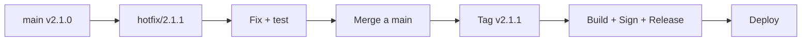

# Guía de Despliegue y Release — ABDAudioLab v2.1.0

**Versión:** 2.1.0
**Fecha:** 2026-10-13
**Estado:** Documento vivo — actualizar por release

---

## 1. Pipeline de Build Local (Oficial)

### 1.1 Prerrequisitos

| Herramienta | Versión Mínima | Notas |
|-------------|----------------|-------|
| **Windows** | 11 (22H2+) | x64 |
| **Visual Studio** | 2026 (v143) | Community/Pro/Enterprise |
| **CMake** | 3.22+ | En PATH |
| **Git** | 2.40+ | Para submodules |
| **WebView2 Runtime** | Evergreen (120+) | Sistema o Fixed Version |

### 1.2 Script Oficial: `build.bat`

```bat
@echo off
REM ============================================
REM ABDAudioLab - Build Script Oficial
REM Ejecuta desde la raíz del repositorio
REM ============================================

set CMAKE_GENERATOR=Visual Studio 17 2022
set CMAKE_ARCH=x64
set BUILD_DIR=build
set CONFIG=Release

cmake -S . -B %BUILD_DIR% -G "%CMAKE_GENERATOR%" -A %CMAKE_ARCH% ^
    -DCMAKE_BUILD_TYPE=%CONFIG% ^
    -DCMAKE_CXX_STANDARD=20 ^
    -DCMAKE_CXX_STANDARD_REQUIRED=ON ^
    -DCMAKE_CXX_EXTENSIONS=OFF ^
    -DNEEDS_WEBVIEW2=ON

cmake --build %BUILD_DIR% --config %CONFIG% --target ABDAudioLab
cmake --build %BUILD_DIR% --config %CONFIG% --target ABDAudioLab_Tests
cmake --build %BUILD_DIR% --config %CONFIG% --target ABDAudioLab_PluginWorker

echo.
echo Build completado. Artefactos en:
echo   %BUILD_DIR%\ABDAudioLab_artefacts\%CONFIG%\ABDAudioLab.exe
echo   %BUILD_DIR%\%CONFIG%\ABDAudioLab_Tests.exe
echo   %BUILD_DIR%\%CONFIG%\ABDAudioLab_PluginWorker.exe
```

### 1.3 Artefactos Generados

| Artefacto | Ruta | Propósito |
|-----------|------|-----------|
| `ABDAudioLab.exe` | `build/ABDAudioLab_artefacts/Release/` | Aplicación GUI principal |
| `ABDAudioLab_Tests.exe` | `build/Release/` | Suite Catch2 completa |
| `ABDAudioLab_PluginWorker.exe` | `build/Release/` | Worker out-of-process VST3 |
| `WebView2/` | `build/ABDAudioLab_artefacts/Release/ABDAudioLab.exe.WebView2/` | Runtime WebView2 (copia local) |
| `resources/` | `build/ABDAudioLab_artefacts/Release/resources/` | Assets, splash, iconos |

---

## 2. Ejecución de Tests (Quality Gates)

### 2.1 Suite Completa (Hermética)

```powershell
# Desde la raíz del repo
.\build\Release\ABDAudioLab_Tests.exe "~[ves]"

# Desde build/Release (verifica hermeticidad POST-5D.5)
cd build\Release
.\ABDAudioLab_Tests.exe "~[ves]"
```

**Criterio de pase:** 918 casos — 890 PASS, 28 SKIP, 0 FAIL, exit 0

### 2.2 Gates Específicos por Categoría

```powershell
# Paridad/Convergencia (PARITY-01, CONVERGENCIA-01, INTEGRATION-01)
.\build\Release\ABDAudioLab_Tests.exe "[parity]"
.\build\Release\ABDAudioLab_Tests.exe "[convergence]"
.\build\Release\ABDAudioLab_Tests.exe "[integration-01]"

# Audio A/B 5D (HITO-AUDIO-AB-5D)
.\build\Release\ABDAudioLab_Tests.exe "[audioab_5d]"

# TargetProfile (HITO-10A-E)
.\build\Release\ABDAudioLab_Tests.exe "[targetprofile]"

# Hardware/Transport (D2.1-D2.6)
.\build\Release\ABDAudioLab_Tests.exe "[hardware]"
.\build\Release\ABDAudioLab_Tests.exe "[transport]"
.\build\Release\ABDAudioLab_Tests.exe "[preflight]"
.\build\Release\ABDAudioLab_Tests.exe "[consent]"

# Hermeticidad rutas (POST-5D.5)
.\build\Release\ABDAudioLab_Tests.exe "[hygiene]"

# Export/Report (HITO-04)
.\build\Release\ABDAudioLab_Tests.exe "[export]"
```

### 2.3 CI/CD Gates (GitHub Actions)

| Gate | Workflow | Comando | Criterio |
|------|----------|---------|----------|
| **1. Compilación** | `build.yml` | `build.bat` | Exit 0, 0 warnings nuevos |
| **2. Suite completa** | `build.yml` | `~[ves]` | 0 FAIL, exit 0 |
| **3. Paridad** | `parity.yml` | `[parity]` + `[convergence]` + `[integration-01]` | Todos PASS |
| **4. Audio A/B 5D** | `audio-ab-5d-ci.yml` | `[audioab_5d]` | 10/10 runs PASS/WARN |
| **5. Higiene rutas** | `audio-ab-5d-ci.yml` | `[hygiene]` | 8 casos PASS |
| **6. Hermeticidad** | `audio-ab-5d-ci.yml` | Ejecutar desde raíz Y `build/Release` | Mismos casos, 0 fallos resolución |

---

## 3. Empaquetado de Release

### 3.1 Estructura de Distribución

```
ABDAudioLab_v2.1.0_Win64/
├── ABDAudioLab.exe                    # App principal
├── ABDAudioLab_PluginWorker.exe       # Worker VST3
├── WebView2/                          # Runtime WebView2 (Fixed Version)
│   ├── msedgewebview2.exe
│   └── ...
├── resources/
│   ├── splash_art.jpg
│   ├── app_icon.ico
│   └── ...
├── contracts/
│   └── hardware/                      # 40+ contratos JSON versionados
├── profiles/
│   └── targets/                       # TargetProfiles declarativos
├── presets/
│   └── recipes/                       # MeasurementRecipes canónicas
├── guided/
│   └── evidence/                      # Evidencia calibración digital
├── exported_luts/                     # Directorio salida LUTs (vacío)
├── exports/                           # Directorio salida reportes (vacío)
├── docs/
│   ├── README_USER.md                 # Guía usuario
│   ├── CHANGELOG.md                   # Historial versiones
│   └── LICENSE                        # Licencia
└── uninstall.exe                      # Desinstalador (opcional)
```

### 3.2 Firmado de Código (Code Signing)

```powershell
# Requiere certificado EV Code Signing en almacén Windows
# Variables de entorno:
#   SIGNTOOL_CERT_THUMBPRINT=<thumbprint>
#   SIGNTOOL_TIMESTAMP_URL=http://timestamp.sectigo.com

signtool sign /tr %SIGNTOOL_TIMESTAMP_URL% /td sha256 /fd sha256 ^
    /sha1 %SIGNTOOL_CERT_THUMBPRINT% ^
    ABDAudioLab.exe ABDAudioLab_PluginWorker.exe

# Verificar firma
signtool verify /pa /v ABDAudioLab.exe
```

### 3.3 Instalador (MSIX / Inno Setup)

**Opción A: MSIX (Store/Modern)**
```xml
<!-- Packaging/ABDAudioLab.wapproj -->
<Package>
  <Identity Name="ABDSynths.ABDAudioLab" Publisher="CN=ABDSynths" Version="2.1.0.0" />
  <Properties>
    <DisplayName>ABDAudioLab</DisplayName>
    <PublisherDisplayName>ABDSynths</PublisherDisplayName>
    <Logo>Assets\StoreLogo.png</Logo>
  </Properties>
  <Applications>
    <Application Id="ABDAudioLab" Executable="ABDAudioLab.exe" EntryPoint="Windows.FullTrustApplication">
      <uap:VisualElements DisplayName="ABDAudioLab" Square150x150Logo="Assets\Square150x150Logo.png" ... />
    </Application>
  </Applications>
  <Capabilities>
    <uap:Capability Name="runFullTrust" />
    <DeviceCapability Name="serialcommunication" />
  </Capabilities>
</Package>
```

**Opción B: Inno Setup (Standalone)**
```iss
; Packaging/ABDAudioLab.iss
[Setup]
AppName=ABDAudioLab
AppVersion=2.1.0
DefaultDirName={pf}\ABDSynths\ABDAudioLab
DefaultGroupName=ABDSynths\ABDAudioLab
OutputDir=..\dist
OutputBaseFilename=ABDAudioLab_Setup_v2.1.0
Compression=lzma
SolidCompression=yes
WizardStyle=modern
SignedUninstaller=yes
SignTool=signtool sign /tr %SIGNTOOL_TIMESTAMP_URL% /td sha256 /fd sha256 /sha1 %SIGNTOOL_CERT_THUMBPRINT% $f

[Files]
Source: "..\build\ABDAudioLab_artefacts\Release\*"; DestDir: "{app}"; Flags: ignoreversion recursesubdirs createallsubdirs
Source: "..\contracts\hardware\*"; DestDir: "{app}\contracts\hardware"; Flags: ignoreversion recursesubdirs
Source: "..\profiles\targets\*"; DestDir: "{app}\profiles\targets"; Flags: ignoreversion recursesubdirs
Source: "..\presets\recipes\*"; DestDir: "{app}\presets\recipes"; Flags: ignoreversion recursesubdirs

[Icons]
Name: "{group}\ABDAudioLab"; Filename: "{app}\ABDAudioLab.exe"
Name: "{commondesktop}\ABDAudioLab"; Filename: "{app}\ABDAudioLab.exe"; Tasks: desktopicon

[Run]
Filename: "{app}\ABDAudioLab.exe"; Description: "Launch ABDAudioLab"; Flags: nowait postinstall skipifsilent
```

---

## 4. Versionado y Changelog

### 4.1 Esquema de Versionado

```
MAJOR.MINOR.PATCH[-PRERELEASE]
  │    │    │
  │    │    └─ Patch: Bugfixes, hotfixes, docs
  │    └────── Minor: Features compatibles, hitos certificados
  └────────── Major: Breaking changes, arquitectura nueva
```

### 4.2 Fuentes de Versión

| Archivo | Campo | Uso |
|---------|-------|-----|
| `src/version/BuildVersion.h` | `kAppVersion`, `kBuildNumber` | Runtime, About dialog, manifest sesión |
| `CMakeLists.txt` | `project(VERSION ...)` | CMake, CPack, installer |
| `package.json` (si aplica) | `version` | MSIX, npm |
| `CHANGELOG.md` | Historial | Usuario, release notes |

### 4.3 Build Version Header (Generado por CMake)

```cpp
// src/version/BuildVersion.h.in → configurado por CMake
#pragma once

namespace abdaudiolab::version
{
    inline constexpr const char* kAppName        = "ABDAudioLab";
    inline constexpr const char* kAppVersion     = "@PROJECT_VERSION@";      // ej. "2.1.0"
    inline constexpr int         kBuildNumber    = @BUILD_NUMBER@;           // ej. 154
    inline constexpr const char* kBuildDate      = "@BUILD_DATE@";           // ej. "2026-10-13"
    inline constexpr const char* kGitCommit      = "@GIT_COMMIT_HASH@";      // ej. "a1b2c3d"
    inline constexpr const char* kGitBranch      = "@GIT_BRANCH@";           // ej. "main"
    inline constexpr bool        kIsReleaseBuild = @IS_RELEASE_BUILD@;       // true/false
}
```

---

## 5. Telemetría y Diagnóstico (Producción)

### 5.1 Logging Estructurado

```cpp
// src/core/Logging.h
namespace abdaudiolab::core::logging
{
    enum class Level { Trace, Debug, Info, Warning, Error, Critical };

    void init(Level minLevel = Level::Info, std::optional<std::filesystem::path> logDir = {});
    void shutdown();

    // Macros con source location (C++20)
    #define ABD_LOG(level, fmt, ...) \
        ::abdaudiolab::core::logging::log(level, __FILE__, __LINE__, fmt, ##__VA_ARGS__)
}
```

**Destinos:**
- Consola (Debug builds)
- Archivo rotativo: `%APPDATA%/ABDAudioLab/logs/ABDAudioLab_YYYYMMDD.log`
- Event Viewer (Windows) — solo Error/Critical

### 5.2 Crash Reporting

| Mecanismo | Implementación |
|-----------|----------------|
| **SEH Exception Handler** | `SetUnhandledExceptionFilter` → minidump `.dmp` |
| **C++ terminate handler** | `std::set_terminate` → stack trace + minidump |
| **JUCE Crash Reporter** | `juce::CrashReporter` (opcional, opt-in) |
| **Ubicación dumps** | `%APPDATA%/ABDAudioLab/crashes/` |

### 5.3 Telemetría de Uso (Opt-in)

```cpp
// src/telemetry/UsageTelemetry.h
namespace abdaudiolab::telemetry
{
    struct SessionMetrics
    {
        std::string sessionId;           // UUID
        std::string appVersion;          // 2.1.0
        std::string osVersion;           // Windows 11 22H2
        std::string audioDevice;         // WASAPI: Focusrite Scarlett 2i2
        size_t      sampleRate;          // 48000
        size_t      bufferSize;          // 256
        int         workflowMode;        // 0=Guided, 1=Classic, 2=Free
        int         targetKind;          // Hardware, VST3, Synthetic
        double      sessionDurationSec;  // 342.5
        bool        exportCompleted;     // true/false
        bool        exportFormatLUT;     // true/false
        bool        exportFormatNAM;     // true/false
        bool        exportFormatHTML;    // true/false
    };

    // Solo si usuario acepta en Setup (GDPR compliant)
    void sendIfOptIn(const SessionMetrics&);
}
```

---

## 6. Actualizaciones (Auto-Update)

### 6.1 Estrategia: GitHub Releases + Polling

1. **Publicar release** en GitHub con tag `v2.1.0`, artifacts `.msix` / `.exe`
2. **App consulta** `https://api.github.com/repos/ABDSynths/ABDAudioLab/releases/latest` al arranque (background)
3. **Si hay versión nueva** y usuario tiene auto-update activado → descargar + lanzar instalador silencioso
4. **Rollback**: Mantener versión anterior en `%LOCALAPPDATA%/ABDAudioLab/previous/`

### 6.2 Canales

| Canal | Frecuencia | Audiencia |
|-------|------------|-----------|
| **Stable** | Por hito certificado (mensual) | Todos los usuarios |
| **Preview** | Semanal (main branch) | Opt-in early adopters |
| **Nightly** | Diario (CI verde) | Solo desarrolladores |

---

## 7. Rollback y Hotfix

### 7.1 Rollback de Release

```powershell
# 1. Revertir tag en GitHub
git tag -d v2.1.0
git push origin :refs/tags/v2.1.0

# 2. Eliminar release en GitHub UI
# 3. Notificar usuarios (si auto-update ya distribuyó)
# 4. Publicar v2.0.1 con fix
```

### 7.2 Hotfix Flow



---

## 8. Checklist Pre-Release

| ✅ | Item | Responsable | Verificación |
|----|------|-------------|--------------|
| | Suite completa `~[ves]` verde (2 dirs) | Dev | `ABDAudioLab_Tests.exe "~[ves]"` |
| | Gates 1-6 CI verdes | CI | GitHub Actions all green |
| | 0 warnings nuevos en build | Dev | `build.bat` output |
| | CHANGELOG.md actualizado | Lead | Entrada v2.1.0 |
| | `BuildVersion.h` version bump | Lead | `kAppVersion`, `kBuildNumber` |
| | Contratos hardware versionados | Lead | `contracts/hardware/` commit |
| | TargetProfiles validados | Lead | `test_TargetProfileValidation` |
| | Firmado código EV cert | DevOps | `signtool verify` |
| | Instalador genera sin errores | DevOps | Inno/MSIX build |
| | Smoke test instalador en VM limpia | QA | Windows 11 VM |
| | WebView2 Fixed Version incluida | Dev | `WebView2/` en artefactos |
| | Documentación usuario actualizada | Tech Writer | `docs/README_USER.md` |
| | Anuncio release preparado | Lead | GitHub Release notes |

---

## 9. Soporte Post-Release

| Canal | SLA | Detalle |
|-------|-----|---------|
| **GitHub Issues** | 48h triage | Bugs, feature requests |
| **Email soporte** | 24h respuesta | `support@abdsynths.com` |
| **Docs online** | Siempre | `https://docs.abdsynths.com/abl` |
| **Discord comunidad** | Best-effort | `#abdaudiolab-support` |

---

## 10. Known Limitations (Release v2.1.0)

| Limitación | Workaround | Fix Planeado |
|------------|------------|--------------|
| **Banco físico metrológico (D2.7B) no certificado** | Usar solo perfiles `.abdloop` previos + mock | HITO-10D2.7B (requiere hardware) |
| **VES/CZ-101 bloqueado** | Usar `SyntheticSynthFixture` para CZ-101 | HITO-10V1 (requiere VES headless) |
| **Thread safety DSP pendiente** | Funciona en práctica, pero UB teórico | P0 en roadmap |
| **LabAnalyticEngine hardcodeado** | No usar para métricas críticas | Reimplementar análisis real |
| **Solo Windows x64** | — | Linux/macOS post-v3.0 |

---

*Documento actualizado por release. Próxima revisión: v2.2.0*